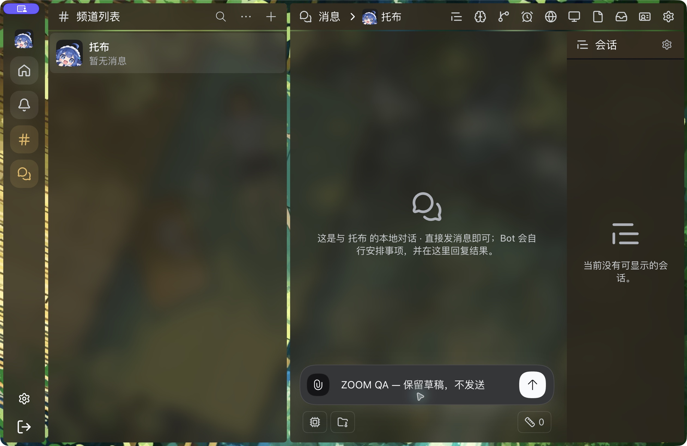

# macOS product zoom delivery evidence

Current implementation: ordinary product installation carries the licensed theme but leaves the native `ui-theme` row untouched. The explicit `deepseekbot-zoom-setup enable --home <home> --profile desktop --desktop-app <app>` command requires the target Desktop to be closed and adds a Profile-local package link through that app’s bundled pnpm, under the native Profile writer lock and with scripts disabled. Reopen the same Desktop. Disable before product removal; native settings remain in the original Profile Patch. Setup success reports configuration only (`runtimeVerified:false`).

The earlier grouped replacement booted but renamed the Settings namespace to `qualified-theme`. That was not a valid manual-font preservation proof. Both sync and async Node-hook experiments also failed actual DSH metadata discovery despite standalone resolver tests. Those experiments are not part of the delivered source. The historical validation record must not be used to accept the discarded composition.

Actual prepared product `0.0.0-zoom.2268.9`, isolated macOS Node v24.21.0 / DSH 0.2.1-rc.2, authenticated native Host API:

- Baseline native `ui-theme`: font 16, dark preference.
- Product installed and explicitly enabled: exactly one native theme module id, compatibility marker present, original namespace and font 16/dark retained.
- Native settings mutation changes font to 17; true Host restart retains 17/dark.
- Setup disable plus restart restores native theme bytes without the marker; the same original namespace still contains 17/dark.
- pnpm may leave an unlisted link on remove. Setup removes only its exact owned symlink and verifies absence; other overrides are refused.

These are real tarball/Host/settings checks, not native Desktop visual or manual-font UI acceptance. Both supported Host versions passed fresh ordinary product install, Bot/DM creation and real restart. Reinstall, local-version upgrade and rollback preserved the same canonical Bot identity and one theme module. Raw product removal fell back to the original native theme and retained font 17; explicit post-removal cleanup removed the owned override. The setup command refused 0.2.0-rc.2 without changing the Profile. All 48 focused tests, lint, format, types and targeted product build passed; see `validation.json`. No model or external IM delivery is claimed.

The existing native window remains held for the Human's physical IME check and has not been silently replaced. Earlier native shortcut recording rejected an occupied binding without changing zoom; a temporary custom binding changed one level and retained a synthetic draft, then was reset. That earlier window is not evidence for this corrected package composition.

No new rendered UI is introduced by this packaging/CLI correction. A fresh native-install before/after pair remains pending; the separate fresh-product Web origin was denied by browser approval and no alternate browser/CDP access was attempted. Required wallpaper and chrome before/after evidence belongs to the separate PRs #2294/#2295. Same-user-data Host switching, corrected packed native activation, physical IME and the broader #2269 native matrix remain open.

#2268 and #2269 remain unaccepted. Windows/Linux are deferred to Human testing under #2270. No merge or release.

The final generated Client checks actual `__DSH_BOOT__.release.version` before exposing its font-key lease. Generated-adapter execution tests cover qualified, mismatched and missing versions. The preserved native window's boot version was read without changing its state, but the new guard is not yet loaded there. The final candidate repeated the five native Host/settings lifecycle checks; its setup and Host bytes match the earlier .7/.8 reinstall/upgrade/rollback artifacts. Existing Profile overrides still need explicit disable before switching outside the qualified tuple; absence of the zoom capability does not qualify a copied theme on unknown versions.

The actual managed Desktop rejected the old offline DSH CLI path (`managed exclusively by the
Electron application`). Native `installBundle` also rejected the copied theme (`not-bundle`),
even with a staging-only empty Bundle, because installation metadata wins. Those failures
invalidate the prior headless result as Desktop installation proof. The explicit closed-app
installer is a downstream package transaction and changes no installed app files. Fresh native
acceptance of the final installer is recorded separately below when completed.

## Actual macOS Desktop delivery — 2026-10-19

The [native delivery record](native-desktop-20261019.json) supersedes the earlier headless-only
activation, Host-switch and pending-IME limits. The installed final setup command refused a
running Desktop; closed-app enable loaded the lease after a real native restart. Disable
restored the original theme, retained the zoom document and preserved the original `ui-theme`
font settings. Re-enable retained a native-UI font write of 15px. Direct installed CLI
reset/set readback passed against the explicit native Client.

Native Host A → independent native Host B → A reused the same browser data without concurrent
windows; level 2 (144%), default 0 (100%) and the exact document revision were identical at
every stop. This qualifies restart-based local-Host switching, not a remote Host selector.
The final native image uses the integrated S1/S2 stack identified in the JSON, with a synthetic
unsent draft. It is actual Desktop capture; the earlier source matrices remain separate proof.

The Human explicitly accepted real Chinese IME candidate/draft/zoom protection. Final visual
QA for wallpaper/header, panels and zoom Settings passed in both native window modes (Human: “都正常”); Windows/Linux stay in #2270.
No PR has been merged and no release has been published.
