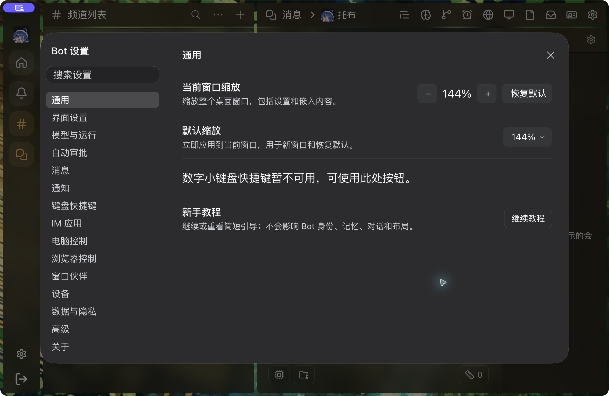
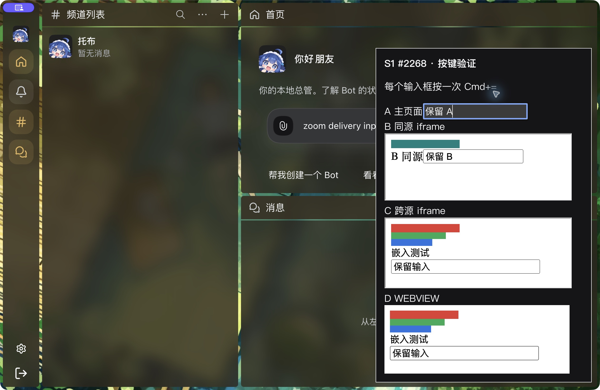
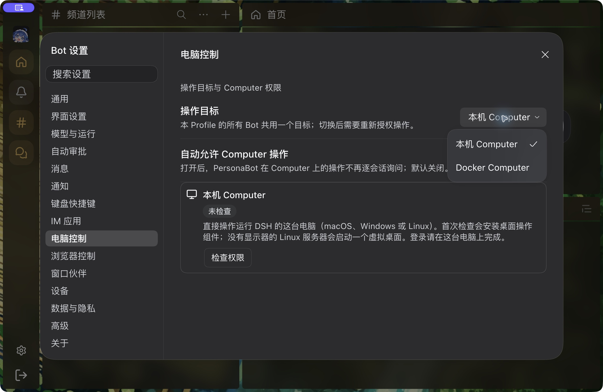
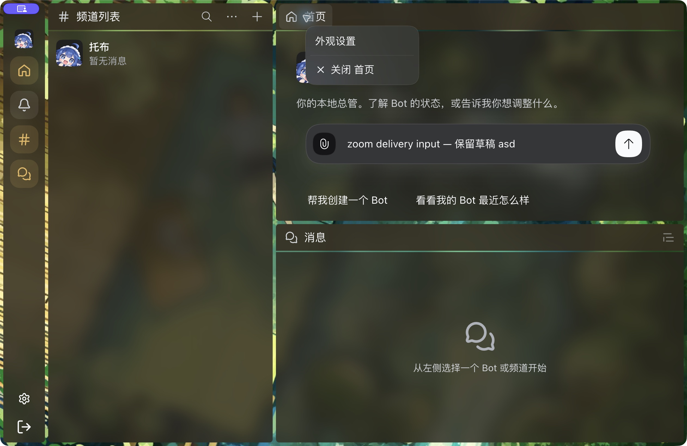
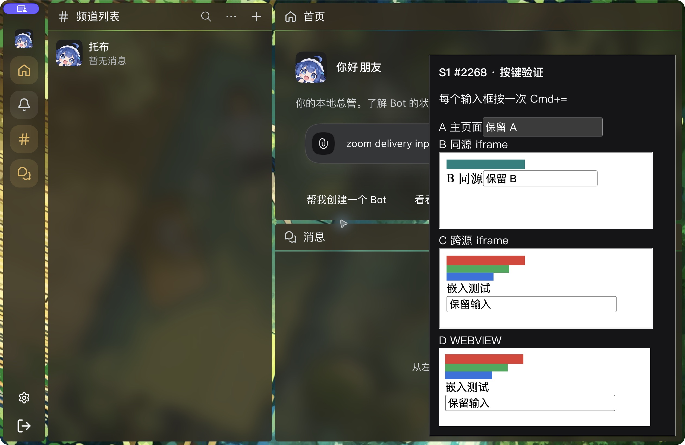
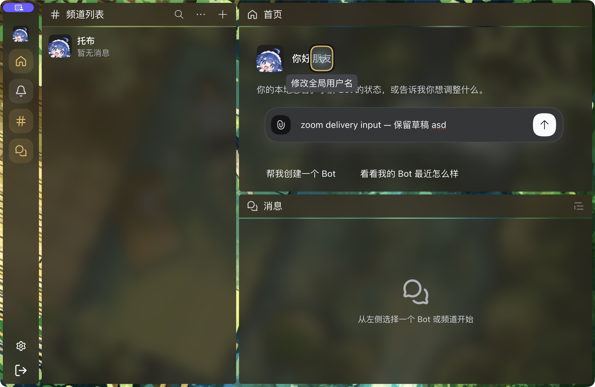
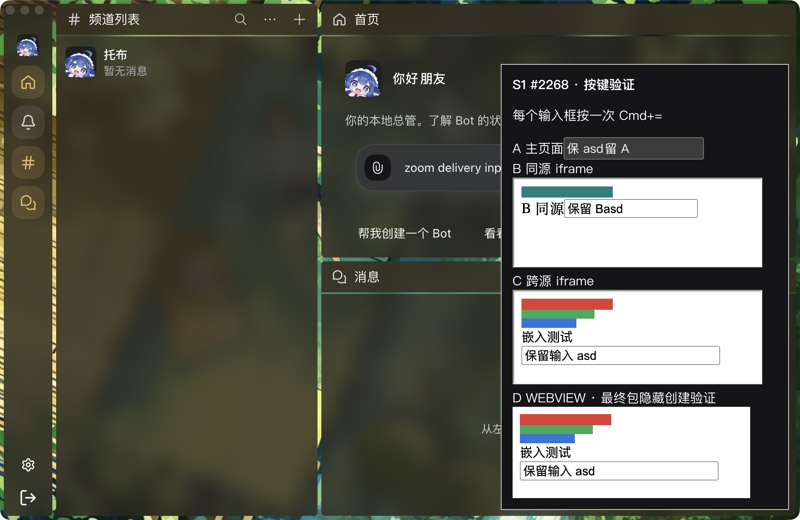

# Shared Select zoom regression

Source commit: `f12c5e658a79655090d9e0d3b08fc880b4a86012`. Both images use the same 1261×820 viewport, 144% CSS zoom and synthetic fixture state. They show the production Select/SettingsDialog/PointerMenu and unmodified reachable DSH Menu/Modal code and CSS. This is an isolated source-component fixture, not a running DSH/native-window screenshot.

- Before: the native body-portaled choice menu is outside the viewport.
- After: the menu is aligned with the trigger inside its owning Settings Modal.
- Baseline: 132/136 cases fail across 17 levels, two viewport sizes, start/end alignment and page/dialog containers.
- Fix: 136/136 pass with no page errors. Keyboard selection, menu-only Escape, focus return, toggle/outside dismissal, retained draft/menu identity and open-menu zoom changes are also asserted.
- 2035 Client tests pass (one existing skipped test); 29 related tests, lint, formatting, root/mobile types and a production Client build to a separate temporary output pass.

Run `node scripts/check-select-zoom.mjs --output <report.json>`; add `--baseline e17154081` to reproduce the failure and `--screenshots <directory>` for the matched images. The fixture blocks requests outside its own loopback origin and uses no Host, credentials, user wallpaper, messages or guest browser.

## Native follow-up — 2026-10-19

The [native menu probe](native-menu-probe.json) records actual installed Desktop checks at
144%, 23% and 430%. At maximum zoom, keyboard focus scrolls the recovery button into view;
the default picker stays inside the viewport and can select the minimum level. These three
captures are actual Desktop output from the .12 artifact, with its version stated explicitly.
They are additional evidence, not a relabeling of the source fixture before/after pair.

The final .14 artifact passed closed-app enable/restart, original font preservation, A→B→A
local Host switch and exact-target CLI read/set/reset. The Human accepted final wallpaper,
header/corner, panels and zoom Settings in native windowed/fullscreen modes. Real IME was
explicitly accepted earlier in this task. Current full Client regression passes 2035 tests
with one existing skip; Browser 407/8skip and Computer/selected workspace 234/3skip passed.

The first .14 embedded automation attempt did not establish guest focus: a nested AX click left the real
parent focus on Bot Settings, so its root zoom event is excluded from webview proof. The
fixture was disposed, and prior Human guest foreground/once-only records retain their own
scope. The later foreground follow-up below supersedes that guest-focus gap. #2269 remains open for its other required gates.
No new PR has been merged or released.

## Final-package focused embedded and popup follow-up

The Human foregrounded the same existing Desktop. The [final native embedding record](final-native-embedding.json)
now establishes real guest input focus, same guest identity/navigation/input, one minus and
one plus whole-window action, and unchanged guest-native zoom. Focused same-origin and
cross-origin iframes plus the main input were also driven through CUA native keys, with
per-document readback. Equal delivery may include Shift; it is not relabeled physical plain Equal.

The earlier failed nested-AX attempt is retained above. The new accepted guest rows explicitly
have parent WEBVIEW focus and guest `hasFocus=true`. The task fixture was removed through its
owned release, leaving the same formal window at144%. No production guest recovery hack exists.

Final .14 Browser/Computer target menus and Home context-menu screenshots additionally show
correct viewport placement and native Escape/focus return. No target, permission or message was changed.

Further .14 follow-up established native Cmd+H hide/restore at unchanged geometry, guest identity, URL, input and internal zoom. The complete-window capture is linked below. Native Minimize actions still did not establish hidden state.
Tool Minimize actions did not establish hidden state, so they are not counted as a pass. The
late console cohort has native `/plugins/events` network failures; no whole-cohort
error-free claim is made. #2269 remains open, and prior Human webview-restoration proof keeps
its original scope. Windows/Linux remain deferred.

A passive native Network observer captured `/plugins/events` HTTP200 + graph, failure after
301.1s, and automatic HTTP200 + full-graph recovery three seconds later. This attributes the
route and observes recovery; the underlying timeout source is not confirmed. No guest reload
or renderer restart was used.

The native Tooltip check found a distinct geometry regression: at144%, the Home-name tooltip
was nearx907 while its trigger was atx659–705. The downstream pinned zoom lease now fits native
bubble geometry without replacing its visibility, delay, keycap or dismissal owner. The
expanded source fixture passes136 Select cases and204 Tooltip cases;36 additional zoom
changes preserve an already-pinned bubble. Final updated-package Tooltip pixels remain a
separate acceptance gate. Earlier .14 native proof remains versioned as .14.

## Final updated package — .16

The [versioned final record](final-native-16.json) adds actual corrected Tooltip pixels at144%
and120%, plus Human/native hidden-created, hidden-resized webview recovery after ordinary
minimize/restore. The recorded hidden and restored viewport is1261×820 at144%. Both initial
navigation-ready events occurred while hidden; the full-window native image after restore
shows the guest ruler and input. The fixture was released afterward. The .14 id-preserving
hide/restore and focus rows above remain separate evidence, not relabeled .16 results.

Current source:2037 Client tests pass,1 existing skip. The earlier avatar-editor timeout is
retained and the full rerun passed. Select136/136, Tooltip204/204 and36 retained pinned-bubble
zoom changes pass; unadapted native Tooltip fails192/204 cases. The complete
[source Tooltip matrix](tooltip-source-matrix.json) is separate from native pixels.

The original broad native/input, installer and Host-switch records retain their version and
scope. macOS Human/native behavior qualification covers these representative supported paths.
Default reset and numberpad bindings have not shipped: the pinned native protocol rejects
numberpad codes, and reset remains Settings/CLI/custom-bindable without a default. This
outstanding original requirement is tracked explicitly in #2318; it has not been waived or
counted as passing S2 acceptance. #2299 closes only the bounded #2269 delivery after review
and merge. The separate mobile Expo-doctor failure is fixed on main by merged #2319,
which superseded the closed dependency PR #2317 for #2314. Fresh CI for the updated stack
remains a separate gate.
Unknown app versions, arbitrary third-party pages and Windows/Linux remain outside this
qualification.

The review follow-up restores the native tooltip's original `data-side` together with its
translation and maximum width on disposal. A source regression forces a bottom-to-top flip
and verifies restoration plus observer shutdown. Existing .16 native screenshots predate
this cleanup-only change and are not relabeled as a new native run.
