# Mobile creation avatar verification

Issue [#3075](https://github.com/BotHarness/DeepSeekBot/issues/3075). Task `codex/local/01a17bef-21c0-75f0-bf5d-2fedb6df7b73`. Physical Android 16 phone; SDK 58; arm64. iOS is assigned to another engineer and is not verified here. These are real device captures with the status bar cropped; all Bot names and portraits are synthetic QA data.

## Behavior and authority

The creation draft owns an independent avatar choice. Name edits preserve it. Shuffle, Photo and Customize are explicit actions. The native customizer keeps edits local until Done; Back discards those edits. Done writes through the existing creation owner before publishing the new draft, and a failed write leaves the previous draft intact. Creation applies the selected recipe through the existing target-bound Host appearance API. The Host remains the authority for a created Bot's appearance.

Both styles use the desktop's core recipes, built-in presets, species, parts, swatches and proportions. Labels are extracted unchanged into a shared pure core module. Custom-part pixel drawing and library import/export remain desktop-only. No Host method, CLI capability or dependency is added by the avatar feature. The native event prerequisite is [#3082](https://github.com/BotHarness/DeepSeekBot/pull/3082).

## Frozen sources and binaries

| Evidence                               | Frozen source                              | Binary                                      |
| -------------------------------------- | ------------------------------------------ | ------------------------------------------- |
| Before name edits, `b1.png` / `b2.png` | `94797941062a5c956e158eabd79b7c8c6f7d0f51` | Corrected native Debug baseline             |
| After name edits, `a1.png` / `a2.png`  | `ad2c44fc51234d3062d3b2ed279e618c4d5c8eb7` | Same Debug binary                           |
| Pixel / Line and 100% / 130% matrix    | `d34a3c0f9299b192e8eb42bf934c9ceaefb7cd51` | Same Debug binary                           |
| Final 200% matrix and Release journey  | `51ab500155f6d9d6530a0710ceac4143c9989f08` | Matching final Release for creation journey |

Debug APK SHA-256: `82fa4366ad2584ceaf4636d951fb20817ec3c7baacf7f3db0d8fb03d8b37887e`.
Final non-debuggable development-ID Release APK SHA-256: `8b83c4ab81e779b3a90f22d4aa698a9cc312a6ed0f5aba31e38bd33936baaacb`.

The batch starts at main `6a3293cce08344b9344edc3cf534e2e4778bdcf1`, includes unchanged performance PR #3050, and adds the namespace fix from #3082. Tag PR #3030 conflicts with main's native field replacement and was excluded after aborting its merge. This report makes no tag-chip parity claim. Avatar runtime changes are through `725541ed0`; `3389493ee` adds the final explicit-action test. Later commits attach evidence only.

## Actual results

- Before: typing `3075` then `30752` changes the portrait. After: typing `30752` then `307523` preserves identical portrait pixels. [Crop hashes and bounds](name-invariance.json) retain both comparisons. Explicit Shuffle still changes the portrait.
- Native Pixel hair selection, Line eyes, background swatches and a proportion slider save successfully and return to the same wizard step. Switching styles retains each style's local edits. Back preserves the saved draft. Stable native view wrappers prevent save-time reparenting crashes; the flow also retains its step parameters while the root editor is open.
- Native Photo picker cancellation preserves the choice. An app-owned synthetic photo survives entering and cancelling the customizer. Opening Customize with the name keyboard visible dismisses the keyboard. Import override preservation and invalid-recipe refusal have automated coverage; real Zip/Git import was not rerun in this avatar batch.
- Six Debug states (font 1.0 / 1.3 / 2.0 × light / dark) exercise actual name input with the keyboard visible, reachable caret/footer, native option selection and Back cancellation. After stacking the large-text avatar actions, both 2.0 states were repeated against the final source. Options use two columns at maximum text size.
- Final Release: change the Line background, tap Done, cold restart, reopen the draft and create exactly one Bot through the native UI. CLI `show` reads back an `appearance.recipe` exactly equal to the editor's selection. The real DM and profile show that portrait. No message or model call is sent.
- Both renamed native event paths also pass in Release: Memory selects the profile button and mounts its content; For you selects the Activity tab.

The first matrix attempt hit the host reader's output limit while reading keyboard diagnostics, before any completed case; it was rerun with a bounded extracted result. An intermediate large-text layout missed its theme binding and failed typecheck/native loading; it is excluded from the final results. The final binary and both final large-text cases use the corrected source. These checks do not establish an FPS target or a new frame-time improvement; #3050 has its separate performance evidence.

Broad related checks passed 3,136 tests, with 3 skipped, before the last action-layout refinement. The final affected UI run passed 38 tests in 3 files; the updated explicit-action component suite passed all 4 tests. Typecheck, lint, formatting and the Host/client build passed. UI/Host facts and per-case source references are also recorded in [results.json](results.json). CI and Human review remain separate gates.

## Native captures

| Before: name A / name B                 | After: name A / name B                |
| --------------------------------------- | ------------------------------------- |
| 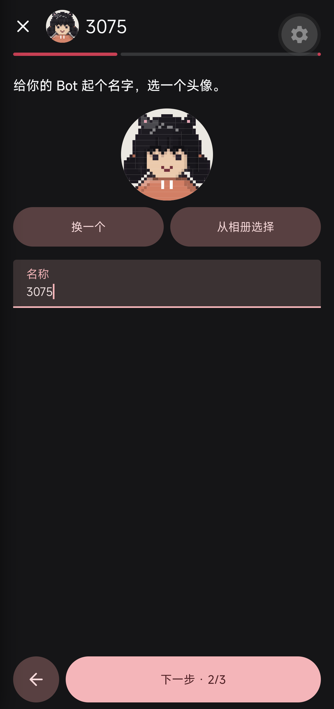 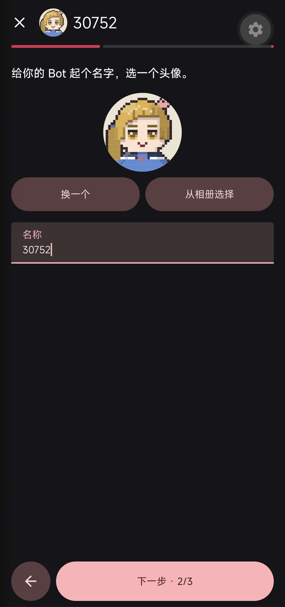 |  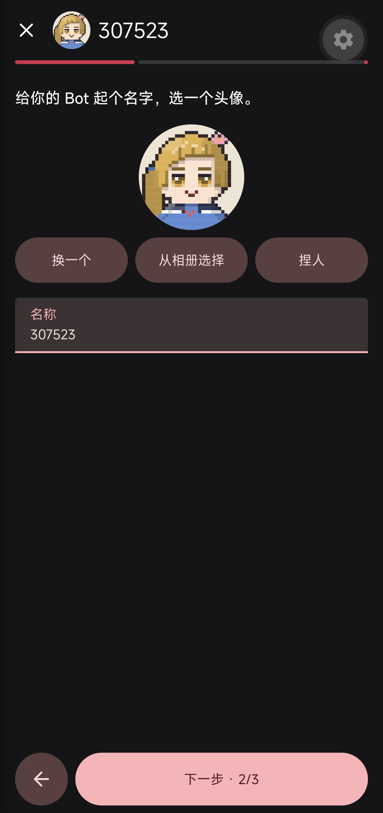 |

| Pixel parts     | Line parts     | Release color selection  |
| --------------- | -------------- | ------------------------ |
| 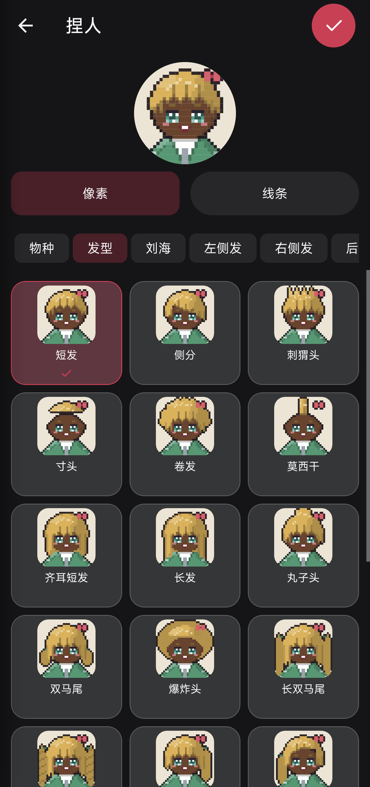 | 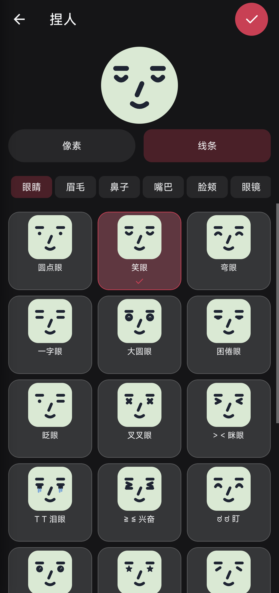 | 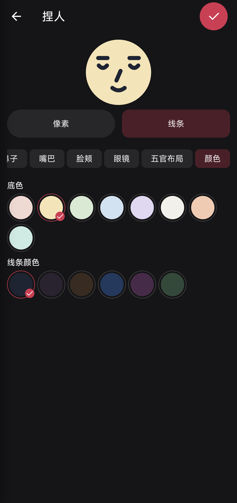 |

| Font               | Light                           | Dark                           |
| ------------------ | ------------------------------- | ------------------------------ |
| 1.0                | 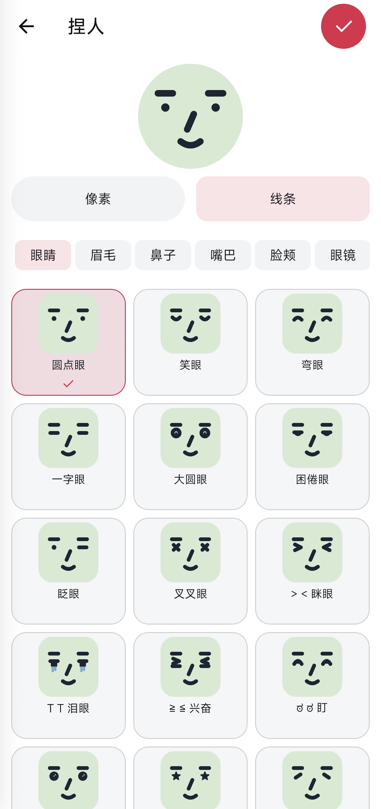      | 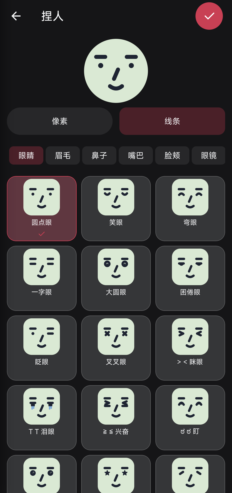      |
| 1.3                |  | 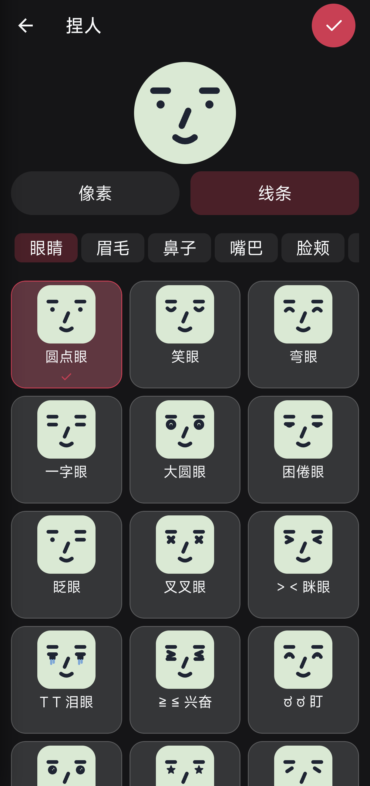 |
| 2.0 final          | 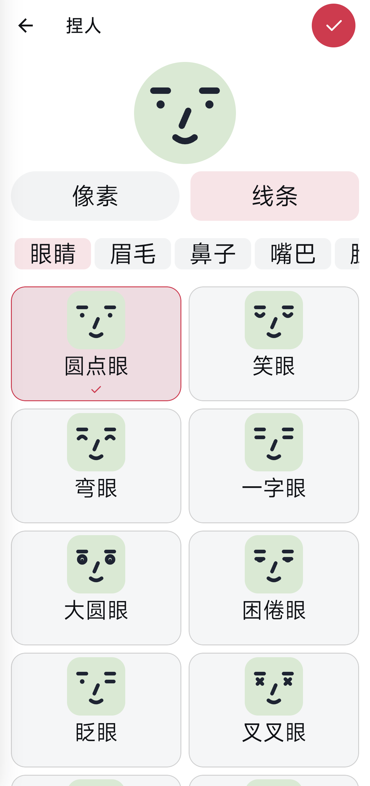      | 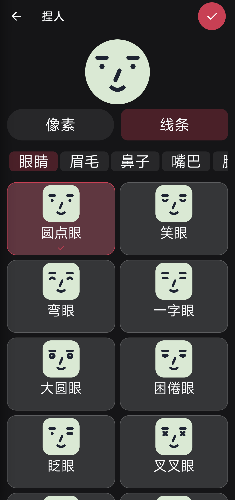      |
| 2.0 keyboard final | 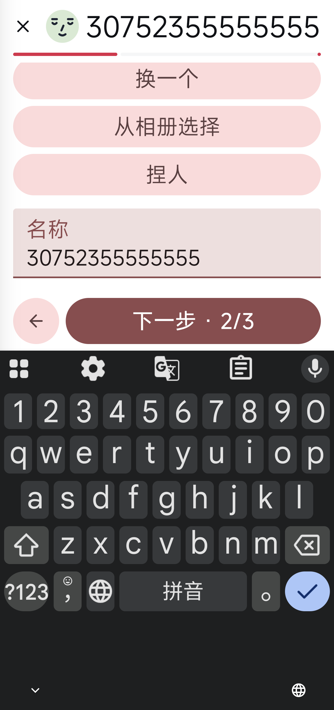     | 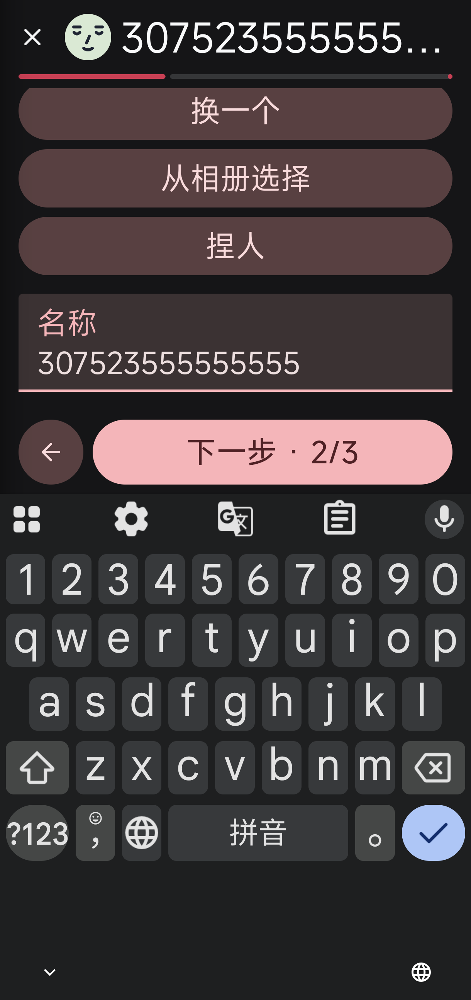     |

| Created Release DM   | Created Release profile         |
| -------------------- | ------------------------------- |
| 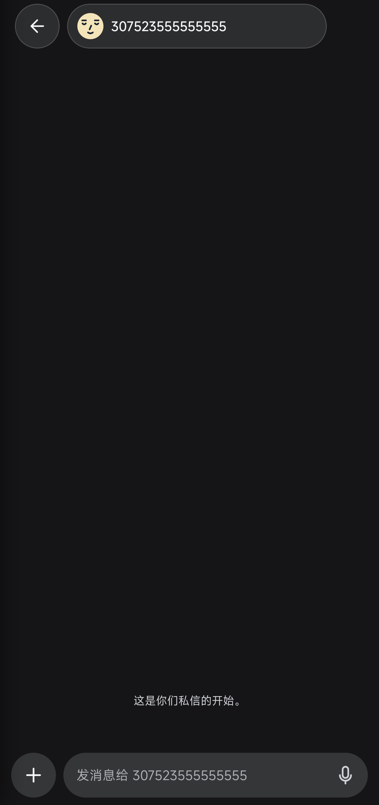 | 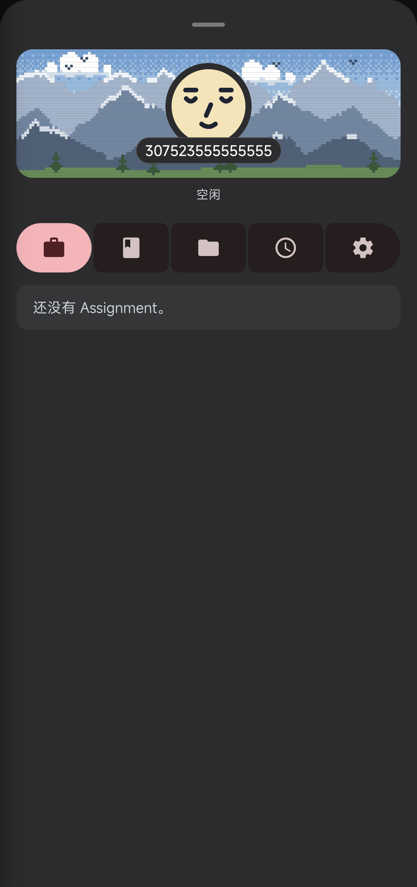 |

## Restoration and review limits

The QA Bot was deleted through its exact canonical deletion preview/confirmation; only its tombstone and retained memory remain in the stopped isolated QA profile. The original APK hash, input method, font/theme/density/navigation/keyboard settings and original blank draft were restored. The accepted app's native drawer confirmed exactly the original five pairings. Only the QA pairing/device was revoked; only the owned Host, Metro, reverse mappings and temporary credentials were removed. The shared default ADB service was left unchanged and the phone lease was released.

The PR is draft pending Human UX review and the separately owned iOS check. New recipe drafts are readable by the new app; rollback to a pre-feature binary requires finishing or discarding a pending customizer draft first. Already-created Bot recipes use the existing Host schema and API. The local HTML explainer is an additional local review aid, not a hosted artifact or runtime proof.
