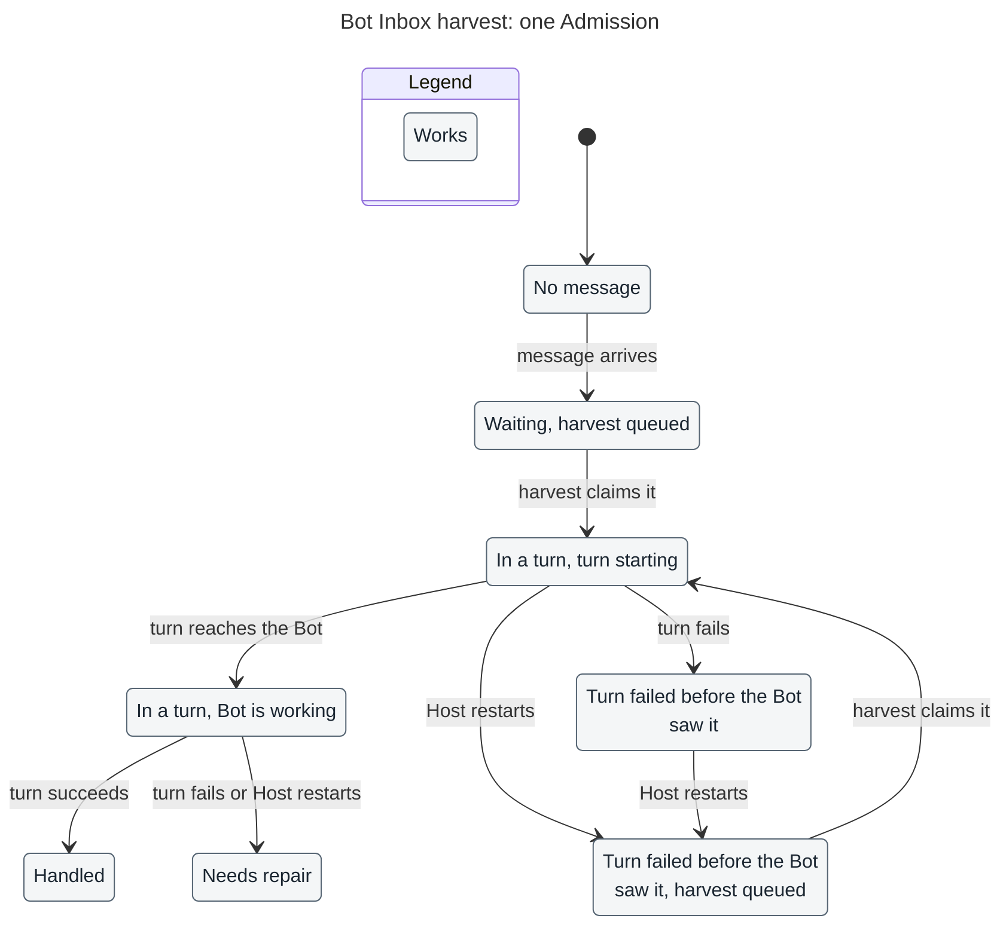

# Turn-time harvest consumes the ready attention set

The Orchestrator is woken once per ready set, not once per event. While a turn runs, newly admitted items mark the ready set dirty instead of queueing their own turns; when the running turn ends — or when the Bot is idle — one harvest turn selects a bounded part of that ready set. The ready set is every unhandled immediate item (mentions, DMs, invitations, join decisions, Assignment Reports), every digest batch that reached its count or interval, and passive notices; it excludes below-threshold digest items, `mentions` ordinary messages without a same-Channel trigger, `silent` attention, and rejected events. A direct address with steer delivery is the only bypass: it injects into the running turn at DSH's next safe step (ADR-0025's delivery rules still apply), and if no turn is active it joins the next harvest. There is at most one pending harvest turn per PersonaBot.

When a Group Channel is brought into a turn by a direct mention or a due digest, the Host selects that Channel's unhandled Inbox Admissions as context, including below-threshold digest and `mentions` ordinary messages. It does not select `silent` ordinary Admissions. The selection reserves space for the triggering message and nearby chronological context, plus a guaranteed oldest-pending slice. It advances the oldest slice on later eligible turns so continuous new traffic cannot starve old messages. Per-Channel inclusion is capped at 100 messages and also by a smaller turn-wide text/token budget; 100 is a ceiling, not a target. The prompt preserves Source Event and Admission identity, orders the selected messages chronologically within their Channel context, and reports omitted counts and a way to continue reading. A message that was not selected remains pending, even when a later message in the same Channel was handled. Unselected immediate items remain ready for a later bounded harvest; context-only `mentions` messages never wake a turn by themselves. A preference change does not reclassify older Admissions.

One harvest turn is one consumption unit. An Admission is Processing only after its content or a faithful actionable summary actually enters the active Orchestrator turn, not when queued or merely selected. Before that turn crosses into DSH, its selected Admissions retain the existing side-effect-started protection; if the turn fails, the included items become needs-repair rather than silently replaying, and if it succeeds they become handled. Unselected items retain their pending or ready state. The turn's message orders actionable items first (waiting Assignment answers and direct addresses ahead of ordinary traffic), then Group context and digest batches, then passive notices, and tells the Orchestrator that it may work items in parallel and delegate long-running work to Assignment Sessions.

An explicit `channel_read` that returns previously unhandled Admissions to the Orchestrator joins those exact returned IDs to the active turn's consumption set. A successful turn handles them even if the Bot sends no reply; a failed turn leaves an explicit repair outcome. Merely querying metadata, opening a Channel in the Human UI, or fetching a page that omits an event never handles it. The existing Observation fact remains an internal audit boundary, not a new primary Inbox state or a required per-message completion tool. An explicit ignore decision remains distinct from ordinary successful handling.

## Why

One turn per event makes a busy Bot's queue grow without bound, and each queued turn pays full context cost for a single item. A person holds many contexts and works them together; the Orchestrator orchestrates, and its Assignment Sessions carry the parallel long-running work. ADR-0025 already intended "one bounded digest per class"; the harvest makes that binding for turns instead of events. Keeping one consumption unit per turn preserves the claim and side-effect contract that already governs reports riding a turn (ADR-0036, ADR-0037) without inventing per-item retries.

## Considered options

- **One turn per admitted event** — rejected: unbounded queue growth and one full turn per item.
- **One queue entry per event, merged only when convenient** — rejected: the queue still grows, and consumption semantics would depend on timing accidents.
- **Per-item retry inside a failed harvest turn** — rejected: a turn's side effects are not attributable per item; the existing all-marked conservative contract is safer.
- **Letting below-threshold digest items wake by themselves** — rejected: count and interval still govern automatic wake. Once the same Channel enters a turn for another eligible reason, its pending items may provide context without creating a separate wake.
- **Harvesting `silent` attention** — rejected: silent means recorded without surfacing; only an explicit read brings it back.
- **Marking an entire Channel handled when a recent page is shown** — rejected: messages omitted by the context cap never entered the Bot's turn and would be falsely cleared.
- **Always selecting only the newest messages** — rejected: a busy Channel could starve its oldest pending Admissions indefinitely.

## Consequences

- The per-Bot serial queue becomes a dirty ready set plus at most one pending harvest wake; digest timers become idle harvest triggers.
- Steer delivery is unchanged; a steered item belongs to the running turn and never appears in the next harvest.
- The unified turn-message render (the memory-delivery track, #350–#353) is this harvest's message assembly; notices ride harvest turns without waking one alone. Selection, omitted counts, and explicit-read settlement must remain visible through the canonical Bot Inbox projection (#152), with no second message store.
- A failed harvest shows all its items as needs-repair, and the Human or Bot explicitly re-runs them.

## Completed Report and native completion pairing

An Assignment's semantic completed Report and the Host's confirmed native completion are separate Source Events, authored by the Bot and Host respectively. The adapter supplies the native Turn number from Session Events, never model arguments; after a successful native `turn/end`, the Host links one idempotent completion notice to a completed Report from that exact owned Session and Turn, retaining the native end sequence and Report Source Event ID. Session identity alone, text similarity and timestamps are insufficient causal identity. A progress-only successful Turn does not create this paired notice.

The Report owns the causal wake. Its paired completion notice joins that harvest when available or rides the next real Turn; it never independently wakes or replays a Turn, including after Host restart. A late notice remains pending when the Report has already been handled. Only actual model exposure and successful Turn settlement handle the notice, preserving each source's own observation/handling facts. The harvest preserves both Report meaning and Host confirmation with their separate references rather than replacing the Report with a weaker lifecycle summary. The authenticated Bot Inbox query exposes the Turn and exact related Report reference through its existing seam.

This avoids a second paid model request for the same completion without erasing independently navigable provenance or treating an unseen notice as consumed. It establishes successful completion pairing only; failure, interruption and strong-cause escalation remain separate #194 acceptance slices.

## Enforced by

The TLA+ model `verification/harvest/Harvest.tla` (`node scripts/verify-tla.mjs harvest`; the `verify-harvest` skill). TLC checks every order of admissions, claims, turns that reach DSH, successes, failures and Host restarts for three Admissions and two restarts. It confirms three rules:

- an Admission never reaches DSH in two turns, so a failed turn is never replayed;
- an Admission is handled only after a turn showed it to the Bot;
- every pending Admission is eventually claimed, including one that arrives while a harvest runs (under weak fairness).

Three broken variants show what each guard buys:

- If the harvest's `finally` no longer checks readiness, an Admission that arrives mid-turn waits forever.
- If a claim also takes needs-repair Admissions, a turn is replayed.
- If a failed turn ignores the side-effect mark, a turn is replayed.

The model also shows the designed limit: an Admission whose turn failed before reaching DSH becomes retryable and waits for the next harvest, a new Admission or a restart. It does not schedule one itself.

Generated from the model by `/statechart` (one Admission, one restart):

