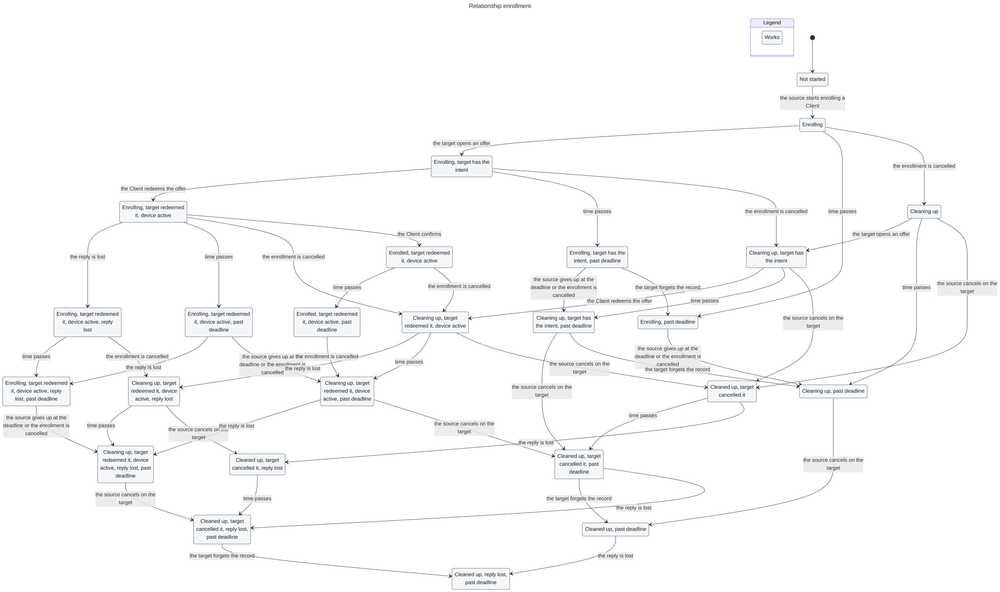

# ADR-0339: Relationship enrollment keeps issuance and cancellation durable

Status: Accepted implementation decision for Environment E6 (#4115); runtime acceptance remains a separate gate.

An approved Host Relationship can enroll independent Clients, but a successful device redemption can commit before its reply reaches the Client. Cancellation cannot depend on receiving a device ID: dropping a late response or revoking only a known credential leaves an unknown grant active. We keep enrollment intent and cancellation in the existing application-defined relationship owner, alongside Device Pairing's canonical device grants, instead of disconnecting the relationship or introducing a second credential store.

## Issuance and persistence

Operational Database generation 150 records each relationship, Client public key and direction. It follows published Human Context140 and Team/private-Bot141–143, canonical Host Relationships144, published Team lifecycle145, published Channel access146 and offline retirement147, published Team model policy148 and Human usage attribution149. Earlier Environment140–143 forks and the offline145/account146 and offline146/account147 and offline147/account148 preview lineages are incompatible upgrade inputs. Retained matching-source QA Hosts may remain only for approved registration retirement; the new lineage uses fresh Profiles and each Host's own official account login, without copying credentials. The source Host writes an unconfirmed intent before asking the peer for an offer. Its fixed deadline is the existing ten-minute pairing-offer lifetime. The target records that same intent; redemption atomically checks its state and deadline, commits the existing `paired_devices` and `relationship_device_grants` facts, and consumes the intent once. Private keys and device credentials remain in the Client's existing private storage or CLI file.

After private persistence, the Client confirms the same public key. Source confirmation is idempotent: a lost confirmation reply is resolved by reading and retrying that key, never by minting another key. A committed intent remains committed across its original deadline. An unconfirmed intent cannot be committed after expiry; it becomes pending cleanup. A Web Client retains an explicitly marked private record while confirmation is unknown, retries that same intent after refresh, and removes the private record when cancellation or expiry is established. The Environment row reports that the connection is finishing.

The CLI clears its pending marker through a private temporary file and atomic replacement, preserving the usable original when writing or replacement fails. A same-credential browser storage update refreshes the existing HostClient's saved routes and manual preference without persisting them again; active writes drain before a preference switch. Account token exchange is owned by the serialized account owner and is bounded by account-generation cancellation and a ten-second deadline. Caller cancellation stops waiting promptly and prevents subsequent relay work; an exchange already in progress retains the owner lock through persistence of its rotated refresh token. A caller cancelled before its queued work starts performs no exchange. Sign-out, close and account changes invalidate the old generation and discard its late result. This follows [AuthKit session resilience](https://workos.com/docs/authkit/session-resilience): every successful refresh rotates the token, so caller cancellation must not discard a valid replacement or rely on the old token’s thirty-second grace period.

## Cancellation and recovery

Cancellation addresses the exact relationship and Client public key. The target writes a cancellation tombstone and revokes matching derived devices in one database transaction; it then closes their streams and removes matching live offers. Redemption checks that tombstone in its own grant transaction. A late offer request checks the same intent and fixed deadline, so cancellation before offer creation, cancellation before redemption, and cancellation after grant commit all converge without retiring other Clients or independent phone grants.

Device teardown also runs for a known device already marked revoked by that transaction, even without an attached Feed stream. Owned streams still trigger teardown if the canonical row was purged. Resource cleanup remains idempotent; an unknown device without owned streams does not trigger teardown, and revocation receipts and events still distinguish a new canonical or stream change from an already-revoked state.

The source durably retains pending cleanup and uses pinned Host-to-Host Noise control to retry that attenuation after sign-out or restart. It retries at most eight times with bounded backoff; exhaustion remains inspectable and can be retried explicitly through CLI. An unconfirmed intent whose Client disappears also enters cleanup at its deadline. Pending unconfirmed or cleanup work prevents automatic enrollment from accumulating fresh keys. Records are reclaimed only after their fixed deadline plus sixty seconds: completed cancellation/cleanup, incoming unconfirmed offers, incoming committed intents whose canonical derived grants are all revoked, and source committed intents whose relationship is disconnected. Active source confirmation and unresolved cleanup remain available for exact readback. The 1,024-record limit refuses new intents rather than evicting authority or live tombstones.

## Same-account trust and Client scope

Same-account discovery uses the existing authenticated relay list and offer endpoints. Each participant verifies its own exact registration, Host ID and Noise key. The receiver independently fetches the source registration through its own account session; caller-supplied directory rows or HTTP results do not prove membership. Its own relay HMAC, account, registration, freshness and verifier hash must match a fixed-role transcript containing both registrations and pinned Host identities, the relationship ID, deadline and nonce. Stable registration ordering chooses one initiator. Account generation and explicit-disconnect suppression are rechecked after asynchronous work and before approval, activation and automatic enrollment.

The canonical `account_origin` records current server-verified account qualification, not an immutable history of how approval began. It is written atomically with a new account relationship. An existing manually approved active relationship can gain that qualification only through the same complete bilateral proof, using its existing ID and exact pinned identities. Each participant compares the previously observed qualification, including its absence, in the transaction; it never overwrites a newer qualification. This adds neither a second authority nor a new approval: ID, direction, approval state, existing grants, private admission and independent routes remain intact. A pending manual relationship still requires explicit approval. Manual approval or a URL alone never qualifies a relationship; relationships without verified qualification retain **Use on this client**. Sign-out invalidates new automatic work immediately and leaves existing independent grants and routes intact. Cleanup is an attenuation and remains available while signed out. Bot collaboration membership is separate; this decision deploys no relay change.

The existing Host relationship owner schedules discovery initially and every thirty seconds, so discovery does not require a Web Client on the deterministically selected initiating Host. Its timers do not keep the process alive and close cancels both queued and running work. Signed-out discovery performs no relay request. A fresh authoritative offer from both participants can refresh changed account registrations on an existing active same-account relationship while retaining its exact Host identities, pins and relationship ID. The update compares the previously observed qualification in the same transaction; a delayed old registration cannot overwrite a newer one. Explicit-disconnect suppression remains authoritative for both first qualification and refresh. If one participant commits qualification before its response is lost, retry proves membership again and converges on the same relationship without reapproval or new grants.

An official hostname can also change while its registration remains the same. The initiating Host therefore compares its own verified offer origin as well as the peer's origin before skipping a qualified relationship. A process-local successful-announcement memo is bound to the account generation, relationship ID and that verified own origin. It is recorded only after the peer acknowledges the proof, the local expected-qualification update succeeds and the generation remains current. Restart, sign-out or generation change clears the memo; retired relationship entries are removed and disposal releases it. This is bounded delivery state, not durable authorization or an alternative route authority. The first discovery after restart requalifies each eligible relationship once, even when both addresses appear unchanged; subsequent unchanged polls skip the write. Requalification may update the relationship's observation timestamp, so unchanged grants and pins must not be described as a byte-identical whole relationship row.

Account qualification also records the exact `officialOrigin` returned by the participant's own authenticated offer. This is server-verified transport provenance, not a caller URL flag or another route owner. The same comparison transaction replaces only the previously recorded official origin, retaining independent routes and refusing route-capacity overflow. First qualification adds the new origin without guessing which manual route to replace; capacity refusal commits neither qualification nor route. It does not infer an origin from the registration ID: relay labels and zones can differ. Legacy qualification without this field can add the newly verified origin but cannot guess which old route to remove. Existing public-only Clients learn the verified route through the original route owner without minting another grant or changing their explicit preference or browsing scope; private-admission Clients retain their existing path.

The automatic Client supplies an additive intent; its existing SavedHost owner merges the verified origin with the fresh stored routes inside the credential transaction, including routes another tab added while waiting. It refuses more than eight routes with `relationship-route-limit` and preserves the complete previous configuration and grant. Client records cannot prove the origin of historical routes, so repeated registrations may reach that limit and require explicit route management; automatic refresh neither guesses obsolete addresses nor evicts a manual preference.

The automatic consumer is the supported in-harness desktop/Web Client. Native mobile keeps explicit per-Host enrollment and does not inherit another Host. A phone browser running the complete owner Web Client is a Web Client; physical-device classification is not inferred from User-Agent or a caller flag.

The Member/Admin page composition starts neither the account coordinator nor Owner environment providers. Remote credential restoration, route learning, enrollment and local removal remain disabled even when that page shares an ambient Owner cookie or old browser storage. A caller enable option cannot override the page boundary; existing per-Human Member RPC remains under the Team bridge and Host authorization checks. These Client guards do not replace server proof or authorize a Member to manage account relationships.

## Client storage coordination

All browser credential-array writers use the same short native IndexedDB readwrite transaction as a coordination boundary around synchronous fresh-read, exact credential-generation comparison and local-storage update. IndexedDB stores no credentials, lease or authority. It preserves unrelated Hosts and refuses stale removal or updates to a replaced device. The database closes after the transaction and acquisition is bounded to fifteen seconds. This keeps existing HTTP LAN manual pairing and route persistence available without unsafe local-storage locking.

Automatic enrollment additionally holds a per-Host Web Lock across intent and persistence. Inside that lock it first reloads the existing saved Host and verifies its pin, so same-origin tabs reuse one Client grant. Different Hosts keep independent work. Web Locks require a supported secure context; automatic enrollment refuses before minting a key when that capability is absent. Existing encrypted HTTP LAN manual enrollment is supported by the current `getRandomValues` and Noise carrier and is retained through the short IndexedDB coordination path. Neither lock acquires the separate Client execution lock; execution may acquire the short credential lock after its own guard.

Local **Forget** keeps its existing meaning: erase this Client's saved credential without revoking the remote device or the Host Relationship. **Remove** also retires this Client's grant. Both atomically retain a non-authoritative automatic-enrollment choice for the exact Host/pin in the existing private array, so the automatic consumer cannot immediately undo the Human's choice. Those tagged preference rows contain no device credential, never start a HostClient, and survive unrelated writers; explicit manual enrollment clears the choice. Relationship disconnect remains the separate canonical, bilateral suppression path. Sign-out, scope changes and Plugin disposal write no such preference and do not revoke an already committed grant.

Tentative persistence never clears that choice. A completed manual enrollment clears only its captured choice generation, including a captured absence, in the exact credential transaction. Pending confirmation retains that snapshot across refresh. Each later Forget records a new choice generation; a superseded manual intent refuses completion and cleans up only its own key. Explicit cancellation restores an earlier choice only while its own credential is still current and no newer choice exists. Before attaching a Client, the owner reloads the saved credential and reuses an already attached matching Client rather than overwriting another tab's newer connection.

Readers parse private records individually: legacy SavedHost rows, new pending-confirmation metadata and tagged local choices can coexist, while one malformed row does not discard other credentials. Older readers ignore tagged choices rather than treating them as Hosts. Older whole-array writers cannot preserve the new coordination/choice contract; mixed-version open tabs are not a qualified mode. Reload all Clients after upgrading, and do not claim cross-tab protection for a downgraded writer. The server's pin, relationship and device-grant checks remain authoritative.

## Enforced by

The TLA+ model `verification/enrollment/Enrollment.tla` (`node scripts/verify-tla.mjs enrollment`; the `verify-enrollment` skill) covers the target-side issuance and cancellation above and the source-side cleanup. TLC checks every order of enrollment start, offer requests that may arrive late, redemptions, lost replies, confirmations, deadlines, explicit cancellations, cleanup, record reclamation and a target restart, for two Client keys with up to two live offers each. It confirms four rules:

- one Client key gets at most one device grant;
- after a cancellation for a key, the key has no active grant, whether the cancellation came before the offer, before redemption or after the grant committed;
- no grant is issued after the key's deadline;
- a grant whose reply never reached the Client is eventually revoked (under weak fairness, with cleanup eventually reaching the target).

Five broken variants show what each guard buys:

- If redemption does not require an unconfirmed intent, a retried offer request redeems a second grant for the same key.
- If redemption ignores the deadline, a grant is issued after the source gave up.
- If cancellation does not write a tombstone for an intent it has not seen, a late offer request after the cancellation creates the intent and is redeemed.
- If cancellation does not revoke the key's devices in its transaction, a cancellation after redemption leaves the grant active.
- If an expired unconfirmed intent does not enter cleanup, a grant whose reply was lost stays active forever.

Generated from the model by `/statechart` (one key, one restart):

