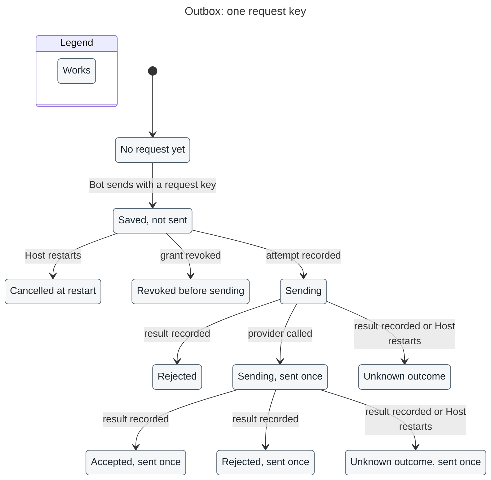

# External IM provider decisions

Why BotHarness talks to Lark/Feishu, Slack, Discord, WeChat and QQ the way it does. How it works lives in [the architecture](../architecture/botharness-architecture.md) and the platform guides ([Lark](../lark-connection.md), [Slack](../slack-connection.md), [QQ](../qq-connection.md), [Provider integration](../dev/guides/im-provider-integration.md)); terms live in [`GLOSSARY.md`](../../GLOSSARY.md). Each section states the current decision, the reasons a reader cannot get from the code, and what enforces it. History is in Git: this file replaces ADR-0001, 0006, 0008, 0009, 0010, 0011, 0038, 0039, 0101, 0104, 0105, 0106, 0107, 0108, 0111, 0112, 0117, 0120, 0122, 0126, 0127, 0128, 0129, 0136, 0137, 0139, 0141, 0142, 0143, 0145, 0149, 0151, 0152, 0165, 0168, 0171, 0173, 0174, 0175, 0176, 0197, 0275, 0276 and 0343, and each section lists the ADRs it absorbed.

Two rules run through every section:

- **The Provider owns the platform; BotHarness owns the facts.** The IM Provider (a maintained dsh-im build) owns SDKs, credentials, connections and native checks. BotHarness Messaging owns Bindings, conversation entries, Source Events, Inbox Admissions and the Outbox in the Operational Database.
- **Admission is not authority.** External text is untrusted. Receiving it never grants tool approval, Memory acceptance, pairing, Workspace access or a right to speak somewhere else.

## 1. BotHarness consumes a separate IM Provider through a public Service

_Formerly ADR-0011; ADR-0001 (extend dsh-im in place), ADR-0009 (thread-first reply default) and ADR-0010 (keep self-built modules in-repo for a PoC) are retired._

BotHarness is a standalone DSH plugin. It uses the Provider only through a versioned same-Host Service (DSH Service Definition → Provider → Consumer), probes each capability by version, and never imports Provider internals, reads its stores or calls its private JSON. Each platform adapter is registered and disposed through its owning Fiber. Reusable contract improvements are proposed upstream; a merged upstream PR is not a released compatible artifact.

Why: dsh-im already had multi-Bot management, settings and SDKs, but no seam for routing or Bot identity. Forking it into BotHarness would mean a second platform roadmap; calling its private modules would break on every bump. A capability probe, not a version string, says what a Provider can do.

Enforced by: `createDshImProvider` rejects services without the required contract (`dsh-im-unsupported.test.ts`, "a legacy dsh-im service cannot silently acquire verified-identity authority" in `messaging-outbound.test.ts`).

## 2. Products pin an independently versioned Provider artifact

_Formerly ADR-0104 and ADR-0127 (Proposed, built: `scripts/product-artifacts.mjs`)._

The product artifact composes Core, Client and `@botharness/im-provider` through one DSH Bundle Patch. The Provider is its own package and version train, built from an immutable `DoodleBears/dsh-im` commit. The builder checks the input's runtime digest, manifest and lock hashes before staging and records provenance; changing shipped Provider bytes needs a new Provider version and fresh real-platform qualification. The Provider keeps its Loader ID, RPC namespace and storage identity so stored credentials survive. Development Profiles opt in explicitly (`--im-provider`) and pin the same kind of SHA plus digest. Installing a Provider enables no account.

Why: the upstream npm release lacked the checked contracts, and "same version string" or "install succeeded" proved nothing. A pinned digest lets every tester and every user run the bytes that were actually qualified.

Enforced by: `scripts/test/product-artifacts.test.mjs`, `scripts/test/dev-im-provider.test.mjs`, `scripts/test/npm-provider-release.test.mjs`.

## 3. Secrets stay in the Provider's credential store

_Formerly ADR-0006._

App secrets, tokens and QR credentials live in the DSH credentials service, owned by the Provider. BotHarness stores an opaque account reference and a non-secret fingerprint, and never puts a secret in config, the Operational Database, logs, cards, Memory or the repository. Inline app creation (§5) sends secrets from the Client straight to the Provider's own settings transport.

Why: it makes "no secrets in the repo or the backup" a structural property instead of a review promise. An environment variable may override a reference, never replace the store.

Enforced by: `dsh-im-setup.test.ts` (setup metadata and bound accounts carry no Provider secret; Messaging tables have no credential-shaped column), the repository secret scan in CI.

## 4. A Binding is an authenticated app identity

_Formerly ADR-0101 and ADR-0111; the one-app-per-platform limit was lifted by ADR-0142 (§5)._

Binding an app to a PersonaBot verifies the platform identity through the Provider's authenticated `describeBot` and stores a fingerprint derived from stable platform IDs (Lark domain + app + Bot Open ID, Slack workspace + Bot user + App, Discord App + Bot user, WeChat paired account + owner + credential digest, QQ AppID + robot ID), never from a display name or a Provider config ID. One app binds to at most one Bot; a Bot may bind several apps of one platform. Identity and conversation authority are separate: pausing an identity stops its leases and its unstarted sends without touching conversation entries; unbinding invalidates all its entries; rebinding never restores old ones. Resume re-verifies the same fingerprint and refuses a new identity.

Why: an opaque Provider bot ID is local configuration, and a saved target ID is a mutable alias; neither proves who the app is or where a message goes. Mixing identity and conversation authority made "pause this app" indistinguishable from "stop listening to this group".

Enforced by: `messaging-identity.test.ts`, `messaging-several-apps.test.ts`, `messaging-several-apps-migration.test.ts`, "changed account or target and an archived bot fail closed" in `messaging-outbound.test.ts`.

## 5. A bound app admits its DMs and mentions; conversations are entries

_Formerly ADR-0142, which amended 0038, 0101, 0106, 0111 and 0120._

An enabled Binding is the authority to receive that app's **default traffic** into the Bot's Inbox: DMs to the app, and group messages the Provider reports as mentioning it, limited to the event kinds qualified for that platform. The platform's own controls (availability scope, membership, group admins, granted scopes) decide who can reach the app; BotHarness adds no second per-conversation consent. The first admitted message from a new conversation records an implicit **conversation entry** in the same transaction. A Binding's **new-conversation mode** is `auto` (admit) or `ask` (hold metadata only, no content, no backfill when allowed); it follows the platform default, `auto`, unless set on the app. Auto-creation is bounded (20 new entries per hour, 500 active, 200 held) and overflows to held. **Block** is durable per Bot, fingerprint and conversation: it survives restarts, `auto` mode and unbind/rebind, and only an explicit Allow again lifts it. Ordinary group text, thread following, Channel placement and wake rules stay explicit per-conversation opt-ins. The Client offers one **Bind app** step; inline app creation is a Provider capability and starts the app in `external-consumer` mode.

Why: four separate authorities (connect, save target, bind, grant, enable) meant a DM to a freshly bound app reached nothing. The trade-off is explicit: anyone the platform lets reach the app can wake the Bot and spend its budget, and is answered only through the checked original route. Durable blocks make revocation stick under `auto`.

Enforced by: `messaging-default-traffic.test.ts`, `messaging-default-traffic-migration.test.ts`, `messaging-new-conversation-default.test.ts`, `messaging-conversation-list-migration.test.ts`, `dsh-im-setup.test.ts`.

## 6. Intake commits the Source Event and Admission before acknowledging

_Formerly ADR-0106, 0276, and the intake parts of ADR-0126 (Slack), 0129 (WeChat) and 0151 (QQ)._

BotHarness holds one exclusive Provider Consumer lease per account, fanned out to every subscriber (Bindings, Channel routes, ingests); the Provider acknowledges only after every applicable subscriber has persisted or refused the event. Claiming the lease persists `external-consumer` mode, and losing it never falls back to the Provider's standalone Session. Messaging verifies registration, fingerprint, entry revision, active Bot and conversation, then commits one canonical Source Event (keyed by provider, fingerprint, conversation and native message ID) and its Inbox Admission in one transaction. Redelivery deduplicates; conflicting content for the same identity fails closed. Polling Providers (WeChat) advance their cursor only after acceptance. Recovery never invents a history cursor: redelivery may leave gaps. Messaging owns external readiness (`inbound.pendingExternal`) and records immutable per-source receiving evidence (`messaging_source_paths`); Runtime owns timers, scheduling and settlement.

Why: a Provider-owned Session or a second SDK listener would compete for execution and credentials, and an acknowledgement before commit can lose a message. One lease and one canonical source keep one identity and one wake decision per message.

Enforced by: `messaging-inbound.test.ts`, `messaging-consumer-fanout.test.ts`, `dsh-im-consume-cancellation.test.ts`, `messaging-slack.test.ts`, `messaging-weixin.test.ts`, `messaging-qq-direct.test.ts`, `messaging-qq-recovery.test.ts`.

## 7. Capabilities are per account and never implied

_Formerly ADR-0038; target-scoped Service Grants remain only for Providers without conversation listing (§10)._

Each configured account advertises an explicit capability set (receive kinds, replies, files, history, proactive post, reactions, typing, cards). BotHarness exposes a trigger, tool, reply or action only when that exact capability is negotiated for that account. Plugin installation, tool visibility, or a target appearing in model context never implies capability or authorization. Unsupported, permission-missing, out-of-scope and revoked are stable, observable outcomes, not silent fallbacks.

Why: a lowest-common-denominator API would cripple richer platforms, and calling an unsupported operation optimistically turns runtime errors into the contract.

Enforced by: capability checks in `dsh-im.ts` covered by `dsh-im-unsupported.test.ts` and each platform's `messaging-*.test.ts`; Bridge tools appear only while the Bot has IM (`tool-effects.test.ts`).

## 8. Replies go back only through the checked original route, as the responder

_Formerly ADR-0122 and the reply parts of ADR-0106, 0126, 0128 (Proposed, built: Discord), 0129 and 0151._

A reply names a canonical Source Event and nothing else: the Host derives the Bot, its own Binding and entry, and the immutable original route. Before sending, the Provider re-authenticates the account and re-reads the exact native source (sender, conversation, thread/root/parent) where the platform allows it; where it does not, it uses bounded local proof (WeChat's private continuation token, 30 days / 1,000 entries; QQ's process-local source proof, 5 minutes / 5 replies). A synchronous BotHarness fence runs immediately before the native send. Another Bot that reads a shared source replies only through its own Binding and its own active entry for that conversation; Lark Open IDs are app-scoped, so only the sender ID resolved by the responder's own read is used. Ambiguity (several of one Bot's apps in the conversation) refuses. Platform routing is adapted in the Provider: Slack threads by `ts`/`thread_ts` with no fabricated parent; Discord threads are child channels of a verified parent, with permissions computed from current roles and overwrites; Discord's own managed role counts as a mention only when its native ownership is verified.

Why: replying through another Bot's identity or to a model-chosen destination would be a confused deputy. Re-reading the source closes the gap between intake and reply; a reply that cannot be qualified refuses instead of falling back to the group mainline.

Enforced by: `dsh-im-reply-mentions.test.ts`, `messaging-slack-thread.test.ts`, `messaging-discord.test.ts`, `messaging-weixin-routing.test.ts`, `messaging-qq-direct.test.ts`, `messaging-external-bot-sender.test.ts`.

## 9. The Outbox is durable and idempotent, not exactly-once

_Formerly ADR-0039, ADR-0117, and the dispatch rules of ADR-0101._

Every reply, report or post first commits one Outbox intent with a stable request key, payload hash and the identity/entry revision it was authorized under, then marks one attempt in-flight before the provider call. A repeated key with the same payload returns the existing intent; a different payload conflicts. Success means the provider accepted, never delivered or read. A timeout, Provider disposal, thrown send or Host crash after the attempt started is **Unknown Outcome**: never retried automatically, never resent after restart, and only a Human may resolve it. Revocation cancels unstarted intents as `grant-revoked`; a started request keeps its original authorization snapshot. Backup restore turns `in-flight-at-cutoff` into Unknown Outcome. A report is canonical in the Outbox itself (no Source Event, Channel placement or DM mirror); a genuine Human reply to it is matched by native parent/root within the same account and conversation.

Why: BotHarness and a platform API share no transaction. Retrying a lost response duplicates messages; dropping failures loses accepted intent. A model cannot prove external state, so it cannot clear an unknown.

Enforced by: the schema (`messaging_outbox.request_id` is UNIQUE; `messaging_outbox_attempts.intent_id` is the primary key, so one intent has at most one attempt), `outbox-idempotency.property.test.ts` (any sequence of requests, provider results and restarts sends each key at most once and keeps an unknown unknown), `messaging-outbound.test.ts`, and the TLA+ model `verification/outbox/Outbox.tla` (`node scripts/verify-tla.mjs outbox`; the `verify-outbox` skill). TLC checks every order of request, claim, provider call, result, revocation and restart for two keys, two concurrent sends and two restarts. It confirms that a key reaches the provider at most once, and that a pending, cancelled or revoked intent was never sent. Three broken variants show what each guard buys: removing all three repeat guards (return the existing intent, claim only a pending intent, one attempt row) sends twice; calling the provider before the claim commits leaves a sent message marked pending, which a restart cancels; recovering an in-flight attempt as pending marks a sent message unsent.

Generated from the model by `/statechart` (one key, one restart):

## 10. Proactive posts reach where the platform lets the app speak

_Formerly ADR-0197 and ADR-0139, with the posting rules of ADR-0142 and ADR-0038._

`bridge_post`, reports and Profile sends may target an active entry or any conversation the Provider currently lists as postable (`bridge_reachable_groups`). The Host re-checks reachability, entry revision and Binding at acceptance and immediately before each side effect. A first post to a listed conversation creates an implicit entry; a block refuses, mute and held do not. Each Binding has a loop guard, 60 posts per rolling hour by default (null disables it), counted from Outbox attempt starts. Providers without conversation listing keep Human-issued Service Grants on a saved target. WeChat posts only to the paired owner and only while a fresh private context exists; it records a client acknowledgement separately from a native message ID. Client recovery drafts reuse the original request ID and never send by themselves.

Why: platform permissions are where people already manage a bot's reach; a second per-target consent made ordinary reports unusable. The loop guard stops runaway posting without restricting normal use.

Enforced by: `messaging-reachable.test.ts`, `messaging-weixin-post.test.ts`, `messaging-qq-post.test.ts`, `grant-execution.test.ts`.

## 11. Channels place canonical sources; nothing is copied

_Formerly ADR-0108, 0112, 0120 and 0143 (Proposed, built: `messaging/conversation-ingest.ts`)._

An external message appears in a local Channel as a **placement** that references its Source Event; the text lives only in the Source Event. One source may be placed in several Channels (unique per Channel). Two ways to place: a Bot-owned **Channel Bridge route** on a conversation entry (needs the receiving Bot to be a Channel member), and a Channel-owned one-way **conversation ingest** (外部会话接入) that the Human connects under External connectors, which needs no Bot identity and grants no reply, post, history, file or Memory authority. An ingest collects all messages the Provider delivers and defaults to context-only wake. Channel membership gives other members visibility, not the receiving identity, another Admission or a wake. Pause keeps the lease and acknowledges without placement; delete and recreate set a fresh intake boundary and never backfill. Membership is rechecked at intake, wake, reads and before an external effect.

Why: a separate shared Inbox or per-member copies duplicate history and confuse shared awareness with a decision to wake. Keeping one-way listening Channel-owned lets a Channel hear a group without binding an app to a Bot.

Enforced by: `messaging-conversation-ingest.test.ts`, `channel-bridge-migration.test.ts`, `messaging-routes-migration.test.ts`, `channel-bridge-media.test.ts`.

## 12. Files and media are acquired on demand under source authority

_Formerly ADR-0008, 0105, 0107, 0137, 0275 and the media parts of ADR-0126, 0129 and 0151._

Intake records only safe descriptors (opaque IDs, names, kinds, declared sizes); private resource keys, CDN tickets and download URLs stay in the Provider. Bytes are fetched on first access, through the existing Attachment owner, after the Provider re-checks the source message and resource association; a file ID alone is not permission. Downloads are bounded (25 MiB default) and cancellable. Humans get previews only for sniffed PNG/JPEG/GIF/WebP and playback for verified MP4 or decoded voice (SILK, Ogg Opus → bounded WAV in a disposable Worker); BotHarness runs no ASR and labels a missing platform transcript as unavailable. A Bot works on an independent copy saved into a Workspace Grant with write permission, uses native tools, then explicitly imports a result and replies with it; originals are never overwritten remotely. Ordinary-collection media is kept only when that capability was negotiated and collection is on.

Why: a universal parser or a second file catalog is unnecessary when native file tools and Shell exist; eager downloads would copy content nobody asked for and widen the attack surface.

Enforced by: `messaging-attachments.test.ts`, `channel-bridge-media.test.ts`, `lark-audio.test.ts`, `messaging-qq-files.test.ts`, `messaging-qq-images.test.ts`, `messaging-qq-voice.test.ts`, `messaging-qq-ordinary.test.ts`.

## 13. History reads are explicit, anchored and bounded

_Formerly the context-read parts of ADR-0106 and ADR-0126 (see also ADR-0125 in Messaging)._

`bridge_context` starts from a Source Event already admitted to this Bot; it cannot choose an account or conversation. The Provider re-authenticates and verifies the anchor before listing. Pages hold at most 20 messages, report omissions and incompleteness, and expire their continuations with the runtime. Returned complete messages reconcile into canonical Source Events without Admission, placement, wake or Memory write. Names are presentation, never identity. QQ and WeChat offer no history read.

Why: the model needs nearby context, but a free-form history reader would be a new authority over conversations the Bot was never asked about.

Enforced by: the `bridge_context` cases in `messaging-inbound.test.ts`, `messaging-slack.test.ts`, `messaging-discord.test.ts`.

## 14. External people pair before they get authority

_Formerly ADR-0136, 0165, 0168, 0171, 0173 and 0174._

Two kinds of pairing, never implied by each other, both scoped to one Bot and its current Binding and never transferred across Bots, apps, rebinding or restored Profiles:

- **Management pairing** (`/pair` in a private DM): a deterministic control that creates no Source Event, Admission or wake. The authenticated Web Human approves it with an explicit selection of capabilities (`approve`, `reject`, `answer`, `save-rules`); nothing is preselected and the first applicant gets nothing special.
- **Chat pairing** under the opt-in sender restriction (Lark, Slack DMs): an unpaired request stores only metadata, approval assigns one primary behavior Role and sends a fixed "ask again" notice; the blocked instruction is never replayed.

Effective management capability is the union of the Role, Authorization Groups and person exceptions, minus any explicit Deny; reviewing pairings and delegating are separate grants, and a reviewer can only grant within their own current ceiling. Behavior items are referenced by ID with Deny precedence and declared exclusions checked before any write. Role text is prompt behavior, not an access control. `bridge_sender_permissions` and `bridge_directory` are read-only, dated lookups. The Web Human keeps full authority. Requests expire after 10 minutes and are bounded (5 attempts, 200 pending per Profile, 25 pending and 100 approved per Bot).

Why: anyone can reach a community Bot before its maintainer, so neither the first applicant, a display name, a pasted token nor a model reply can establish authority. Separate use and delegation stop existing approvers from silently recruiting administrators.

Enforced by: `bot-pairing.test.ts`, `lark-pairing-cards.test.ts`, `pairing-settings.test.ts`, `messaging-lark-dm.test.ts`.

## 15. IM approvals and rules rejoin the native owner

_Formerly ADR-0141 and ADR-0175._

A tool approval can be sent to one selected management DM of an approved pairing. Card actions go through the exclusive Consumer, carry the actual platform operator (never button data), and reach the same one-winner `ChannelToolApproval` broker as the Web; the native Session still owns the request and the result. Allow once is checked again by the execution fence just before native execution. Session-wide Computer/Browser grants stay Web-only. A rule saved through IM needs both `approve` and `save-rules`, a preview and a second confirmation bound to a nonce, and records its external creator; every later match re-checks that creator's current authority, and losing it revokes the rule permanently. Known-unsent card sends retry at most three times; uncertain ones never.

Why: an IM receipt or button press is not a decision, and a rule created by a reviewer who has since lost authority must not keep standing execution power.

Enforced by: `lark-approval.test.ts`, `tool-approval-rules.test.ts`, `lark-questions.test.ts`.

## 16. Feedback, typing and alerts never risk duplicates

_Formerly ADR-0145, ADR-0149 and ADR-0176._

Reactions (`received` after commit, `answered` after the reply is provider-accepted), typing indicators and work-failure alerts are optional checked capabilities that run beside intake and execution, never inside them. Each records its attempt before the external call and never retries an uncertain one. Typing is a process-local lease shared by overlapping work (renewed at most every 5 s, at most 10 minutes) and persists only the preference. Failure alerts observe the committed `sessionFailure` message, go to the existing management route, and carry fixed text without error details, arguments or paths.

Why: a duplicate or misleading signal is worse than a missing one, and none of these may delay or change the message they describe.

Enforced by: `messaging-feedback.test.ts`, `messaging-typing.test.ts`, `messaging-weixin-typing.test.ts`, `failure-alerts.test.ts`.

## 17. Reception history records local observations only

_Formerly ADR-0152._

Where a platform supplies no durable history cursor (QQ), Messaging keeps bounded reception intervals per Bot, Provider and fingerprint (latest 128 closed intervals): pauses, unbinds, blocks, stops, and "continuity unverified" after an unclean stop. These are inspection observations; BotHarness never infers missing messages or backfills from them. Same-app rebind keeps blocks and mute preferences but does not revive revoked authority.

Why: a truthful local record is better than an apparently complete transcript the platform cannot back.

Enforced by: `messaging-default-traffic.test.ts` (reception history), `external-conversations.test.ts`.

## 18. Settings show saved configuration before live checks

_Formerly ADR-0343._

The IM settings snapshot has a `saved` mode (persisted configuration, checks marked pending, no Provider calls) and a `status` mode (only this Bot's bound accounts, inspections shared within the request). The Client shows saved first, then status; pending is never shown as verified. Mutations and sends always re-verify. The same modes are available in the CLI as `--read-mode saved|status`.

Why: one slow Provider used to hold the whole page, and saved projection is presentation data, never authorization.

Enforced by: `messaging-settings-loading.test.ts`, `bot-im-control-cli.test.ts`.
