# Messaging decisions

Why Channels, Bot Inboxes, Group collaboration and the Channel timeline work the way they do. How it works lives in [the architecture](../architecture/botharness-architecture.md); terms live in [`GLOSSARY.md`](../../GLOSSARY.md); the external platforms are in [IM provider decisions](im-providers.md). Each section states the current decision, the reasons a reader cannot get from the code, and what enforces it. History is in Git: this file replaces ADR-0026, 0030, 0036, 0037, 0054, 0061, 0065, 0069, 0073, 0078, 0081, 0099, 0102, 0103, 0113, 0115, 0125, 0179, 0181, 0184, 0206, 0217, 0226, 0227, 0231, 0232, 0277, 0292 and 0293, and each section lists the ADRs it absorbed.

Two rules run through every section:

- **One content authority.** Every message is one immutable Source Event in the Operational Database. Channel placements, Inbox Admissions, receipts, mirrors, drafts and caches point at it; none of them is a second copy that can disagree.
- **The Host decides, not the payload or the prompt.** Authorship, membership, causation, mentions and freshness are derived and checked by the owning Host module. A caller-supplied ID, a typed name or prompt advice is never authority.

## 1. Channels and Inboxes share one transactional Messaging store

_Formerly ADR-0026 and ADR-0037; ADR-0030 (per-Channel NDJSON as the system of record) is retired._

A Channel is a platform-native space, `dm` (a PersonaBot and one Human, or two PersonaBots) or `group`, where Bots and Humans talk. A Bridge is a configuration relationship, not an entity: it connects an external source to an explicitly configured Channel or Bot Inbox and never auto-creates a Channel. Every inbound fact, from a Channel, a direct Bridge message, a webhook, a Session event or the system, is recorded once as an immutable **Source Event** with trusted provenance and, when replyable, a non-secret **Reply Route**. The same SQLite transaction adds the optional Channel placement, zero or more per-Bot **Inbox Admissions**, the delivery-Outbox intent and the exact Messaging Policy revisions it evaluated. Admissions never copy content; Reply Routes never hold credentials. Edits and retractions append a causally linked Source Revision or tombstone; the original row never changes. The store is BotHarness's own Operational Database ([ADR-0041](persistence.md#adr-0041)); attachment bytes are Host files ([ADR-0100](workspaces.md#adr-0100)).

Why: Inbox attention does not always belong to a Channel, so a per-Channel log could not be the authority. DSH storage domains offer no transaction across the event, its placement, its Inbox fan-out and its Outbox row, and without one an event can commit under one Trigger or Grant and be admitted under another. A file log also could not de-duplicate at-least-once ingress cheaply.

Enforced by: `messaging-store-boundary.test.ts` (only the database owner, the log store and the Purge Ledger open SQLite), `messaging-inbound.test.ts`, `channel-changes.test.ts`.

## 2. Messaging commands own every Messaging write, and the Host bounds Bot loops

_Formerly ADR-0036._

Browser RPC, model tools, Bridges, webhooks and system producers are adapters into one Messaging module; none writes the store, a Channel or an Inbox directly. Each adapter derives a trusted Actor from authenticated Human identity, Session ownership, verified external identity or a named Host capability; a caller-supplied `actorId` or tool visibility is never authorization. The module authorizes, de-duplicates ingress (a repeated key returns the existing event), assigns the event id and time, and derives causal fields and Reply Routes itself. Runtime notification happens only after commit and is recoverable from the Outbox. Membership (may read and send) and subscription (all, mentions, none) are separate relationships; digest timing is Wake Policy. Bot-to-Bot causation is Host-enforced: every Bot-caused input increments a trusted hop counter, and an event over the limit stays durable but admits and wakes nobody. Every send within the limit wakes its recipients; ADR-0036's per-chain de-duplication was removed ([Session decisions](sessions.md#adr-0261) has the current limit). A correlated Provider Echo enriches the outbound event instead of creating a second message; an own-sender echo that cannot be linked yet is held as evidence, never treated as a new user message.

Why: every adapter that wrote its own rows would carry its own idea of authorization and de-duplication, and the next one would forget a check. Prompt advice cannot stop two Bots answering each other forever; only a counter the model cannot set can.

Enforced by: `messaging-store-boundary.test.ts` (the files that write `source_events`, `channel_placements`, `inbox_admissions` and `messaging_outbox` may only shrink), `bot-hop-limit.test.ts`, `bot-group-steered-causation.test.ts`, `messaging-inbound.test.ts`.

## 3. Live delivery follows the durable commit

_Formerly ADR-0054, ADR-0181 and ADR-0179._

A message is visible to other clients only after its commit. The Host then publishes it with the Channel revision; reconnects replay committed rows after the last revision, and a gap makes the Client re-read rather than guess. A streaming `channel_send` preview is a **draft**: scoped to one LLM attempt and Channel, numbered separately from Channel revisions, never replayed after a Host restart, and never a message, Source Event or Inbox input. Anything durable or irreversible (TTS, Inbox admission, external notifications, audit) waits for the committed message. Application live streams run as stream-mode Remote methods on DSH's multiplexed Remote stream carrier, with the SSE route kept as a fallback. The Channel stream uses the journal frame vocabulary: while the window follows the tail, DSH's `RemoteJournalStream` owns gap repair and reopening; a detached window (around a read anchor, or paged away from the tail) uses timeline pages (§4) while the stream keeps advancing the revision and preview.

Why: showing an uncommitted message lets a client act on something that may never exist. One HTTP response per live stream exhausted the browser's six connections per origin once two documents were open; the Remote carrier is outside that budget. DSH already ships the gap-repair helper for its own timeline, so the Client stops reimplementing it.

Enforced by: `channel-live.test.ts`, `journal-stream-contract.test.ts`, and the TLA+ model `verification/live/Live.tla` (`node scripts/verify-tla.mjs live`; the `verify-live` skill). TLC checks every order of writes that commit or roll back, publishes in any order (a caller may await between its commit and `onPlaced`), opens, dropped streams and received entries, for three messages and two opens. It confirms that the client never shows a message twice, shows only committed messages, and shows the committed messages in revision order with none skipped. Three broken variants show what each guard buys: publishing inside the transaction shows a message that rolled back; without the subscriber's `delivered` check and the client's cursor check, a commit that the opening page already holds shows twice; without the client's gap repair, a commit published before an earlier one leaves the earlier one missing. Either duplicate check alone is enough.

Generated from the model by `/statechart` (two messages, one open):

```mermaid
---
title: "Live delivery follows the commit"
config:
  markdownAutoWrap: false
  state:
    useMaxWidth: false
---
stateDiagram-v2
  classDef works fill:#f4f6f7,stroke:#566573,color:#1b2631
  classDef wrong fill:#fdedec,stroke:#c0392b,color:#7b241c
  classDef fixed fill:#e9f7ef,stroke:#1e8449,color:#145a32
  classDef mixed fill:#fdebd0,stroke:#d35400,color:#7e5109
  classDef after fill:#ffffff,stroke:#808b96,color:#566573
  classDef worse fill:#f4ecf7,stroke:#7d3c98,color:#4a235a
  classDef worksPath fill:#f4f6f7,stroke:#1f3a93,stroke-width:4px,color:#1b2631
  classDef wrongPath fill:#fdedec,stroke:#1f3a93,stroke-width:4px,color:#7b241c
  classDef fixedPath fill:#e9f7ef,stroke:#1f3a93,stroke-width:4px,color:#145a32
  classDef mixedPath fill:#fdebd0,stroke:#1f3a93,stroke-width:4px,color:#7e5109
  classDef afterPath fill:#ffffff,stroke:#1f3a93,stroke-width:4px,color:#566573
  classDef worsePath fill:#f4ecf7,stroke:#1f3a93,stroke-width:4px,color:#4a235a
  state "Legend" as legend {
    state "Works" as legendWorks
  }
  class legendWorks works
  state "Following, shows 0 of 0" as s0
  state "Following, shows 0 of 1, 1<br/>on the way" as s1
  state "Following, shows 0 of 1, 1<br/>to publish" as s2
  state "Following, shows 0 of 2, 1<br/>on the way" as s3
  state "Following, shows 0 of 2, 1<br/>to publish, 1 on the way" as s4
  state "Following, shows 0 of 2, 2<br/>on the way" as s5
  state "Following, shows 0 of 2, 2<br/>to publish" as s6
  state "Following, shows 1 of 1" as s7
  state "Following, shows 1 of 1, 1<br/>to publish" as s8
  state "Following, shows 1 of 2, 1<br/>on the way" as s9
  state "Following, shows 1 of 2, 1<br/>to publish" as s10
  state "Following, shows 1 of 2, 1<br/>to publish, 1 on the way" as s11
  state "Following, shows 1 of 2, 2<br/>to publish" as s12
  state "Following, shows 2 of 2" as s13
  state "Following, shows 2 of 2, 1<br/>to publish" as s14
  state "Following, shows 2 of 2, 2<br/>to publish" as s15
  state "Not following, shows 0 of<br/>0" as s16
  state "Not following, shows 0 of<br/>1" as s17
  state "Not following, shows 0 of<br/>1, 1 to publish" as s18
  state "Not following, shows 0 of<br/>2" as s19
  state "Not following, shows 0 of<br/>2, 1 to publish" as s20
  state "Not following, shows 0 of<br/>2, 2 to publish" as s21
  state "Not following, shows 1 of<br/>1" as s22
  state "Not following, shows 1 of<br/>1, 1 to publish" as s23
  state "Not following, shows 1 of<br/>2" as s24
  state "Not following, shows 1 of<br/>2, 1 to publish" as s25
  state "Not following, shows 1 of<br/>2, 2 to publish" as s26
  state "Not following, shows 2 of<br/>2" as s27
  state "Not following, shows 2 of<br/>2, 1 to publish" as s28
  state "Not following, shows 2 of<br/>2, 2 to publish" as s29
  [*] --> s16
  s16 --> s0 : the client opens the Channel
  s16 --> s18 : the write commits
  s0 --> s16 : the stream drops
  s18 --> s17 : the Host publishes a commit
  s18 --> s8 : the client opens the Channel
  s0 --> s2 : the write commits
  s18 --> s21 : the write commits
  s17 --> s7 : the client opens the Channel
  s8 --> s7 : the Host publishes a commit
  s8 --> s23 : the stream drops
  s2 --> s1 : the Host publishes a commit
  s2 --> s18 : the stream drops
  s21 --> s20 : the Host publishes a commit
  s21 --> s15 : the client opens the Channel
  s17 --> s20 : the write commits
  s8 --> s12 : the write commits
  s7 --> s22 : the stream drops
  s23 --> s22 : the Host publishes a commit
  s2 --> s6 : the write commits
  s1 --> s17 : the stream drops
  s1 --> s7 : the client receives an entry
  s20 --> s19 : the Host publishes a commit
  s20 --> s14 : the client opens the Channel
  s15 --> s14 : the Host publishes a commit
  s15 --> s29 : the stream drops
  s7 --> s10 : the write commits
  s12 --> s10 : the Host publishes a commit
  s12 --> s11 : the Host publishes a commit
  s12 --> s26 : the stream drops
  s23 --> s26 : the write commits
  s6 --> s4 : the Host publishes a commit
  s6 --> s21 : the stream drops
  s1 --> s4 : the write commits
  s19 --> s13 : the client opens the Channel
  s14 --> s13 : the Host publishes a commit
  s14 --> s28 : the stream drops
  s29 --> s28 : the Host publishes a commit
  s10 --> s9 : the Host publishes a commit
  s10 --> s25 : the stream drops
  s22 --> s25 : the write commits
  s11 --> s9 : the Host publishes a commit
  s11 --> s25 : the stream drops
  s11 --> s14 : the client receives an entry
  s26 --> s25 : the Host publishes a commit
  s4 --> s5 : the Host publishes a commit
  s4 --> s20 : the stream drops
  s4 --> s10 : the client receives an entry
  s4 --> s3 : the Host publishes a commit
  s4 --> s14 : the client receives an entry
  s13 --> s27 : the stream drops
  s28 --> s27 : the Host publishes a commit
  s9 --> s24 : the stream drops
  s9 --> s13 : the client receives an entry
  s25 --> s24 : the Host publishes a commit
  s5 --> s19 : the stream drops
  s5 --> s9 : the client receives an entry
  s3 --> s19 : the stream drops
  s3 --> s13 : the client receives an entry
  class s0 works
  class s1 works
  class s2 works
  class s3 works
  class s4 works
  class s5 works
  class s6 works
  class s7 works
  class s8 works
  class s9 works
  class s10 works
  class s11 works
  class s12 works
  class s13 works
  class s14 works
  class s15 works
  class s16 works
  class s17 works
  class s18 works
  class s19 works
  class s20 works
  class s21 works
  class s22 works
  class s23 works
  class s24 works
  class s25 works
  class s26 works
  class s27 works
  class s28 works
  class s29 works
```

## 4. Timeline pages use Host-owned cursors, and a database change log feeds caches

_Formerly ADR-0061 and ADR-0293._

`channelTimeline` serves latest, older, newer and around windows with opaque before/after anchors and `hasOlder`/`hasNewer`; the Client never decodes a cursor. The Client keeps one contiguous window and never stitches across unseen history. Message grouping is a Client projection only. The Human read position is Host-owned, per Channel and Human, advanced only from committed messages actually visible, and monotonic; a missing or invalid anchor falls back to latest. A global monotonic `channel_changes` log, written by SQLite triggers on every table that feeds the message projection (including fan-out to replies and other dependent messages), lets a reconnecting client ask `channelChanges` and `channelListChanges` for only what changed. A different epoch or a pruned cursor returns `reset`; rows older than 30 days are pruned at startup.

Why: a message-id-only query has no direction or boundary, and a full-history snapshot grows without bound. The change inventory found 54 write paths; a notification per call site would miss the next one, while a trigger cannot.

Enforced by: `channel-timeline.test.ts`, `channel-timeline.property.test.ts` (any history, page sizes, starting window and appends: one contiguous window with no gap or duplicate), `channel-timeline-bounded.test.ts`, `channel-changes.test.ts` ("a test fails when a projection table has no trigger").

## 5. PersonaBots collaborate through Channels; references do not grant membership

_Formerly ADR-0065 and ADR-0069._

A Bot-to-Bot DM is a real `dm` Channel with two PersonaBots, not a Session relay. A Bot's send creates one Source Event and placement and admits the recipient, never itself. In a Human–Bot DM, selecting `@Bot B` gives Bot A contact context for B (ID and description, no Soul, Memory or credentials); it neither adds B nor wakes B, and only A's own send to B does. Bot-to-Bot DMs are hidden from the Human roster by default but readable, and each Bot send to one leaves an activity chip in the sender's Human DM. Selecting a `#Group` reference keeps the Channel ID and gives a non-member Bot the current name only. A non-member Bot may request to join only a Group selected in the DM event that started its turn; the Human or the Group's Bot creator decides once, and acceptance adds membership atomically.

Why: one Channel path keeps one content authority and makes Bot collaboration inspectable. A Human's `@B` in a private DM is a request to A, not a message to B; turning it into either membership or a wake would leak the DM. A reference is context; membership is consent.

Enforced by: `bot-group-invitation.test.ts`, `group-join-reference.test.ts`.

## 6. Group membership is invitation-first with auto-accept, and management is idempotent

_Formerly ADR-0073, ADR-0081 and ADR-0226._

Membership starts with an invitation from the Group's Bot creator or the Human (`inviterHuman: true`, never shown as Bot ownership). The Bot-mode setting **auto-accept Group invitations** defaults on and accepts without a turn; when off, the invited Bot alone decides and a decline never wakes it again. There are no Group roles: the Bot creator manages Bot members and settings, the Human can override anything and alone deletes the Channel, and any Bot can leave. Name, avatar (a bounded PNG, JPEG or WebP data URL validated by the Host), members, invitations and join requests live on the existing Channel record and invitation facts. Management asked of Tob through the scoped CLI records a durable operation receipt (`channel_management_operations`) keyed by kind, normalized payload and target identities: a repeat reconciles the same Group or invitation, a conflicting payload refuses, and a deleted target is never recreated.

Why: almost every invitation is accepted, so a wake per invite is friction, while the off switch keeps consent. A personal Group does not need a permission system. A lost response to "create a group" must not create a second group.

Enforced by: `group-auto-accept.test.ts`, `channel-management.test.ts`, `group-management-tools.test.ts`.

## 7. The local Human has one identity; names are labels

_Formerly ADR-0078 and ADR-0103._

The local Human is a Group member with a stable Host-owned ID, join time and first visible revision; read positions are keyed by Channel and Human, and the browser cannot choose the ID. A Human receipt is projected from membership and read position; a Bot receipt only from its Inbox Admission; no second receipt ledger exists. The Human may set a default display name and per-Channel nicknames: nickname, then default, then `Human`. Mentions keep typed stable targets and render current names, so a rename changes no Source Event and repeats no notification.

Why: a Channel-only read position could not say who read a message, and a browser tab is not a person. Roleplay needs different names per Bot, but the names still refer to one person whose reads and pending actions must not fragment.

Enforced by: `group-human-receipt.test.ts`, `human-name.test.ts`, `human-channel-name.test.ts`.

## 8. Group mentions resolve to members, never to text alone

_Formerly ADR-0099 and ADR-0206._

Only a Human may use "@所有 Bot". The Host expands it at send time to one ordinary direct mention per active Bot currently in the Group, shows the count, and refuses a send whose membership changed since the preview. A Bot's `channel_send` mentions a colleague through `mention_bot_ids` or by writing `@Name`: the Host matches the typed name against active Group members other than the sender (case- and spacing-insensitive, longest name first, ASCII word boundaries and email-like text respected). One match is stored as an Actor mention; two members with the name refuse the send with their IDs; names of the sender, non-members and paused Bots stay text. Leading mentions join the badge row; a mid-sentence one keeps the name in place. A send chains from the newest source the Bot took in that Channel during the turn; each mention within the hop limit wakes its recipient ([Session decisions](sessions.md#adr-0261)).

Why: models address colleagues by name, so ignoring typed names left mentioned Bots asleep, while guessing between two Bots of the same name would wake the wrong one. A Bot-wide broadcast would multiply wake loops nobody asked for.

Enforced by: `bot-mention-text.property.test.ts` (any mix of mentions, plain words, look-alike names and email-like text), `bot-group-mention-text.test.ts`, `group-mention.test.ts`, `bot-group-steered-causation.test.ts`.

## 9. Model Channel reads budget content before consuming it

_Formerly ADR-0102._

`channel_read` returns a model projection (identity, author, time, full body, reply context, trusted attachment and action references; no receipts, delivery states or revisions). The Host fits the whole serialized result into a budget of UTF-16 code units (default 12,000, adjustable from 1,000 to 24,000) before it marks any message observed: a page is the largest chronological prefix that fits, with a continuation and a count of omitted candidates. An oversized message returns a `readContent` locator and is read in ordered fragments whose cursor binds a hash of the projection; only a contiguous prefix read in the current turn counts as consumed.

Why: the history query marks returned messages as observed, so cropping its output afterwards would mark unseen messages handled ([ADR-0077](../adr/0077-turn-time-harvest-consumes-the-ready-attention-set.md)). A summary of a long instruction is not the instruction.

Enforced by: `channel-model-read.test.ts`.

## 10. External traffic reaches Group members through the shared Channel

_Formerly ADR-0113, ADR-0115 and ADR-0125._

A newly placed ordinary external message commits one Source Event, its placement and one Inbox Admission per current active member, each snapshotting that member's Channel override or `group-ordinary` default. Direct external mentions keep the receiving identity's mention path. Replay keeps the original recipients and never admits later joiners. `bridge_share(source_event_id, channel_id)` lets a Bot place one fact from its own Inbox into a Group it belongs to, as the event's first placement, after checking its admission, identity, Grant and membership; members may read and discuss it, but external reads and replies still need the Bot's own authority. `bridge_context` nearby reads five minutes on each side of the anchor and tops a sparse side up to `before_count` (default 10) and `after_count` (default 5), each 0–20; counts are minima, not caps.

Why: members need their own attention to shared traffic without a second transcript or queue. Sharing must not convert future intake into a Bridge or borrow the receiving identity. A busy group needs time coverage; a quiet one needs a few messages either way.

Enforced by: `group-digest.test.ts`, `messaging-inbound.test.ts`, `dsh-bot-agent-adapter.test.ts`.

## 11. IM conversation mirroring is an opt-in projection

_Formerly ADR-0217._

`dmMirror` (show inbound IM messages in the local DM) and `dmForward` (send local messages to the IM conversation) are independent, default-off choices per Binding and conversation; WeChat is the first qualified platform. A mirror is an extra display-only placement of the same Source Event, with no second Admission. Each enable starts a new epoch so redelivery cannot backfill an earlier one. Outbound mirrors are deterministic local carriers linked to the Outbox intent; Content Purge clears both. Forwarding stays on the opted-in Binding and conversation, never falls back to another account, and an off/on cycle invalidates pending work.

Why: re-inserting IM text as local messages would create a second content authority that survives purge, and forwarding is an external side effect that needs its own consent.

Enforced by: `messaging-weixin-dm-mirror.test.ts`.

## 12. A Group send is checked against what the Bot actually read, in the commit transaction

_Formerly ADR-0227, and ADR-0231 and ADR-0232 (Proposed, built: `freshness_override`, `keepOpenInboxIds` and `review_action` in `runtime/bot-message-tool.ts`, `runtime/channel-action-tool.ts` and `channels/send-review.ts`)._

For a Group with send review on (off by default, per Group, through the bridge and CLI), the Channel owner compares the reply's basis with the Channel inside the same transaction that appends it. The Host issues expiring observation handles scoped to the Bot, Orchestrator Session and Group; a bounded read records individual message revisions and fingerprints, and the model must carry the returned handle into the send. A stale basis holds the draft (persisted, with no public message or Admission) and may return a bounded delta. After the first hold, at most two automatic rechecks follow; then the send returns `requires-review` and the Bot must drop the draft, drop it and snooze the Inbox item, or send with `freshness_override` and a reason. Dropping an exhausted draft fences further sends to that Group for the rest of the turn. After a restart a held draft is inspected with `review_action: inspect` and recovered only with a fresh observation and `review_action: recover`; a commit turns the draft into a receipt that keeps the message ID and intent fingerprint and clears the copied body.

Why: comparing before an asynchronous append leaves a race, and prompt instructions cannot close it. Busy Groups can invalidate every read, so the review needs an explicit end; a new draft must not reset the budget.

Enforced by: `group-send-review.test.ts`, `bot-group-review-rounds.test.ts`, `group-send-recovery.test.ts`, `group-recovery-revoked-source.test.ts`.

## 13. Unsent composer drafts live on the device, not in Messaging

_Formerly ADR-0184._

The Client stores drafts and submission attempts in browser storage, scoped by Host, Profile, Human and Channel IDs. Drafts keep text, explicit tokens, reply ID, uploaded references and quote targets, never file bytes; restore re-validates every reference with the Host before submit, and `@all` must be chosen again. Concurrent tabs keep both versions. A submission whose answer was lost is `unknown` ("not confirmed") and is settled only by asking the Host for the original client message ID; nothing is resent automatically.

Why: an unsent draft must survive a refresh without becoming a Source Event, reaching a model or entering telemetry. The Host already treats a repeated ID with the same content as one message, so asking beats retrying.

Enforced by: `composer-draft-recovery.test.ts`, `composer-submissions.test.ts`.

## 14. Cross-Host Bot DMs need an online peer and keep no outgoing queue

_Formerly ADR-0277._

PersonaBots on Hosts in the same verified tailnet or Tob Connect account, or in an ordinary LAN after both Humans approve each other's exact Host key, contact each other through ordinary Bot-to-Bot DMs that land in the receiver's Channel and Inbox. Delivery needs the peer online: a definite failure fails, a lost acknowledgement is unknown, and neither creates a persistent outgoing intent, automatic retry or replay. Revoking a LAN approval invalidates its epoch; re-admission never revives it.

Why: a resend subsystem across devices would act long after the Bot and Human stopped expecting it. The Bot decides whether to try later or ask the Human.

Enforced by: `network-bot-message.test.ts`, `network-withdrawal.test.ts`, `bot-lan-membership.test.ts`.

## 15. Attachments are content-versioned and cached as immutable

_Formerly ADR-0292, which replaced the `no-store` and no-thumbnail rules of ADR-0137 ([IM provider decisions](im-providers.md#adr-0137))._

Each attachment has a content version (first 32 hex of its sha256), dimensions and a thumbhash, kept in a sidecar that is recomputed when the file changes and backfilled by a throttled background job. The Host makes WebP thumbnails (`96c`, `320`, `800`) on demand when sharp loads. A request with the current `v` is served `immutable` with an ETag and supports a single `Range`; an old `v` gets 409 `stale-version`; a request without `v` keeps `no-store`. Purged placements carry their file IDs so clients drop cached copies.

Why: phones re-downloaded every original on every visit. Versioning keeps the Host the source of truth while letting clients cache safely.

Enforced by: `media-versions.test.ts`, `attachment-http.test.ts`.
