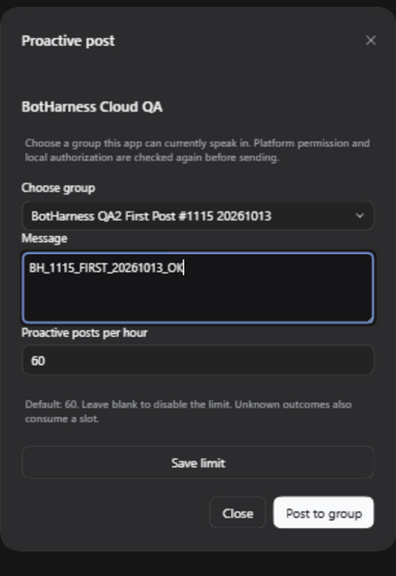
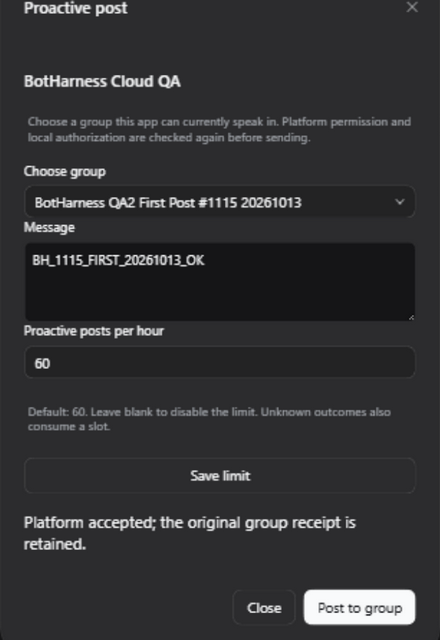
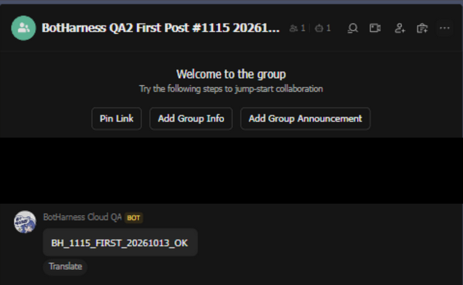
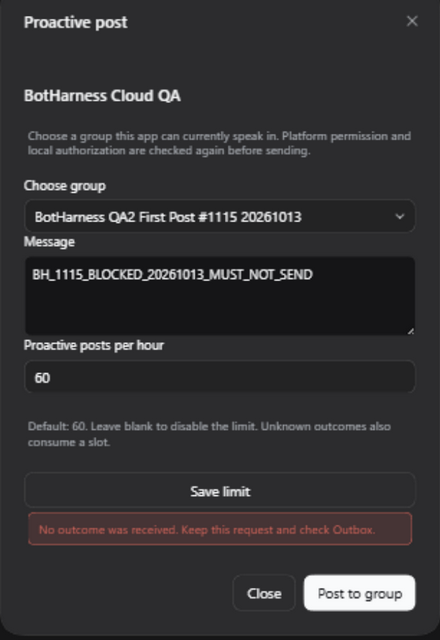
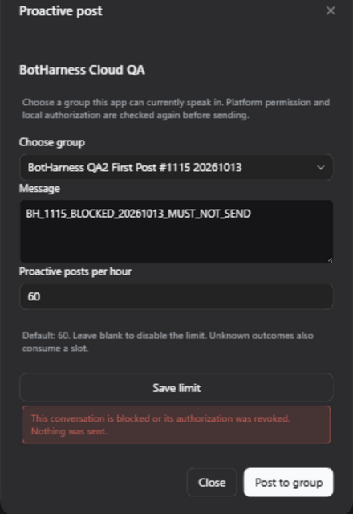

# Lark reachable-group first post — 2026-10-13

For the later same-Provider inline Lark/WeChat and installed-product qualification, see [Provider .20 packaged qualification](provider20-qualification.md). The historical first-post revision boundaries below remain unchanged.

Task `codex/local/01a1342d-5ce4-7872-9f9e-492a9caee393`; [claim](https://github.com/BotHarness/DeepSeekBot/issues/1115#issuecomment-6142085163), [Product #1559](https://github.com/BotHarness/DeepSeekBot/pull/1559), [Provider #27](https://github.com/DoodleBears/dsh-im/pull/27).

The Human confirmed a current exclusive QA2 window and added **BotHarness Cloud QA** to the new private group **BotHarness QA2 First Post #1115 20261013**. The signed-in browser verified the actual Bot and group; there were only creation/invitation system notices, no chat messages or prior mentions. No platform permission was changed.

## Actual first post

Product `735924ab4644b7f6d19364a06acb80f18a77c73c` and Provider `47854bd084d0a578d59fb13830f32e6190fc16af` ran in a task-owned isolated Profile. The Provider artifact contained 400 runtime files with SHA256 `2a9ce7adb8d516a38f2fb7fe3b6daf753636a79e6524caf49e3b02b6fa00484d`. The actual Client bound QA2 with zero conversations, discovered this group, and submitted **BH_1115_FIRST_20261013_OK** once.

The original Lark group displayed that complete text from BotHarness Cloud QA. Canonical Outbox has one `provider-accepted` intent and one accepted attempt; its version-1 native receipt has a message ID and the same conversation ID as the Grant. The implicit Grant has no saved target. Source Event count stayed 3 and Inbox Admission count stayed 1, all belonging to the preceding local DM qualification. The post has no Source Event reference. The Profile has one local Channel and its original three placements; no new local DM or placement was synthesized.

These are actual 1280 × 800, English, dark-theme browser captures. Client images crop the modal; the native image crops the designated conversation and covers Human creation/invitation notices. No unrelated chats, credentials or native account/conversation/message IDs are published. The first two images are a runtime before/after pair on the candidate, not screenshots of base `b6a7b051`. A comparable base-entry capture remains outstanding; no old #1283 image is relabelled as this revision.

## Blocked case and corrected feedback

The actual Client blocked the group, revoking its implicit Grant. Submitting **BH_1115_BLOCKED_20261013_MUST_NOT_SEND** was refused before any new intent/attempt. Outbox and attempt counts remained 1; Source and Inbox counts were unchanged; the native group still displayed only the first marker.

The first Client misleadingly described that definite refusal as an unknown result. This PR corrects the `grant-revoked` feedback while preserving unknown-outcome handling and the original request identity. The rebuilt Client was exercised against the same actual blocked group: the corrected refusal rendered, with zero additional native sends. The successful native post remains evidence of the earlier exact product head; it was not repeated or promoted to a later successful-send proof.

The group was allowed again through the actual Client after each blocked check, without backfilling messages. The task-owned receiver is stopped after verification; the exclusive window is released. Other receivers and the existing QQ pair remain untouched. This is the first Lark slice, not full #1115 completion, a published Provider qualification, QQ proactive permission or own Echo proof.
