# Provider .20 packaged qualification — 2026-10-14

Task `codex/local/01a1342d-5ce4-7872-9f9e-492a9caee393`; [#1115 continuation claim](https://github.com/BotHarness/DeepSeekBot/issues/1115#issuecomment-6146698204), [#1111 qualification claim](https://github.com/BotHarness/DeepSeekBot/issues/1111#issuecomment-6148344093), [Product #1559](https://github.com/BotHarness/DeepSeekBot/pull/1559), [Provider #27](https://github.com/DoodleBears/dsh-im/pull/27).

## Artifact identity

The fresh, task-owned Profile installed all six local product tarballs under product candidate `1.2.2-qa.1115.20261013.1` using the independent official DSH `0.2.0-rc.1` CLI. Product runtime code was built from `8c94b4b0d0fd0949d964a9dcaa99ea45b5f02aff`; the three packaging/pin files carried the pending .20 selection. This is installed-artifact evidence, not npm publication or qualification of a later main-line merge.

The installed Provider is `@botharness/im-provider@4.32.0-botharness.20`, derived from [`0e5b447f45e4a44d4089eac16cc1fa5673dbd66d`](https://github.com/DoodleBears/dsh-im/commit/0e5b447f45e4a44d4089eac16cc1fa5673dbd66d). The actual installed runtime was hashed after the native tests and matches the staged archive:

| Provenance                        | Value                                                                                             |
| --------------------------------- | ------------------------------------------------------------------------------------------------- |
| Source manifest SHA256            | `3331e8f771a91abf396eb4e7ed5c0acc4c3b504cdccc7d715e37062708384cc2`                                |
| Source lock SHA256                | `3476c34c7d4515000d2617beaf2568b2a794b60de9b350cd8eafb7a2bf21adef`                                |
| Qualified input                   | 421 runtime files; SHA256 `8ce0cccd66187db4b028c5bb414ea8d1623ea8e4c564ddd5adf02b14a10f2b86`      |
| Scoped compiled output            | 422 runtime files; SHA256 `1bda59905abe9b761ce7c0d113acdc4b4523d96bc0293b212c4708d0c8dbb733`      |
| Provider tarball SHA512 integrity | `sha512-cJ9kE1H+uytTDh1s9Tg8uJtho6y08wLvc9zqks1S+SrEb7HOfNoW/l4l6BKjtZXtW1KwigN0Ezlrl/siym9nfw==` |

The scoped package retains the native storage and transport identity. Its actual installed manifest has `managedByProduct: true`; product-managed update sources and scoped Client registration were rebuilt rather than borrowing source-Provider acceptance. The separate development selection uses this source on DSH `0.2.0-rc.2`; source testing and the RC1 packaged run remain distinct.

## Current exclusive native run

The Human freshly confirmed both QA2 and the independent WeChat test account as exclusive before enabling their receivers. The preceding source Host was stopped; only this task's fresh packaged Host received. No platform permissions were changed.

**Lark setup and first packaged post.** From the actual Bot DM's Channel Settings → External identities → Bind app → Create app, the Client submitted QA2 credentials through the Provider transport and automatically bound **BotHarness Cloud QA**. No native Settings visit was needed. The identity showed zero conversations. Discovery returned **BotHarness QA2 First Post #1115 20261013**, where the app had still never been @mentioned. The Client sent `BH_1115_PACKAGE20_20261013_OK` once, and the signed-in original group visibly displayed the full text. The original `BH_1115_FIRST_20261013_OK` marker was never repeated.

Before this post, canonical counts were Binding 1, Grant 0, Outbox 0, attempt 0, Source Event 1, Inbox Admission 0, Channel 1, placement 1. After it, only Grant/Outbox/attempt became 1. The Grant is implicit and has no saved target; the intent has no Source Event reference. The version-1 native receipt has a message ID and matches the Grant's conversation. The existing Source Event is the welcome letter, not manufactured remote traffic.

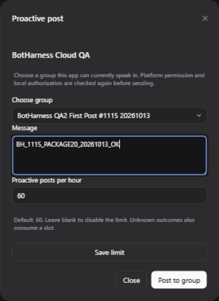

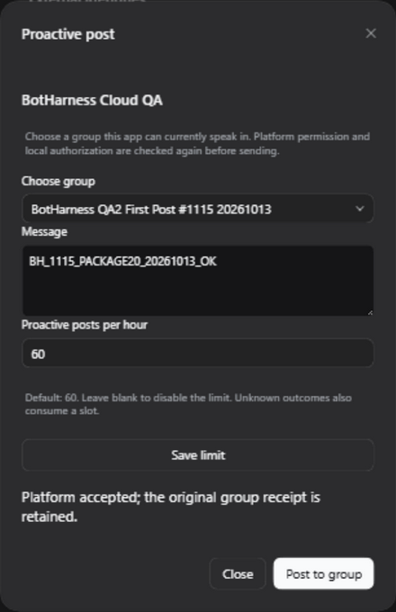

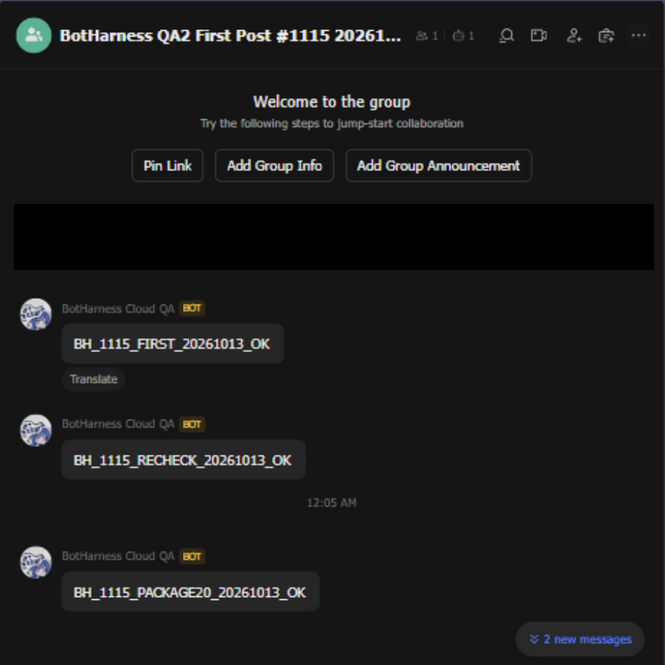

**Blocked zero-send case.** The actual Client blocked that group and confirmed revocation. Submitting `BH_1115_BLOCKED_PACKAGE20_MUST_NOT_SEND` produced the definite refusal shown below. Outbox and attempt counts stayed at 2, including the already accepted WeChat reply; the original Lark group contained no blocked marker. Allow again restored the group through the Client before receive tests.

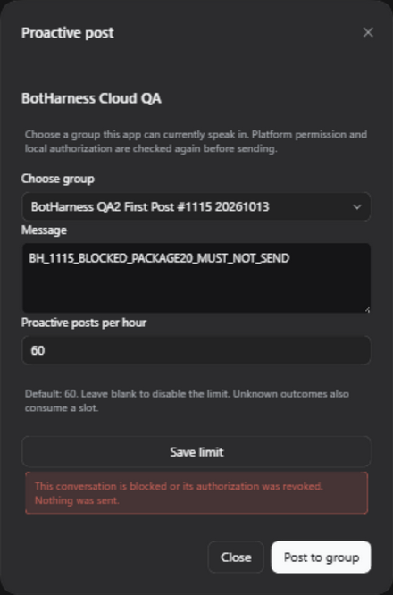

**WeChat setup and owner reply.** The same installed Provider generated a real 320 × 320 pairing QR in the inline dialog. The Human scanned it with the independent test account and confirmed connection. The dialog automatically reached Ready and the owner DM became default traffic. The Human sent `请只回复 BH_1111_PACKAGE20_20261013_OK` once and confirmed the original WeChat private chat displayed the complete exact reply. Canonical Outbox and attempt record acceptance with a conversation-matched version-1 receipt whose `identityKind` is `client-acknowledgement`. This is not a native server message-ID or own Echo claim. The platform did not request a separate verification-code challenge in this run.

**Lark reception.** After the #1115 first-post acceptance, the Human explicitly authorized two additional receive cases. The browser sent one group @ request for `BH_1111_LARK_PACKAGE20_AT_OK` and one QA2 DM request for `BH_1111_LARK_PACKAGE20_DM_OK`. Both complete replies rendered in their original conversations, with matched accepted native receipts. Screenshots were taken after scrolling those actual replies into view.

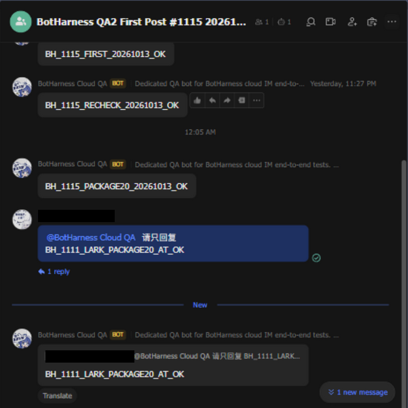

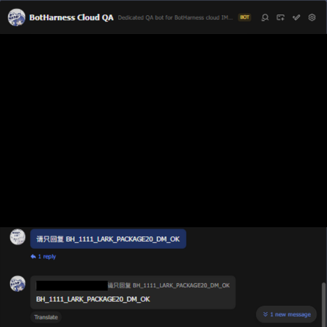

Final canonical counts: Bindings 2, Grants 4 (one revoked Lark Grant, three active), blocks 0, Outbox 4, attempts 4, Source Events 4, Inbox Admissions 3, Channel 1, placement 1. Exactly three new remote inputs were admitted: WeChat owner DM, Lark @ and Lark DM. No standalone Provider Session answered during setup/binding. The Lark reaction-feedback status separately reported failure; text reception and reply acceptance/rendering passed. Reaction permission/display is not qualified by this run, and no permission was changed to hide that limitation.

The receiver and the separate baseline UI Host were stopped by exact PID after verification. All three task ports were confirmed without listeners. No other task or QQ receiver was changed.

## Visual and automated checks

The actual installed picker was inspected in English/dark, Chinese/dark and English/light at 1280 × 800. The separate base `b6a7b0516bf854eef177b2e5cef5add9d2081ff7` capture shows the prior External identities entry point with no configured app/receiver. It is an explicitly labelled predecessor entry, not a data-matched bound-app comparison. Screenshots are cropped; unrelated chats and Human names/notices are covered. Pairing QR, credentials and native identifiers are not published.

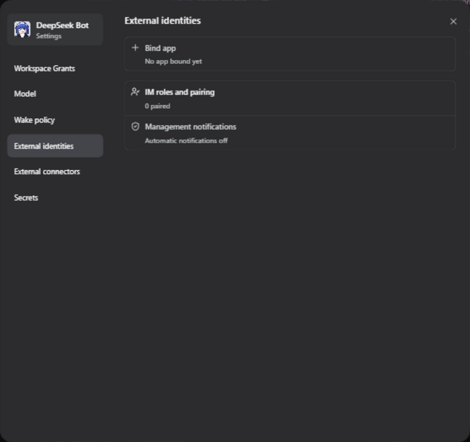

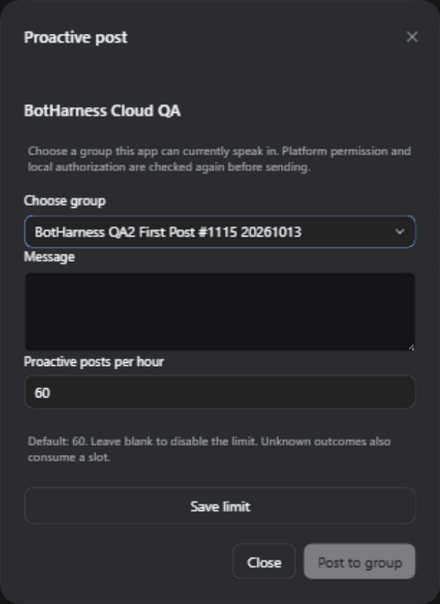

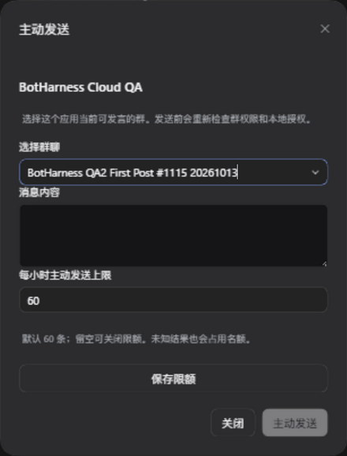

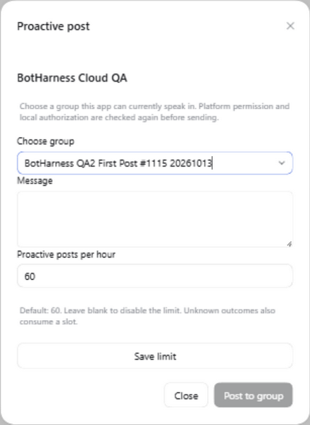

- Provider exact `0e5b447`: Linux Node 24.21.0 `npm ci` / `npm run check` passed build, package verification and 3,827 tests. Windows and Linux source builds have matching compiled entry hashes.
- Product exact `8c94b4b0`: Linux full suite passed 4,524 tests (13 skipped), 536 files (7 skipped), using two workers and a task-owned tmpfs `TMPDIR`. Disk-backed runs had timeout failures; no timeout was raised. Lint, format, typecheck, ledgers, build, slides and docs checks passed separately. Earlier Windows failures are not reclassified as all baseline failures.
- Added held-conversation regression and existing reachable/default-traffic tests: 67/67 passed on Windows. Artifact/development-pin guards: 35/35. Inline setup/secret-boundary/resume Client and Service regressions: 7/7. These focused checks include the pending pin/test-only changes and do not replace a new-head full suite.
- Packaged Client diagnostic reader reported `shell-ready`, exit 0, no earlier failure; actual DOM and native interactions were checked separately. Browser-control failures were inspected without resending markers.
- A local byte scan of 53 BotHarness durable-state/log and native Session files found zero occurrences of the actual Lark App Secret. This scan does not claim every possible QR encoding was searched; secret/QR DTO boundaries are covered by the focused contract tests. Provider-owned credential storage remains private and is excluded from the public evidence.

## Final main-line Product recheck

Product runtime [`822bff0bc6c4a3b0508cd34837d5b7deb8b5d214`](https://github.com/BotHarness/DeepSeekBot/commit/822bff0bc6c4a3b0508cd34837d5b7deb8b5d214) integrates main `40dffd7a65e4123b86fead860f65f3d2de070e29` (see the merge commit's actual parent identity). Main migrations 84–86 were preserved; this exact native candidate uses Generation 87 for the proactive limit. The current decision is [ADR-0197](../../adr/0197-reachable-posts-reuse-messaging-authority-and-outbox.md). Subsequent integration of main `dd24ddf7ff6b472a4635da0b0fa2a0cd5f2ce42d` preserves main's different Generation 87 Assignment access-scope migration and places the proactive limit at Generation 88. Task-only Generation 84/87 Profiles remain isolated; the native evidence below remains evidence of the exact recorded candidate. The connected-app Tool selection from main includes both `bridge_post` and `bridge_reachable_groups`; its positive, negative and resume cases passed.

A fresh Profile installed product candidate `1.2.2-qa.1115.20261014.2` under official RC1. The `.20` Provider archive is byte-identical to the QR/owner-DM-qualified archive above, not just equal in version or provenance. The Human again confirmed a current exclusive QA2 window and authorized exactly one new proactive post and one DM request. Inline Lark creation/binding reached Available with zero conversations; discovery listed the designated group.

The Client sent `BH_1115_MAIN87_POST_OK` once. The browser scrolled the actual Bot message into view and verified its complete rendering in the original group. One implicit Grant and one accepted Outbox/attempt were created without a Source Event reference; Source/Inbox/Channel/placement counts stayed 1/0/1/1. This is a new-Profile dispatch check, not another claim that the now-mentioned group was unmentioned.

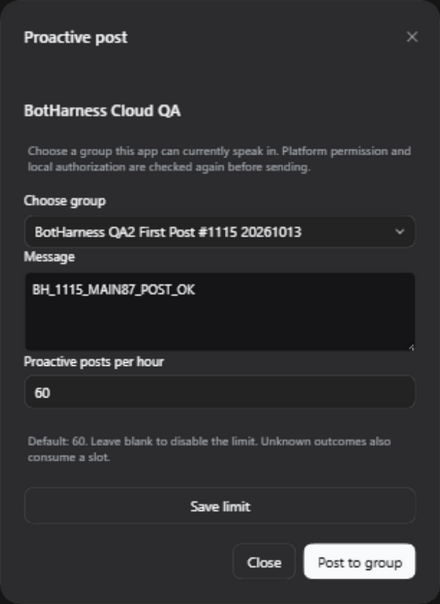

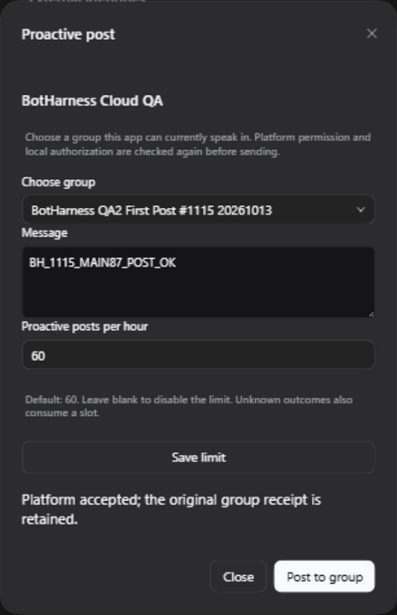

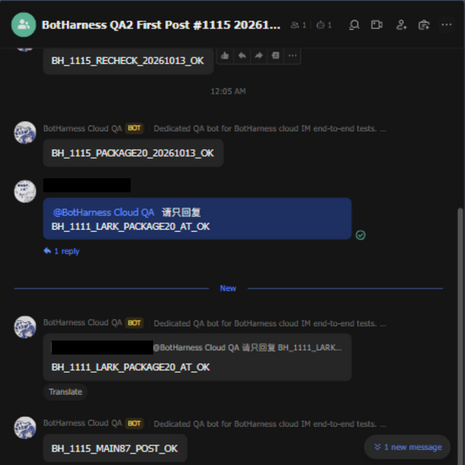

The browser then sent one `请只回复 BH_1115_MAIN87_DM_OK` in QA2's verified original DM. The complete exact reply rendered and was scrolled into view. Final counts are Binding 1, Grants 2, Outbox 2, attempts 2, blocks 0, Source Events 2, Inbox Admissions 1, Channel 1, placement 1. Both native receipts match their Grant conversations; only the DM reply has an inbound Source Event. No original first marker was repeated, and no further WeChat scan or input was needed.

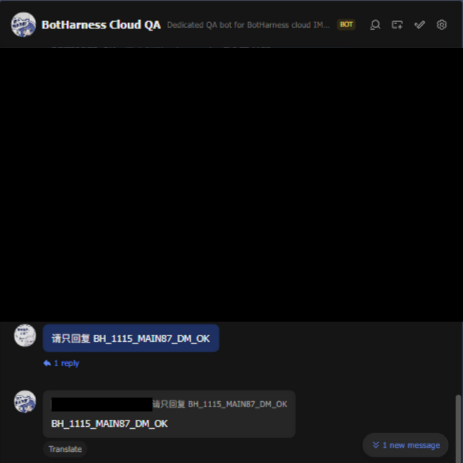

The actual installed Provider was hashed again: 422 runtime files, the same `1bda5990…` digest above, with scoped name/version and product-managed updates. The Client diagnostic reader reported `shell-ready`, exit 0, no prior failure. A fresh scan of 53 application-owned state/log and Session files found no actual Lark App Secret. The exact task Host was stopped; the four task ports had zero listeners and QA2's window was released.

A separate clean checkout of final base `40dffd7a65e4123b86fead860f65f3d2de070e29` was built and opened in the actual browser at the matching 1280 × 800, English/dark presentation. The image shows the predecessor External identities entry point without any configured Provider app; no receiver was started. The new picker has no direct predecessor. That baseline Host was also stopped by exact PID; all five task ports were confirmed without listeners.

[GitHub verify for runtime `822bff0b`](https://github.com/BotHarness/DeepSeekBot/actions/runs/38422833435) passed lint, format, typecheck, slides, all tests, build and generated-artifact checks: **4,591 tests passed, 13 skipped; 546 files passed, 7 skipped**. Separately, exact intermediate merge `ace46d25` passed the Linux local full suite (4,583 tests, 13 skipped; 545 files, 7 skipped) and lint/format/typecheck/build/slides/docs checks with two workers and task tmpfs. These results retain their exact revision/environment boundaries. Any later documentation-only evidence commit does not change the qualified runtime bytes.

[GitHub package preparation for `822bff0b`](https://github.com/BotHarness/DeepSeekBot/actions/runs/38422833504) independently passed the full checks, read the reviewed `.20` pin, prepared/dry-ran the package set and uploaded its review artifact. The exact locally natively qualified `.20` tarball also passed `npm publish --dry-run --access public --tag next`. Neither operation published anything to the registry.

## Provider publication and final integration

[Provider #27](https://github.com/DoodleBears/dsh-im/pull/27) merged at `f1a70eb05b342f437137dfa3e56f7164fb39ecdc`. [Provider-only publisher #1595](https://github.com/BotHarness/DeepSeekBot/pull/1595) merged at `d498fe0f63d8c2b0b725730a934c2515a6f11d33` after its full GitHub verification passed. Publication used the repository's existing protected GitHub Secret, without local npm login or changes to environment protection.

[Publication run 38436929281](https://github.com/BotHarness/DeepSeekBot/actions/runs/38436929281) submitted the exact qualified archive once at 2026-10-13 17:15 UTC. npm accepted it and reported processing; the initial one-minute readback timed out. Later independent read-only verification observed the published version and downloaded its actual registry archive. The full SHA-512 matches the qualified integrity above, and SHA-256 is `7093e339c9df429b4336f0d149bcc4ef35df532c012075fe1172670620ce3536`. Archive manifest, Provider source and compiled runtime provenance passed the same qualification guard. `next` points to `4.32.0-botharness.20`; `latest` remains `4.32.0-botharness.16`. No second publication was needed. The already-published path can verify the existing version without publishing again.

Product integration `34fe6d8540ef421a882c46654d07695fe20ba6c0` preserves main's Generation 87 access-scope migration and appends quota at Generation 88. Local typecheck, lint, format, build and 78 focused database/connected-app Tool/reachability tests passed. [Package preparation](https://github.com/BotHarness/DeepSeekBot/actions/runs/38436974662) passed independently; [full verify](https://github.com/BotHarness/DeepSeekBot/actions/runs/38436974698) remains bound to that exact revision. The native evidence above remains attached to its original candidates; no receiver was restarted and no marker was resent for this later merge.

Product #1559 closes #1115 and #1111 after its final checks and merge. Public stable Product install identity is unchanged. Slack and Discord reachability have automated native-API fixtures, not new real-platform acceptance. QQ proactive permission and own Echo remain separate work.

## Final review corrections

After npm publication, package preparation correctly refused a locally rebuilt Provider archive with different archive bytes. Preparation now verifies the rebuilt source/runtime identity, then downloads and verifies the exact reviewed registry archive before inventory/preflight. A real local reproduction altered only the candidate tarball bytes: the old preflight refused it, the new preparation restored the exact registry archive, and the qualified SHA-512 remained unchanged. This does not weaken the conflict guard or republish Provider .20.

A second real CI check identified an ambient build-config difference: of 422 runtime files, only `lib/client.js` differed, by the 14-byte `"use strict";` directive. In-repository staging inherited BotHarness's strict `tsconfig`; CI's external temporary staging did not. The [esbuild configuration behavior](https://esbuild.github.io/content-types/#tsconfig-json) explains that parent config and strict settings affect this directive. Staging now writes its own explicit `alwaysStrict: true` config, outside the packed runtime/file list. A real build outside the repository reproduced the old `168b0951…` digest before the fix and produced the exact qualified `1bda5990…` digest after it, with all 422 files. Runtime and archive guards remain unchanged, and the same already-published .20 archive is reused.

Review also found Client recovery gaps. Four component regressions reproduced on `62488b39`: unknown state/request identity disappeared on close, a late receipt was lost after dialog disposal, and a list-refresh error misreported a received acceptance. Scoped tab-local drafts now retain unresolved IDs, while an owning Host read-only query reconciles canonical Outbox results without sending. Later unbind or Provider loss cannot turn a prior receipt into a new request. Separate regressions cover reload, in-flight readback, late responses, corruption, bounded retention, explicit new sends after definite results and registry substitution/conflicts. The original native qualification above remains revision-bound; these corrections did not restart a receiver, scan WeChat again or send any new native marker.

Main integration preserves the newer design-system and secret-MCP decisions. Their concurrent ADR number collision is resolved by keeping the design system at ADR-0194, numbering secret MCP as ADR-0195 and this posting decision as ADR-0196; decision content and platform permissions are preserved. Native UI screenshots remain captures of the explicitly recorded earlier candidates. The new recovery-only interaction states have component/Host contract regressions; a fresh native capture is unavailable within the completed exclusive window and the one-send marker constraints. A review path is close/reopen after a lost or pending result and verify the same request ID via the read-only query, with no new native effect.

The final main integration also preserves main's remembered-secret-MCP migration at Generation 88 and appends posting limit plus independent quota revision at Generation 89 (ADR-0197). Experimental task Generations 84/87/88 remain isolated. Quota edits use their own compare-and-swap version without changing reception/reply/typing Binding fences. A controlled in-flight QQ source reply stayed accepted while the proactive quota changed, with its receiver subscription unchanged; stale quota edits are refused. Adapter preflight now classifies cancelled, unavailable-account, fingerprint and capability failures as not-started before invoking the checked native post. This changes Product guards only; the exact published Provider .20 is unchanged.
