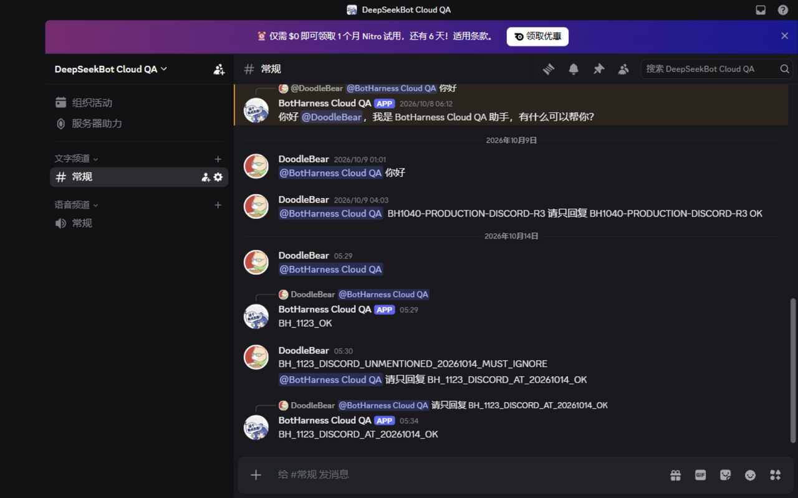
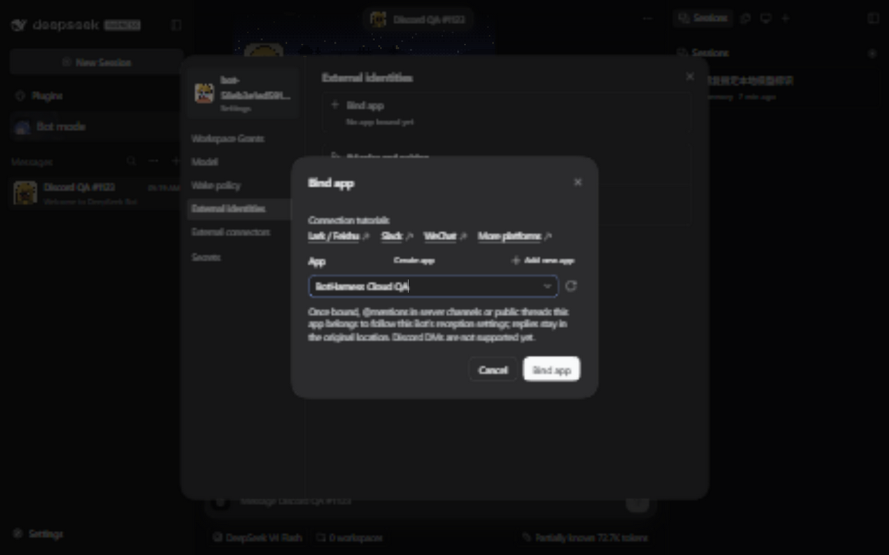
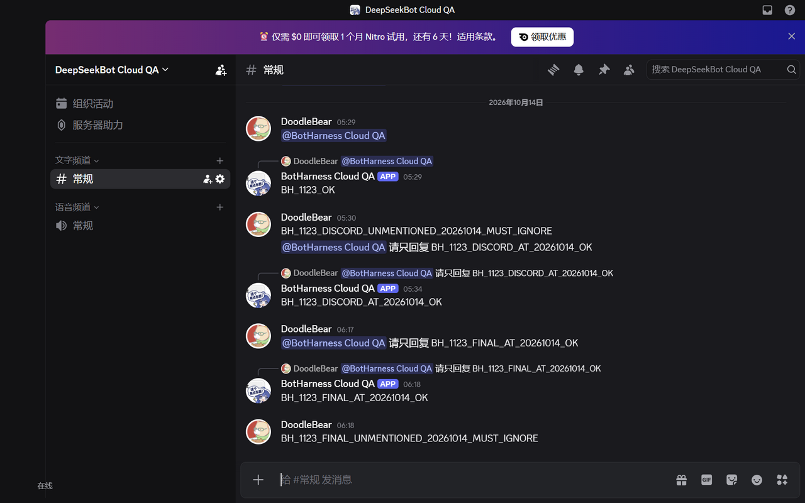
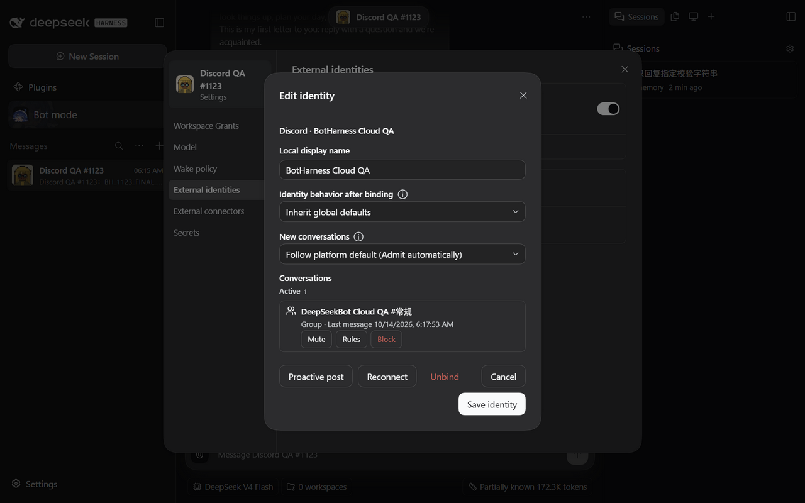

# Discord packaged binding qualification — 2026-10-14

Task `codex/local/01a1342d-5ce4-7872-9f9e-492a9caee393`; [claim](https://github.com/BotHarness/DeepSeekBot/issues/1123#issuecomment-6153367848), [Product #1618](https://github.com/BotHarness/DeepSeekBot/pull/1618), parent [#1107](https://github.com/BotHarness/DeepSeekBot/issues/1107).

## Exact artifacts and receiver window

The task installed six product tarballs for `0.1.0-alpha.1-qa.1123.tokenonly`, built from Product commit `f61f0f20c73df5f1872b368a0cf3c3f50657ba67`, in a fresh isolated Profile using official DSH `0.2.0-rc.1`. The Product UI runtime change is commit `adc38e36`; later commits change the QA setup scripts and documentation. This is installed-package qualification, not npm publication or qualification of a later merge.

The maintained Provider is the already published `@botharness/im-provider@4.32.0-botharness.20`, sourced from `0e5b447f45e4a44d4089eac16cc1fa5673dbd66d`. Its 422-file runtime digest is `1bda59905abe9b761ce7c0d113acdc4b4523d96bc0293b212c4708d0c8dbb733`; archive integrity is `sha512-cJ9kE1H+uytTDh1s9Tg8uJtho6y08wLvc9zqks1S+SrEb7HOfNoW/l4l6BKjtZXtW1KwigN0Ezlrl/siym9nfw==`. No new Provider publication is needed for this slice.

The Human freshly confirmed exclusive **Discord QA1 / BotHarness Cloud QA** before this receiver start. The designated destination was **DeepSeekBot Cloud QA / 常规**, verified in the signed-in Discord web client as account **DoodleBear**. The Token was entered privately by the Human. Read-only native API checks authenticated the actual App/Bot identity, guild/channel association and existing View Channel, Read Message History and Send Messages permissions. No Token reset or platform permission change was performed.

The empty Profile was configured for `external-consumer` before credentials were installed. A real local Bot DM returned the complete `BH_1123_LOCAL_MODEL_20261014_OK`, establishing model usability without an external Discord message.

## Actual binding and native messages

The real installed Client offered **BotHarness Cloud QA** as an enabled Discord choice in **External identities → Bind app**. Selecting it showed the qualified Discord-specific hint. Confirming **Bind app** persisted one available, receiving Binding, initially with zero Grants and zero Outbox intents; no saved delivery target or per-conversation authorization was supplied. The ready state and empty conversation list were inspected in the native Client.

The original plan authorized one @ request and one unmentioned negative. Browser text insertion initially updated the composer DOM without preserving the appended text in Discord's editor state. The submitted first message was therefore only the actual Bot mention; the original channel displayed the reply `BH_1123_OK`. This proved transport and rendering but did **not** prove the intended marker request. It was not counted as a complete marker match.

The unmentioned message `BH_1123_DISCORD_UNMENTIONED_20261014_MUST_IGNORE` was then submitted once. The original channel displayed its full text with no native mentions. It created no external Source Event, Admission or Outbox intent, and no reply. Observation continued for more than three minutes, including the subsequent positive test.

The Human explicitly authorized **one additional @ request** and continued the exclusive window. Browser key input submitted the full `@BotHarness Cloud QA 请只回复 BH_1123_DISCORD_AT_20261014_OK` exactly once. The original channel visibly displayed the complete Bot reply **`BH_1123_DISCORD_AT_20261014_OK`**, attached to that request. Independent native REST reads confirmed the Bot author, exact content, original channel and reply reference.

| Native record                | Message ID            | Result                                                |
| ---------------------------- | --------------------- | ----------------------------------------------------- |
| Initial mention-only request | `1559664410312577025` | Actual mention; appended marker absent                |
| Initial reply                | `1559664446928846859` | `BH_1123_OK`; reply to the initial request            |
| Unmentioned negative         | `1559664615107985420` | Full negative marker; no mentions, admission or reply |
| Authorized complete request  | `1559665519416705155` | Actual mention plus complete requested marker         |
| Complete reply               | `1559665548751798273` | Exact marker; reply to the complete request           |

Canonical final counts were **two** external Source Events, **two** `group-mention` Admissions, both handled/resolved `done`, and **two** `provider-accepted` Outbox intents with native receipts. They correspond to the initial mention-only request and the authorized supplemental request; the negative contributes zero. There is one implicit conversation Grant. Local model-test and welcome-letter events are excluded from these external counts.

The complete request's Source Event is `im-e7239aa78fb3a52fd3503cc759db19bee56c014bd8db55ad77fb9a3725d90410`. Its Outbox text and native receipt match the complete reply above. No standalone Provider session was used for this path.

The exact task-owned Host was stopped at **2026-10-13 20:34 UTC** after capturing the result and reading the canonical facts; its process and listening port were absent afterwards. The exclusive QA1 window ended. A byte scan of 54 task-owned BotHarness state/log and native Session files found zero occurrences of the actual Bot Token; Provider credential storage was excluded and remains private.

## Initial captures and historical delivery checkpoint

The following are real captures from this native run at 1280 × 800. The Discord capture hides only unrelated server navigation and account controls before capture; the designated channel and actual messages are unchanged. The native Client captures are English/dark and contain only task-owned QA data.

These initial captures are after-state/runtime evidence, not matched base/head pairs. At this checkpoint, the original receiver window had ended and the Profile had one conversation. The following final run resolves the previously missing matched evidence without reusing that expired window.

Focused checks passed: 32 registry/Client tests, 75 earlier Product discovery/default-traffic/Discord regressions, and 28 exact Provider-source Discord tests. Lint, whole-repository formatting, typecheck and both Release Ledgers passed on `f61f0f20`; the installed artifacts were built successfully.

The historical full Windows run was **not green**: 4,496 passed, 144 failed, 36 skipped. Failures included filesystem/`fsync` errors, Windows path/mode assumptions, timeouts and a Client-bundle VM failure. This record does not reclassify every failure as baseline. The final Linux full suite and official CI below provide the complete supported verification run; native Windows package acceptance is recorded separately. Discord DMs, pairing and interactions remain #1042 and were not tested here.

## Final integration, matched UI and native qualification

The Product branch integrated main `e363a647876cf7cc41ee649e1de52c0604558ef5` in merge `510e1b84871d2137ab6ad5482f4b1d67872eb7a8`. The conflict resolution preserves main's design-system `FormDialog`/`Field` composition and the three Discord-specific hints. No Core, Browser or Computer runtime source differs from that main revision.

The Human explicitly granted this task a continuous **10-hour exclusive QA1 window**, starting from the confirmation recorded at 2026-10-13 20:49 UTC. This is live task authorization, not a lease inferred from the registry's old timestamp. Within that window, only one task-owned receiver ran at a time, with the unchanged `external-consumer` configuration and existing platform permissions.

Two installed candidates were built from exact source: baseline `e363a647` as `0.1.0-alpha.1-qa.1123.base`, and final runtime/test head `a457b52b0bbe6bc277ba041b72114b3d9d178c5c` as `0.1.0-alpha.1-qa.1123.final`. Both use official DSH RC1 and the same immutable Provider .20 archive/digest above. They ran serially in one new isolated Profile. Actual Client binding, readiness and the empty conversation list were captured before external traffic, in English/Chinese and light/dark at 1280 × 800: **12 matched pairs / 24 real screenshots**. Between locales/revisions, the same task Bot was unbound and rebound with zero Grants and zero Outbox intents; no external message was sent for capture. See [all matched comparisons](ui-comparison.md).

The final head's actual local DM returned `BH_1123_FINAL_LOCAL_MODEL_20261014_OK`. Its genuine original-channel request and reply were then verified through the signed-in Discord web client and independent read-only native REST:

| Final native record  | Message ID            | Result                                                                        |
| -------------------- | --------------------- | ----------------------------------------------------------------------------- |
| Full @ request       | `1559676576705286167` | `@BotHarness Cloud QA 请只回复 BH_1123_FINAL_AT_20261014_OK`                  |
| Bot reply            | `1559676609038917795` | Exact `BH_1123_FINAL_AT_20261014_OK`, original channel, reply to that request |
| Unmentioned negative | `1559676793584099359` | `BH_1123_FINAL_UNMENTIONED_20261014_MUST_IGNORE`; no mentions or reply        |

There was exactly **one** external Source Event (`im-1e063ba97839cbe5d748777c49017635127cf436ccfd51f5563179cc1e2eee08`), **one** handled/resolved `group-mention` Admission, **one** `provider-accepted` Outbox intent/receipt, and **one** implicit conversation Grant. The negative contributed zero Source Events, Admissions and Outbox intents throughout more than 90 seconds of observation. The Client listed the actual `DeepSeekBot Cloud QA #常规` conversation afterward. No initial-marker retry or additional external message was used in this final run.

The final task Host was stopped at **2026-10-13 21:20:57 UTC**; its process was absent and the local port refused connections. A fresh byte scan of 54 task-owned BotHarness state/log and native Session files found zero actual Bot Token occurrences. Credentials remain in the private Provider store. Neither the unused remainder of the window nor this evidence starts a receiver.

## Final full verification and closure scope

The existing Client bundle test reproduced its build failure on both baseline main and the integrated head. The inline `tsdown.build` call also auto-loaded the nine-output root configuration, causing repeated builds into the same overridden output directory. Adding `config: false` confines the test to its explicitly supplied bundle options; all six existing bundle contract assertions pass on Windows and Linux. No assertion, timeout or runtime build guard was relaxed. This matches the pinned implementation and [tsdown's documented config-discovery behavior](https://tsdown.dev/options/config-file#disabling-the-config-file).

On exact `a457b52b`, a clean Linux checkout using Node 24.21.0 / pnpm 12.4.2 passed lint, formatting, typecheck, slides preparation, all **4,713 tests** (10 skipped; 560 files passed, 6 skipped), and build. Two test workers and a task-owned tmpfs temporary directory were used without changing test timeouts or assertions. [Official GitHub verify run 38466649850](https://github.com/BotHarness/DeepSeekBot/actions/runs/38466649850) independently passed the repository's complete lint/format/typecheck/test/build/docs pipeline with the same full test counts. Native Windows acceptance, full Linux tests and CI are distinct evidence.

#1123's maintained checked Provider and unsupported-with-reason discovery already landed through #1559; current automated regressions retain both behaviors. This PR completes the missing native checked binding qualification, truthful Discord copy, reusable QA setup and visual evidence. All seven original #1107 slices are closed; #1123 is its last remaining native child. PR #1618 can close #1123 and #1107 on merge. Discord DM/pairing/interaction qualification remains #1042, consistent with #1107's explicit scope boundary.
