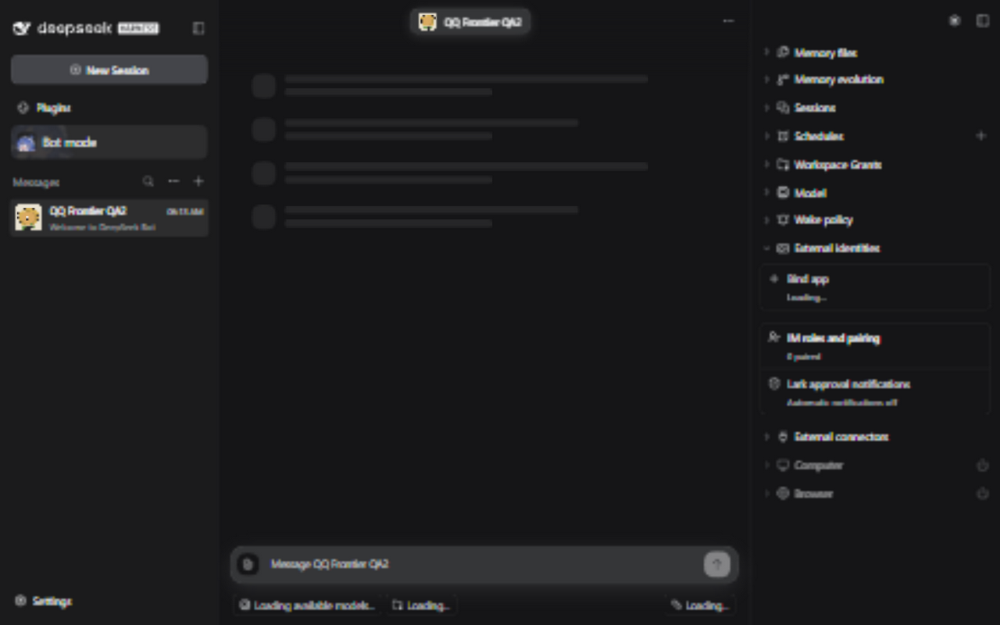
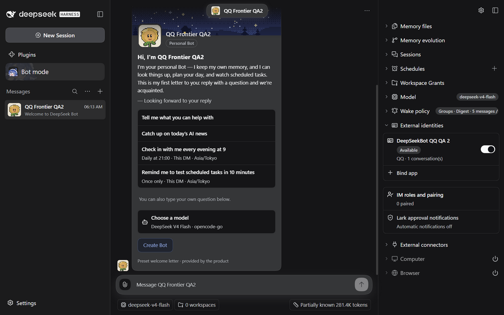

# Two-document Web request recovery

Issue: [#1451](https://github.com/BotHarness/DeepSeekBot/issues/1451).

## Capture provenance

- Before: native DSH `0.2.0-rc.1`, product `36ae449e2cf3c83f3c7804799c2ad8f81ce7a5c0`.
- After: the same persisted isolated QA2 Profile, product `dab3fa85de2e5a3e9e22305fec9b5e9dd85c4e31`, maintained Provider `018533fdd83ce1b19713b06bbcb1a0f9d974042b`, Node24.21.0. Only this task's Host restarted; QA1's existing VPS receiver stayed unchanged.
- Actual collaborative Chromium documents; same English locale, dark theme, test PersonaBot and1280×800viewport. The captures are original PNGs; no text, state or UI was painted into them. The before capture is soft, so the API/DOM feedback loop separately establishes the stalled state.
- Before capture2026-10-11UTC: a second native document remained at Loading; an authenticated messagingSnapshot read timed out at6003ms. Leaving the second document restored the first document's same read at951ms without changing code/Host/Logger.
- The first candidate `04efa8db` shared only roster/Activity; it still failed warm two-document request checks because native client-hmr owns another SSE. It is not accepted as the fix.
- Final combined candidate: both actual documents render the retained real DM, models and qualified QQ binding. Warm authenticated readback confirms native RPC `ok=true`, one identity, no Loading, at1224ms and690ms. [Safe aggregate verification](verification.json) contains no credentials, raw API payloads, native IDs or logs.
- Current fresh document console has no new error. Earlier native unknown-Session/Connection errors and Host-restart failures remain preserved separately; this fix does not claim their causes resolved. Background diagnostic freshness is separate from actual DOM/API inspection.
- QQ authorization and binding survived restart and the receiver reconnected. Human confirmed the fresh original-group reply `QQ_FRONTIER_QA2_20261012_WEB_D_OK` after this final restart. Native readback associates one handled Inbox, available Source, linked own-App reply and native receipt (settled2026-10-11T22:45:19.420Z). These browser images are not QQ group-reply or Echo proof; own Echo remains unqualified.

## Actual before and after

