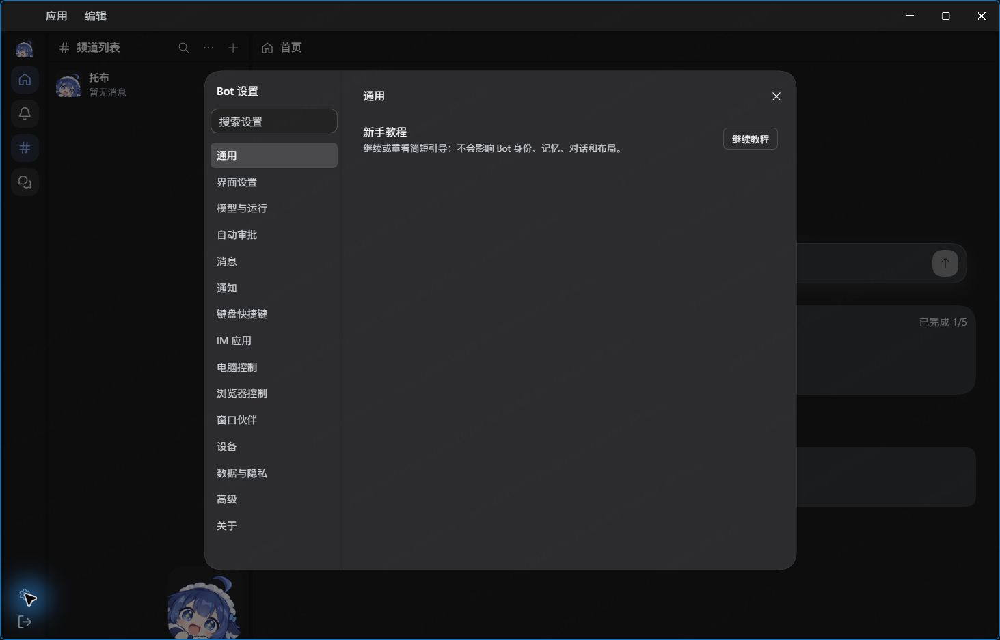
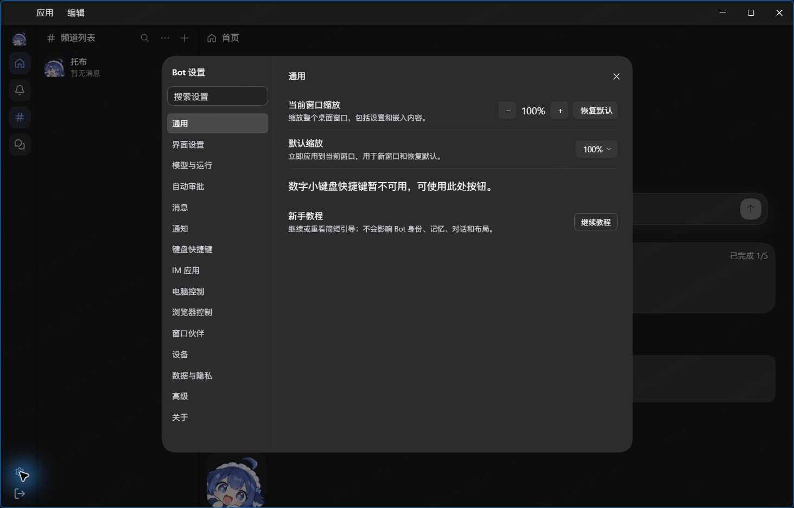

# Windows window zoom candidate — partial qualification

Recorded 2026-10-20 (Asia/Tokyo). Refs [#2270](https://github.com/BotHarness/DeepSeekBot/issues/2270),
[takeover handoff](https://github.com/BotHarness/DeepSeekBot/issues/2270#issuecomment-6274994144) and
[task claim](https://github.com/BotHarness/DeepSeekBot/issues/2270#issuecomment-6276850619).

**Draft only. Windows qualification is incomplete. Linux remains open. No merge or release.**
Task: `codex/local/01a155e2-bea7-79d3-a3d1-c3bd465071d5`.

## Source and artifact identity

- Fresh `origin/main` base: `55c88483002ee10a87a6be262c37c327643a0bee`.
  Implementation: `b27a0cee2ea91f6be09a4830f2f59551ea4a81ab`, branch
  `codex/2270-windows-window-zoom`, in a separate worktree. Existing checkout changes were preserved.
- Installed native observations below use **candidate 1**, `0.0.0-qa.2270.1`, built before the
  implementation commit from a dirty tree based on that base. Its exact dirty source tree was
  not retained as a commit. These results do **not** qualify the final source SHA.
- **Candidate 2**, `0.0.0-qa.2270.2`, was built and packed from implementation SHA
  `b27a0cee2ea91f6be09a4830f2f59551ea4a81ab`. It has **not** been installed or native-tested.
  Its `artifacts.json` SHA-256 is
  `e108a50f1770140158b077836214106fd274000856af20bd47f7064dd6781045`.
- [Artifact manifest](windows-artifacts.json) records both candidates' six tarballs, SHA-256 and
  SHA-512 integrity, installed Client and compatibility hashes, and official Desktop hashes.
  Candidate packages remain machine-local QA artifacts; they were not published to a registry.
- Official Windows Desktop FileVersion is `0.2.1-rc.2` (numeric ProductVersion `0.2.1.0`);
  observed Host boot release `0.2.1-rc.2`, shell `win32`, Shortcut Service `windows`.
  The official installer SHA-512 matched its update feed. Executable and ASAR hashes were
  rechecked after testing and match the initial values. Neither upstream source nor ASAR was edited.
- Compatibility changes are in the product-owned copy of the native theme, under its existing
  namespace. The copied Host module's existing schema-import adaptation explains its output
  hash differing from `hostBefore`; it is not an edit to the official Desktop installation.
- The pinned IM Provider source remains `beaed4a6dabb583654d28fb09298716267039b4a`, with its
  original DSH provenance `0.2.0-rc.2`. Composed artifact Host release is independently
  `0.2.1-rc.2`; source and compiled digests remain checked rather than rewriting provenance.

## Actual Windows environment

`Get-CimInstance Win32_OperatingSystem` reports **Microsoft Windows 11 专业版**, x64,
version `10.0.26200`, build **26200.9457**, DisplayVersion **25H2**. The legacy registry
ProductName says Windows 10 and is not used as the actual OS name.

Observed `devicePixelRatio` at 100% application zoom is `1.1399999856948853` (about 114%).
This is one observed display configuration, not qualification at 100/125/150/200% system scaling.
Node `24.21.0`, pnpm `12.4.2`.

Exactly one task-owned isolated DSH Profile and browser user-data directory were reused.
The same Profile is preserved for continuation. Daily installation, other sessions, credentials,
private paths, access tokens and unrelated conversations are excluded from this report.
The saved test state is default 120%, current 144%; restoring pre-test preferences is pending.

## Native observations on candidate 1

| Check                                                   | Observed result                                                                                                        | Status / limit                                                                                        |
| ------------------------------------------------------- | ---------------------------------------------------------------------------------------------------------------------- | ----------------------------------------------------------------------------------------------------- |
| Before explicit enable                                  | Product installed, zoom override inactive; no zoom settings/target                                                     | Observed candidate baseline, not a pristine main-package qualification                                |
| Formal enable while closed, then cold start             | Packaged setup enabled the copied theme; Windows compatibility lease acquired; settings and one CLI target appeared    | Passed partial install/enable path                                                                    |
| Package transaction while running                       | `desktop-zoom-setup-desktop-running` refusal                                                                           | Passed refusal; no process was killed                                                                 |
| Native settings                                         | Window zoom and device default controls render at 100%                                                                 | Captured below; not full geometry acceptance                                                          |
| Physical Ctrl+0, default 120%, current 144%             | 144 → 120%; default remains 120%; one native Digit0 event, one registered zoom handler call, one zoom-storage write    | Passed reset behavior; draft and selection 26/26 retained; focus preservation **unproven**            |
| Requested Equal / Minus / Shift+Equal / Digit0 sequence | Five events, five handler calls and five writes: 120 → 144 → 120 → 144 → 172.8 → 120%                                  | **Discrepancy**: an additional ordinary Equal event occurred; four-action qualification is not passed |
| Isolated physical Ctrl+Shift+=, releasing Equal first   | 120 → 144%; one native Shift+Equal event, one handler call, one write; draft retained                                  | Passed isolated action; does not resolve the prior extra event                                        |
| Ordinary Equal and Minus                                | Sequence contains 120 → 144 → 120%                                                                                     | Observed, but not a clean independent one-action acceptance                                           |
| Number pad                                              | Actual pinned Windows shortcut protocol rejects NumpadAdd, NumpadSubtract and Numpad0 with `Unsupported shortcut code` | Explicitly unsupported in this candidate; physical keypad behavior not claimed                        |
| Minimize/restore                                        | Human restored the same window                                                                                         | **Not** a guest-painting or pixel qualification                                                       |

Handler counts came from V8 precise coverage of the registered zoom `run` callback, separately
from passive native keyboard observations and zoom-key `Storage.setItem` counts. The instrumentation
did not route keys or supply a second zoom handler. Raw coverage and ARIA records remain private.
The native automation driver emitted an empty physical `KeyboardEvent.code`, so its simulated
Ctrl combinations were not counted as shortcut proof. The Human supplied the physical keys.

The two real native screenshots show **candidate 1 with override disabled vs enabled at 100%**,
in the same Profile. They prove settings visibility, not candidate 2, focus, IME, DPI or guest pixels.

| Disabled                                                                                                          | Enabled                                                                                                                    |
| ----------------------------------------------------------------------------------------------------------------- | -------------------------------------------------------------------------------------------------------------------------- |
|  |  |

## Source and browser checks

| Check                                                                   | Result                                                                                                                                                                                                                                             |
| ----------------------------------------------------------------------- | -------------------------------------------------------------------------------------------------------------------------------------------------------------------------------------------------------------------------------------------------- |
| Frozen dependency install, lint, format check, typecheck, product build | Passed on implementation work; lint has existing warnings                                                                                                                                                                                          |
| Focused zoom / desktop / workspace / wallpaper / provenance tests       | 16 files, 87 tests passed                                                                                                                                                                                                                          |
| Related-test selection                                                  | 26 files / 308 tests passed; 1 file / 1 test failed in `scripts/test/e2e-fresh-profile-install.test.mjs` because its literal `file:/release/...` expectation receives Windows backslashes. That test and its helper are unchanged against the base |
| Dock browser fixture                                                    | All 17 levels and splitter / input checks passed                                                                                                                                                                                                   |
| Workspace chrome browser fixture                                        | 204 cases passed                                                                                                                                                                                                                                   |
| Selector and Tooltip browser fixtures                                   | 136 selector and 204 Tooltip cases passed                                                                                                                                                                                                          |
| Wallpaper browser fixture                                               | 34 cases passed                                                                                                                                                                                                                                    |
| Product and DSH Skill changelog checks                                  | Passed                                                                                                                                                                                                                                             |
| CI plan                                                                 | Related tests plus docs-site public surfaces selected; hosted CI not yet known                                                                                                                                                                     |
| Local docs prerequisite                                                 | `pnpm slides:build` failed at existing `sync-slides.mjs` spawning `pnpm` (`ENOENT` on Windows); dependent docs public-surface test not run                                                                                                         |

Browser fixtures are dependency/layout evidence. They do not qualify Windows native rendering,
embedded focus or application lifecycle. macOS native regression, full suite and final-head hosted
CI are separate outstanding statuses.

## Remaining native acceptance gates

- Install candidate 2 through the candidate package, explicitly enable while closed, cold boot
  the **same** Profile/user-data, rediscover access metadata and Client ID, and repeat the minimum
  keyboard/CLI loop with exact-source evidence. Independently retest Equal, Minus and the extra
  event discrepancy. Prove retained active focus, selection, draft and unchanged native fonts.
- Main input plus same-origin iframe, cross-origin iframe and actual leased business Browser
  webview: all four shortcuts, one native action / handler / write per physical key, guest zoom,
  input and caret preserved. Verify custom bindings, Ctrl+0 conflicts, unbinding, recording,
  repeat and real Chinese IME with an unconfirmed candidate.
- Native panel splitters and allocation, anchored selector/menu/Tooltip/dialog geometry,
  click/scroll/drag, Escape/focus return, settings recovery at 23/430%, and 83/100/120/144%.
  Light/dark themes, wallpaper coverage and header material need native pixel checks.
- Native Windows menu, caption buttons, drag, title drag vs panel drag, double-click maximize,
  window/maximized/fullscreen modes; system scaling 100/125/150/200% and cross-monitor DPI where
  available. Unavailable hardware scenarios remain untested.
- Independent webview foreground gate: create/resize real leased guests while visible and
  minimized, retain RGB ruler/input/identity/navigation count, minimize about eight seconds,
  then ordinarily restore at fixed geometry and inspect native whole-window pixels. Do not
  refresh/recreate, jitter size or force fullscreen to hide a rendering failure.
- Full lifecycle: real exit/restart persistence for zoom/default/draft/layout/fonts/wallpaper;
  exit/reenter Bot mode; closed-app disable with font ownership restored; upgrade/rollback and
  product removal. Test unsupported Host switches and keep the native theme identity.
- Installed CLI revision checks, stale revision, busy/offline Client, storage failure and timeout
  readback without blind replay; ordinary Web native zoom, macOS regression, and multiple windows
  only when the real shell supports them. Restore the Profile's original device preferences.
- Final exact-head CI, independent review and Human QA remain pending. A Windows-only result
  cannot close the Linux scope of #2270.
