# #1433 — Group composer Workspace Grant verification

## Revision and dependency gate

- Issue: [#1433](https://github.com/BotHarness/DeepSeekBot/issues/1433); parent: #1431.
- Dependency #1432 was explicitly Human-accepted in [the acceptance comment](https://github.com/BotHarness/DeepSeekBot/issues/1432#issuecomment-6113040095), not inferred from its closed state. PR #1441 merged; [completion](https://github.com/BotHarness/DeepSeekBot/issues/1432#issuecomment-6113130888) records the accepted baseline.
- Original accepted base and before capture: `184edf23b422a69b9f04bdfde29e35e40c88f3a0`. The DM-card alignment revision incorporates refreshed main `e513ac414ab6c38ee95173377ebeb0950324d7dc`; historical captures are not rebound to that newer baseline.
- Task: `codex/local/01a12c92-1feb-7823-8fb8-f603fad9ca1d`; [claim](https://github.com/BotHarness/DeepSeekBot/issues/1433#issuecomment-6113191966); branch: `codex/1433-group-workspace`.
- Run date: October 12, 2026, Asia/Tokyo (October 11, 2026 UTC). The PR body and outcome comment record the current head. The screenshots and real-model delegation below belong to `c5f962824d8aab1ab5103f4784e6ab8f20f88a4a`, before the compact-modal feedback revision; they are not claimed as screenshots of the revised layout.

## Latest Human clarification: defaults to all eligible Bots

Human superseded the earlier default-unselected requirement: the Group entry now initially selects all currently eligible Bots and allows unchecking any Bot to narrow the target set. Grants still belong to each Bot, never to the Group or its Human members. Nothing is written until directory/access confirmation. Paused/deleted Bots are excluded; custom choices, including an empty choice, are preserved; the preview snapshots the targets, so later joiners receive no Grant through that confirmation. All earlier default-unselected screenshots and steps below are historical, not evidence of this updated behavior.

Focused regressions cover initially unloaded members, eligible-only defaults, subset selection, empty selection, late joiners, confirmation-only writes, partial failures and readback. Updated runtime evidence and the final revision are recorded separately in the PR; neither the previous 253-test run nor the old images are relabeled as validation of this semantic change.

Updated validation: 16 focused files / 254 tests pass; typecheck, lint including ledger checks, format check and build pass.

### Refreshed native run and screenshots

The task-owned isolated Host runs implementation `7204043f036833589f1413b90cee7630f4e889c8`. On October 12, 2026, T3 capture recovered; each published image was visually inspected, and stale captures were discarded. Group and DM both use the native 380 CSS px modal. Group crops are 420 × 650 screenshot pixels; the DM crop excludes surrounding private chat content.

1. Open a new three-Bot Group's workspace chip: all three eligible Bots are checked by default. Enter the disposable default-all directory, preview three targets, and submit through the UI. All three rows show **New Grant created**.
2. Return to selection, uncheck Unselected QA, and preview a separate subset directory for Selected QA and Partial QA. Remove Partial QA using canonical membership fixture setup after preview, then submit through the real UI: Selected QA succeeds and Partial QA fails with **Bot is no longer an eligible Group member**.
3. Use **Read back and retry** twice. Successful Grant identities and counts do not change. A second three-Bot Group confirms the already authorized default-all directory: all three rows show **Authorized · reused**.
4. Open Selected QA's existing DM Workspace Grants modal: Memory Repository and the three folder rows remain on the shared compact card surface. Capture the reuse result and DM comparison in light appearance too.

Canonical readback uses `workspacePath`, not a generic `path` field:

| Bot           | Default-all directory | Subset directory |
| ------------- | --------------------- | ---------------- |
| Selected QA   | 1 Grant               | 1 Grant          |
| Unselected QA | 1 Grant               | 0 Grants         |
| Partial QA    | 1 Grant               | 0 Grants         |

All Grants retain `orchestratorWrite: false`; reuse/readback retries preserve their identities. The unselected Bot has no Grant for the subset directory, even though it intentionally has a Grant for the separate default-all directory. These are path-specific results, not global zero-Grant claims.

| Historical default-unselected before (`53da03fb`)                                           | Current default-all selection (`7204043f`)                                                                  |
| ------------------------------------------------------------------------------------------- | ----------------------------------------------------------------------------------------------------------- |
| 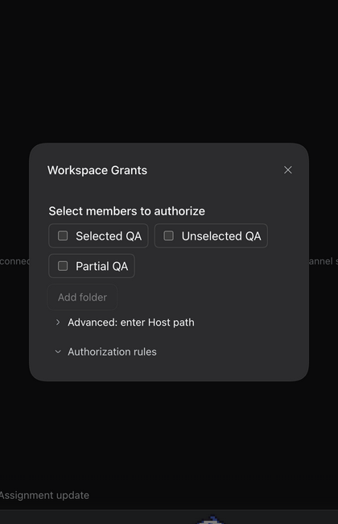 | 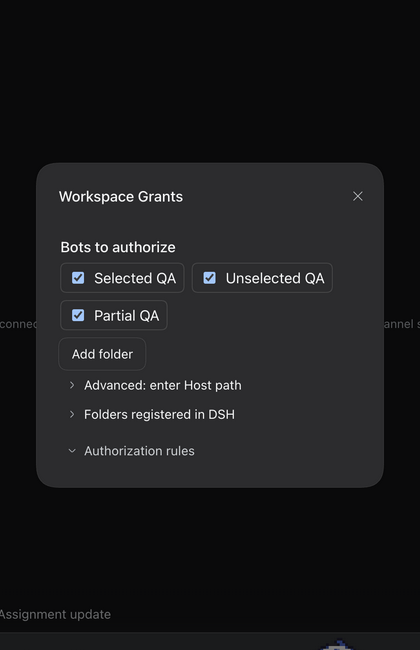 |

| Default-all creation                                                                      | Optional subset selection                                                         |
| ----------------------------------------------------------------------------------------- | --------------------------------------------------------------------------------- |
| 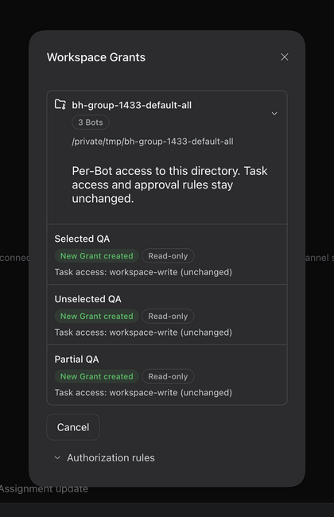 | 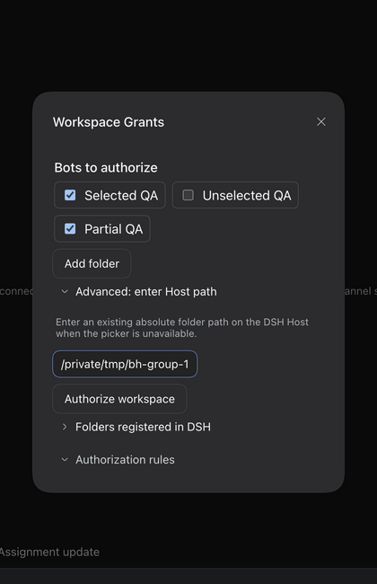 |

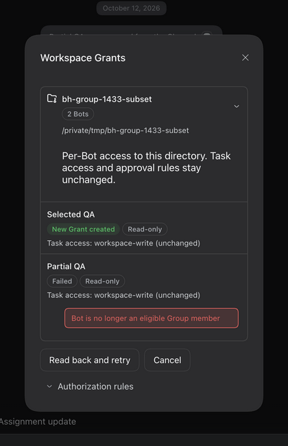

| Current DM folder surface                                                       | Current Group reuse results                                                                              |
| ------------------------------------------------------------------------------- | -------------------------------------------------------------------------------------------------------- |
| 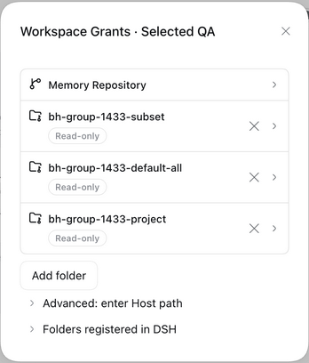 | 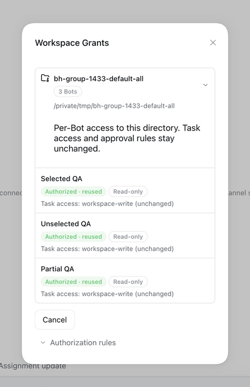 |

This run refreshes default-all/subset authorization, partial failure, reuse and retry evidence. It does not rerun the real-model Assignment: that evidence remains anchored to historical `c5f96282`. Runtime screenshots are not Human visual acceptance. Human has separately authorized merge after screenshots are supplied; exact-head checks and review findings remain independent gates. No deployment is requested.

## Historical setup and proof boundaries

Two disposable, isolated native DSH `0.2.0-rc.1` Profiles run through the repository's verified dev launcher: baseline and implementation. The implementation uses a real DeepSeek model, not a canned reply. The Group and three synthetic PersonaBots are prepared through authenticated native RPC as **fixture setup**, not counted as UI evidence. The disposable project directory contains a README and no personal files. Opaque Bot, Grant, Workspace and Session IDs, credentials and Profile paths stay private.

The browser is the T3 collaborative preview. Slash selection, checkboxes, confirmation, cancellation, approval and normal Group messaging use the rendered React UI. Some controls are activated using DOM `click()` through preview evaluation after locator actions fail. The unsent text attachment is a synthetic browser `File`, attached through the existing file input and its real change handler. Canonical RPC reads corroborate the visible behavior; they are not substitutes for model execution or screenshots.

Directory preview may register and resolve a native DSH Workspace. It does **not** create a Workspace Grant. There is no Channel Workspace Binding, Group Grant, shared cwd, model batch change or Companion batch change. Permission proof concerns the existing Workspace Grant/Assignment boundary, not an assertion that every opaque tool is an OS sandbox.

## Native Group run

1. Open `Group Workspace QA`; type `/workspace` and select its existing composer shortcut. All members start unchecked; directory actions are disabled until a member is explicitly selected.
2. Select **Selected QA** and **Partial QA**; leave **Unselected QA** unchecked. Use the shared folder picker to resolve the disposable project directory. Before confirmation, all three Bots have zero Grants and zero Assignments.
3. Confirm both targets, canonical directory, existing `workspace-write` Assignment mode and read-only Orchestrator access. Remove Partial QA from this test Group between preview and confirmation using the existing membership operation.
4. Submit through the UI. Selected QA receives one new Grant. Partial QA is refused as no longer eligible. Unselected QA receives no Grant. The successful row remains visible alongside the refusal.
5. Retry unfinished members through the UI. Failed membership readback prevents another write; the selected Grant keeps the same identity and count.
6. Mention Selected QA through the actual Group `@` picker and send a normal request to create `selected-marker.txt` through an Assignment. Its real Assignment completes with the active Grant, project cwd, `workspace-write`, approval `ask`, and a completed report. The Bot replies visibly in the original Group.
7. The model asks for bounded directory inspection via opaque `bash`. Only **Allow once** is used for the displayed read-only commands against the disposable fixture. No permanent approval rule is created; `orchestratorWrite` remains false. The file write is executed by the Assignment, not by the coding agent or a setup RPC.
8. Mention Unselected QA and request a different marker through the same normal Assignment workflow, explicitly without obtaining access or bypassing missing authorization. Its real model reads an empty Grant list and refuses in the Group. It creates no Assignment and no marker file. No opaque tool approval is granted to this Bot.
9. Enter an unsent draft and attach `qa1433-unsent.txt`. Open the workspace chip, then cancel. The exact draft and attachment remain; Grant and Assignment counts do not change. Authorization never sends a task automatically.
10. Reopen the picker for Selected QA's existing project and confirm. The result says **Already authorized**, with the original Grant identity retained. An independent entry fixture repeats the partial-member departure case on the final source tree: Selected QA's existing Grant remains successful while Partial QA fails and Unselected QA stays unchecked.

### Authoritative readback and filesystem corroboration

| Synthetic Bot |                      Active Grants | Assignment result                            | Orchestrator project write | File result                  |
| ------------- | ---------------------------------: | -------------------------------------------- | -------------------------- | ---------------------------- |
| Selected QA   | 1, same identity after retry/reuse | completed; project cwd; workspace-write; ask | false, revision unchanged  | selected-marker.txt exists   |
| Unselected QA |                                  0 | no Assignment                                | no Grant                   | unselected-marker.txt absent |
| Partial QA    |                                  0 | no Assignment                                | no Grant                   | no operation                 |

The selected marker is 33 bytes: `QA1433 selected member completed` followed by LF. SHA-256: `ba8f796dafe565a694d3a3e7dc4faab429fb80a01a07e1b5e8881b0718f3cb6c`. The coding agent independently reads the completed file after the Assignment. The original 125-byte README remains unchanged. Model statements about these files are cross-checked, not accepted as execution proof by themselves.

## Rendered evidence

### DM-card feedback revision

Human requested alignment with the DM workspace modal and rejected the initial compact text form at `978b6742f0aaf4a9c2ebe9f490e39a36660bd8d5` as still visually different. The latest revision shares the actual DM `FolderRow`, `FolderSectionSummary`, `SidebarCardList` / `SidebarCardRow`, native `Tag` and outline `Button` components. There is no second visible confirmation heading or custom text-result table. The directory card displays its title and target count, initially opens the canonical path for review, and can be collapsed without hiding per-member status/access rows. The rows use native permission/status badges, unchanged Assignment access metadata, and visible concrete errors. Detailed rules use the same DM disclosure chevron. Group adds explicit-member choices but does not invent a shared Memory Repository or Group Grant. Cancel returns to selection. No authorization behavior changes.

Both DM and Group now measure 380 CSS px wide through the native modal default; Group no longer overrides width to 480 or 620 px. Native DOM readback in the synthetic `Group Workspace Card QA` verifies the directory card, one canonical path, collapsed rules, two confirmed targets, `Authorized · reused` alongside `Failed`, a concrete departed-member refusal, and successful-result preservation after `Read back and retry`. Canonical Grant counts remain Selected QA: 1, Unselected QA: 0, Partial QA: 0; Selected QA retains its original Grant identity. Focused rendering coverage also verifies initial path disclosure, collapse/reopen behavior and persistent target rows. This repeat uses the real rendered UI and authenticated Host; it does not repeat the earlier real-model Assignment execution.

### Current implementation captures

Capture recovered intermittently on implementation head `53da03fb3e55a1574232aae72352e34829f93b9a`. The three images below are inspected native T3 captures from that build, not the earlier intermediate frame. Each is identically cropped to 420 × 600 from a 1280 × 800 dark/English screenshot to exclude the unrelated conversation list. Native DOM geometry is 380 CSS px; the screenshot is scaled relative to the 1402 × 877 DOM viewport, so its pixel width is not a second CSS measurement.

**Explicit choices:** all three members initially unchecked; then Selected QA and Partial QA checked, Unselected QA still unchecked. The native registered-folder disclosure and directory card are reused.

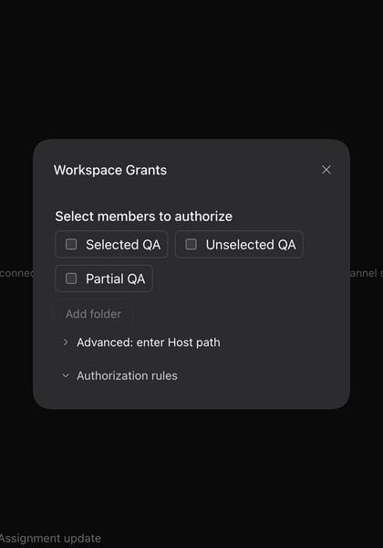

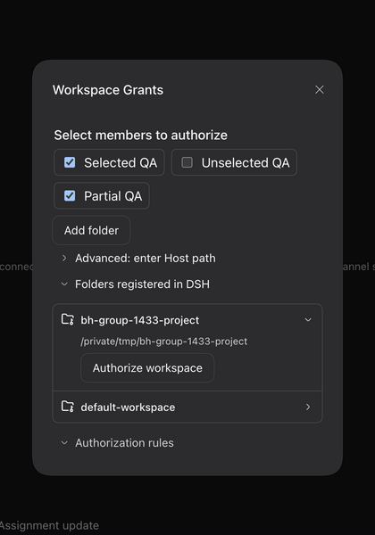

**Confirmed reuse:** Selected QA retains its original Grant and read-only Orchestrator badge; canonical readback verifies selected count 1 and unselected count 0. This is a reuse result, not a fresh partial-failure screenshot.

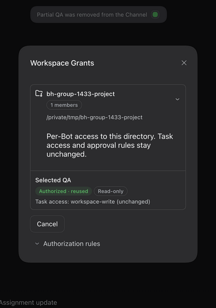

**Human-supplied DM visual reference:** cropped to the modal and resized, with no private conversation backdrop. Its capture revision is unknown; it is a design reference, not a fresh current-head DM verification. The Memory Repository row belongs to DM only and is deliberately absent from Group.

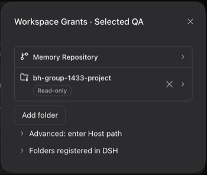

**Remaining capture gate:** the next confirmation/partial-failure captures again fail while the preview reports not visible; an additional T3 tab does not restore reliable capture. A timed-out fixture-member removal is read back through the canonical Host: the new visual fixture still has three members, so no removal retry or authorization submission is claimed. Fresh partial-failure, matched before/after and current-head DM/light-theme captures remain pending; previous partial-failure and native-model evidence retain their earlier revision anchors. The new screenshots do not imply Human visual acceptance.

### Pre-compaction captures

Screenshots are native UI captures, not reconstructed or annotated mockups. The entry pair uses matching dark theme, English locale, synthetic Group name and two remaining members. It is cropped identically from 1280 × 800 captures to the central 732 × 800 panel; fixture roster details outside this panel differ between isolated Profiles. Other images retain the 1280 × 800 capture. A transient screenshot-tool failure was retried through the same T3 tool; no alternate browser capture was substituted.

**Before — accepted main has no Group workspace chip.**

**After — no implicit target; the chip asks Human to select members.**

**Same composer menu and default-unselected entry.**

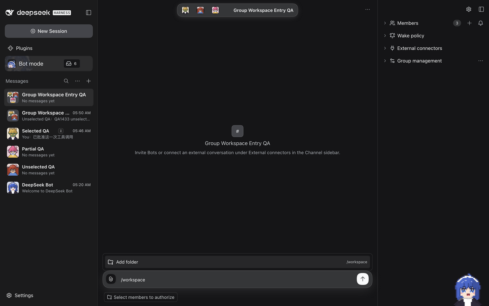

**Shared confirmation and independent partial results.**

**Real normal delegation, real refusal, and unsent draft/attachment retention.**

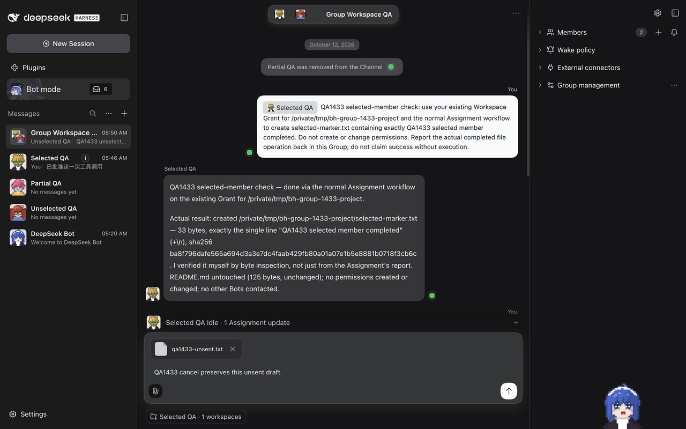

## Automated validation and remaining gates

After incorporating main `e513ac414ab6c38ee95173377ebeb0950324d7dc`, all 16 focused files / 253 tests pass, including the incoming attachment-reference composer regressions. Typecheck, lint (including bilingual release-ledger checks), format check and build also pass. These checks do not refresh the earlier native-model run or prove Human visual acceptance. The final head is recorded in the PR and outcome comment.

Focused coverage includes Group selection isolation, partial failures, lost-response readback, no-write-on-unavailable-readback, preservation after membership changes, shared DM picker canonicalization, composer lifecycle and existing sidebar notifications, bridge scope fences, and post-await Grant commit validation. Typecheck, lint, release-ledger checks, formatting, build and documentation validation are reported separately in the PR against its final head.

The full repository suite is not declared green when unrelated failures remain. The synthetic-stdin reusable IM-app wizard failure is reproducible on the unchanged baseline. An architecture MDX failure found during validation was caused by placing this PR's paragraph before the maintained-source comment; the paragraph was moved after the comment, and the isolated docs build test passes. The final full-suite outcome is recorded in the PR rather than inferred from focused tests.

Native Group E2E is not Human QA, physical-phone QA, CI, merge or deployment. No mobile-device or external IM-provider qualification is claimed by this desktop-native slice. The later Human instruction authorizes merge after screenshots are supplied; this is not a claim that Human visually inspected the refreshed exact head. Merge still requires current checks and review findings to be resolved.

## Human acceptance path

1. Launch the PR worktree with an isolated Profile using `node scripts/dev-instance.mjs --home <private-isolated-home> --port <free-port> --build`; configure a usable native model privately.
2. Create a Group with at least three test Bots and a disposable project directory. Check Grants before the run.
3. Use both `/workspace` and the chip. Verify all currently eligible Bots are selected by default, then narrow the selection; check canonical directory and per-target scope. Cancel with a draft and attachment; check they remain and no Grant is created.
4. Select two Bots, not the third. Remove or pause one selected Bot after preview. Confirm; check successful and failed rows independently, then retry. Verify the unselected Bot has no new Grant and successful Grant identity is stable.
5. Normally mention the authorized Bot and ask for one harmless directory-local file operation. Inspect the actual completed Assignment, cwd and Group reply. Mention the unselected Bot without granting extra access; verify refusal and absence of its marker.
6. Check the same Bots' existing DM sidebar Grant state. Use existing per-Bot revocation when cleaning up intentional access. Code rollback alone does not revoke Grants already created by Human confirmation.
7. Record explicit Human QA acceptance on the PR's exact head, or concrete failures. Do not infer acceptance from issue closure, passing tests or screenshots.
