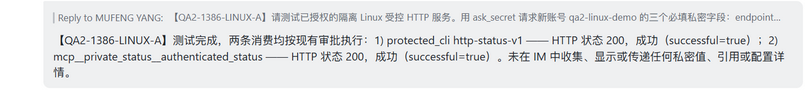
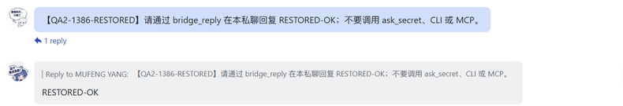

# Private input: isolated Linux qualification

Qualification for [#1386](https://github.com/BotHarness/DeepSeekBot/issues/1386), under [Spec #1378](https://github.com/BotHarness/DeepSeekBot/issues/1378). This is an observation record for the opt-in protected Profile. It does not make that Profile the default, qualify arbitrary credential-bearing CLI/MCP programs, or authorize another deployment.

## Installed boundary

The existing QA2 PersonaBot and its authorized Lark private conversation moved to an isolated Linux Host during a Human-authorized exclusive receiver window. The Windows receiver stopped first. QA1, another session's server stack and pre-existing HTTPS routes stayed outside the task. The controlled HTTP fixture used loopback and synthetic private URL, API key and API secret fields. No external email was sent.

| Component                | Qualified version                                                                         |
| ------------------------ | ----------------------------------------------------------------------------------------- |
| BotHarness source        | `e1a3f7ddd3a757b12857751d344de2c96b929b0b`, with this change's `ask_secret` tool guidance |
| Node / pnpm              | `24.21.0` / `12.4.2`                                                                      |
| DSH                      | `0.2.0-rc.1`                                                                              |
| Qualified IM Provider    | `dsh-im 4.32.0`, source `602baa37fa327f7069545aaadbbd34db8a8f4636`                        |
| Ordinary execution image | `node@sha256:c3de60bf2f9dd0ac6370e6117950ff62d6e339527e7472301c9c78a017978392`            |
| Actual model route       | native `opencode-go/deepseek-v4-flash`                                                    |

The Host kept native Credentials Service as the private store. Ordinary Shell and stdio MCP used non-root Linux containers and only the authorized workspace. The fixed protected CLI and MCP authenticated-status consumers resolved references in the owning Host, discarded response bodies/headers and returned bounded status projections. The fixture intentionally echoed private fields and their encodings in responses.

Windows-to-Linux migration translated only audited path metadata, including the IM Provider workspace mapping and native Session header/project directory. Retained compressed Session Event frames were byte-identical. The native credential store, Bot identity, historical events and opaque references were preserved. Nonsecret workspace permissions were prepared explicitly for guest group `65534`; credential-home parents stayed `0700` and the native credential file stayed `0600`. See the [Linux guide](../dev/guides/private-input-linux.md).

## Actual observed cases

All times below are UTC on 2026-10-11. “Real Bot” means the actual configured model and native Agent/Session path, rather than directly invoking a tool from a developer terminal.

| Case                                      | Observation                                                                                                                                                                                                                                                        |
| ----------------------------------------- | ------------------------------------------------------------------------------------------------------------------------------------------------------------------------------------------------------------------------------------------------------------------ |
| `LINUX-A`, 16:23–16:26                    | Original Lark QA2 request → three-field Owner Web card → existing allow-once approvals → fixed CLI HTTP 200 and fixed MCP HTTP 200 → nonsecret reply in the original private conversation. Web inputs cleared after submission.                                    |
| `LINUX-TOOLS`, 16:28–16:29                | Remembered broad approval remained available. Ordinary Shell persisted a workspace file, ran as UID 65534, preserved separate stderr and exit code 7, and produced a real large-output Spill. Ordinary MCP read the same file without Host credential environment. |
| Restarted pending replacement             | A blank replacement card expired after exact Host restart; a late submission was rejected and the previously configured account remained usable.                                                                                                                   |
| `CROSS-CONSUMERS-B`, 17:28                | A second real PersonaBot attempted both fixed consumers with QA2 references. Both were denied by ownership checks despite broad execution approval; neither reached the HTTP fixture.                                                                              |
| `RESTART-B`, 17:30                        | A real Bot created a one-shot Schedule before the exact Host restart at 17:27:38. Its natural planned firing reused the configured references. CLI and MCP both returned 200 without a new private card or Owner approval action.                                  |
| `CANCEL-A`, 17:32                         | Owner cancellation was accepted; the following submission to that card was rejected.                                                                                                                                                                               |
| Concurrent cards and duplicate submission | Different real Bots held independent pending cards. Two competing submissions to a single card returned one accepted and one rejected result.                                                                                                                      |
| Rotation, 17:32–17:33                     | Blank Owner replacement activated a new grant. Both consumers authenticated using new references. Both denied the superseded references before contacting the fixture.                                                                                             |
| `ACTIVE-REVOKE-CLI`, 17:33                | The fixture confirmed one authenticated request was active and unfinished before revocation. Host reported `{stopped:1,completed:0,uncertain:0}`; the consumer returned a safe cancellation error.                                                                 |
| `ACTIVE-REVOKE-MCP`, 17:34                | The same active-request proof and bounded stop result passed for the fixed MCP consumer. New calls using the revoked references were denied. The fixture recorded two disconnected requests in total.                                                              |
| `EXTRACTION-A`, 17:36                     | Real Bot's ordinary Shell reported UID 65534, no Host key environment, unreadable Host/traversal credential paths, absent Docker socket, denied Git metadata writes and failed TCP access to Host loopback. Only booleans were returned.                           |
| `CLI-INPUT-A`, 17:37                      | Installed DeepSeekBot CLI submitted a real Bot's three-field card through `--values-stdin`; it returned `{accepted:true}` and the card became configured. Values were absent from argv and CLI output.                                                             |
| Rejected approvals                        | Owner rejected both fixed consumer calls with a valid grant. Fixture counters did not advance. Restoring broad approval allowed both consumers while ownership/version checks remained effective.                                                                  |

`EXPIRY-A` reached its natural fifteen-minute deadline at 17:47. The untouched card on the second real Bot produced one expired resolution; a late submission was rejected. A separately configured version-A account also remained independent of local revocation: both consumers returned only HTTP 401 and safe repair guidance against the B-only fixture.

After the exact Host restart at 17:47:56, revoked references remained unusable by both consumers. `RESTART-C` naturally fired at 17:50 and reused the latest version-B grant: both consumers returned HTTP 200 without a new private card or Owner approval action. Separate naturally fired missing-account and revoked-account Schedules at 17:51 and 17:52 returned safe Owner-action errors, opened no cards and performed no HTTP calls. The four successful/negative scheduled cases have canonical `planned` firing records and handled Source Events; the two positive Schedules were created by the actual PersonaBot.

The fixture's final bounded counters were 15 requests, 13 authenticated, 13 completed and two disconnected by active revocation. After the final restart there were no new private cards and no pending approvals. The [allowlisted evidence](evidence/1386-linux-private-input/qualification.json) retains native event sequence numbers, bounded outcomes, canonical firing/IM facts and scan coverage without raw prompts, credential values or private endpoints.

The per-Bot Inbox Admission is the handling authority: the initial bridge Source Event has a handled `human-dm` admission. Its notice and final reply have matching Source Event IDs and `provider-accepted` Outbox attempts. The final Outbox body contains HTTP 200 and no private references; the visible original Lark reply agrees. A Source Event's global legacy state alone is not used to infer delivery or per-Bot handling.

## Findings and limits

The first natural Schedule at 16:34 failed safely because the model passed a Schedule Source Event and then a historical IM Source Event to the IM-only selector. Neither consumer ran. The tool guidance now explicitly tells Web and scheduled callers to omit `source_event_id`; it does not relax accepted-IM source validation. `RESTART-B` subsequently passed through the real scheduled path.

An initial developer rotation probe queried the superseded card and therefore supplied an empty reference set. Both consumers rejected it without HTTP traffic. That attempt is retained privately and is excluded from the rotation success claim; the corrected probe used the configured replacement card.

During qualification, SSH, QA HTTPS and Tailscale temporarily timed out. Read-only cloud checks showed a running instance; the diagnostic command could not be delivered. Connectivity later recovered without a task-initiated server reboot or unrelated service change. Available evidence does not establish the outage cause. A slow remote build completed; later exact Host restarts reused its installed executable and environment.

The initial real IM/Web/IM path was inspected in the signed-in browser. Browser automation temporarily became unavailable during later cases; those cases use RPC/native evidence rather than claimed fresh visual inspection. It subsequently recovered, allowing a clear recapture of the original Linux result and a real restoration message. Raw Sessions, wire data, credential state, private endpoints and full screenshots stay machine-local; only allowlisted facts and cropped test messages are published.

The final runtime scan covered 222,102 files, 786 native Session Events, 92 tool results, one retained Spill and ten task-owned Host logs, with no private canary matches outside the intentional native credential store. The passive model wire probe inspected all 100 actual request bodies (23,039,953 bytes), with zero canary matches. It checked raw, URL-encoded and base64 forms. The native store separately contained the expected synthetic values. The older scanner's aggregate `nativeStoreContainsSyntheticValues:false` means not every canary was present there; it is not a claim that the store was empty. This evidence covers the isolated PersonaBot runtime and model request bodies, excludes intentional private backups and the coding-agent conversation, and does not establish secrecy for unqualified consumers or arbitrary transformations.

Linux Host/fixture listeners and the Linux QA2 receiver were stopped, and only the task-added HTTPS endpoint was removed. Existing routes remained equal to their saved baseline. The original Windows QA2 became `available`/`receiving`. At 18:01–18:02 a real marked Lark request received `RESTORED-OK` in the same private conversation: its `human-dm` admission was handled and its matching Outbox attempt was `provider-accepted`.

## Verification status

- Focused Windows regressions: 7 files / 49 tests passed; 1 file / 3 Docker opt-in tests skipped. The evidence-export change then passed all 4 exporter tests, including the new native approval-outcome case.
- Actual Linux Docker regressions: 3 files / 7 tests passed under private `077` umask, including real ordinary CLI/MCP and protected extraction behavior.
- Final post-revocation restart/Schedule cases, runtime confidentiality scan and exclusive receiver restoration passed, including the real restored IM reply.

These checks are separate from a full Windows suite, final PR CI and Human review. They qualify the installed snapshot above, not later unrelated changes on the main branch. Follow the [runnable guide](../dev/guides/private-input-linux.md) and qualify the exact installed revision again after changing the execution boundary.
