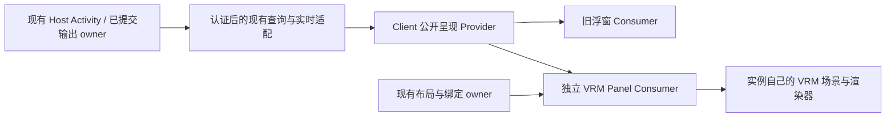

# T1 #2222：VRM＋Activity＋说话表现实施方案

日期：2026-10-19。状态：研究完成，选型收敛；运行时尚未实现或验收。Human 已授权开始 T1，先研究开源方案并敲定最小方案。范围仅限 [#2222](https://github.com/BotHarness/DeepSeekBot/issues/2222)，不启动 T2–T15。

本方案落实 ADR-0234 的既定方向，没有增加领域状态、第二套布局权威或新的代理平台。详细一手证据见 [AIRI / N.E.K.O. 调查](2026-10-19-vtuber-airi-neko-t1.md) 与 [VRM 运行时和素材调查](2026-10-19-vrm-t1-runtime-assets.md)。上游代码均固定提交；源码调查不代替真实 Host 验收。

## 已选方案

独立原生 Panel Plugin，直接使用 `three@0.180.0` 和 `@pixiv/three-vrm@3.5.5`。沿用官方示例的依赖组合，待真实构建和渲染验证；不承诺全部 Three.js 或 VRM 版本均兼容。首片验证一个 VRM 1.0 模型。只有实际使用外部 VRMA 时才加入同版本 `@pixiv/three-vrm-animation`，不先做通用动作导入界面。

| 研究对象  | 采用的经验                                                     | 本片处理                                                   |
| --------- | -------------------------------------------------------------- | ---------------------------------------------------------- |
| AIRI      | 嘴、眼睛、身体的控制权分离；加载代次守卫；迟到模型释放         | 用于自己的薄表现层；不引入 Vue 应用、语音服务或模型编排    |
| N.E.K.O.  | 按输出身份取消；切模型使旧加载失效；完整清理帧循环、监听和资源 | 每个 Panel 独立持有可变 3D 实例，不搬入全局桌宠 manager    |
| ChatVRM   | 小型 Renderer / Model / LipSync 分工                           | 仅作结构参考；已归档 demo 的取消和多实例能力不满足本片要求 |
| three-vrm | VRM loader、normalized humanoid、expression、update/dispose    | 实际运行时依赖；版本、素材、构建与运行行为分别验证         |

## 首次可看到的效果

私聊中打开角色面板，可看到当前 Bot 的上半身或全身小舞台、Bot 名字、真实 Activity 文字与当前发言。先保证在窄面板内看得清表情和状态，再由 Human 判断镜头、比例和动作幅度。背景、容器、按钮使用既有 DSH tokens 与 UI 原语。

| 输入                        | 首版表现                                 | 不改变的语义                                                     |
| --------------------------- | ---------------------------------------- | ---------------------------------------------------------------- |
| idle                        | 轻微呼吸、间歇眨眼、中性姿态             | 不编造任务或情绪                                                 |
| thinking                    | 轻微抬头或侧头、短暂注视变化             | 不读取或显示隐藏推理                                             |
| working                     | 有节奏的上身/手臂小动作                  | 继续显示真实工作状态，不按动画反推工作完成                       |
| waiting / blocked           | 各自可辨认的静态或轻姿态，配原有状态文字 | waiting 不自动解释成等待 Human；attention 单独呈现               |
| 当前允许展示的实际 Bot 输出 | 按文字节奏开合嘴，有限点头/手势          | speaking 与 Activity 并行；不是新 Activity 枚举或音素级 lip-sync |
| 断线、Bot 不可用、模型失败  | 明确提示，停止伪装实时动作；文字仍可读   | 不谎报 idle，不自动绑定其他 Bot                                  |

首片默认模型用官方 `VRM1_Constraint_Twist_Sample` v1.0.1，10,776,032 bytes，SHA-256 `12c2b97e95e700783a6a550dc0eee2d7880aeedccef9ae67bc4c5a2f0f2631a2`。它提供基础嘴型和眨眼；自身许可是 VRM Public License 1.0，不能标为代码的 MIT。分发时携带来源、固定版本、许可及原元数据，从 Plugin 自有资源加载。

**该模型是技术验收样例，不是最终 Q 版美术。** VRM 格式本身不会产生《朋友收集》式大头短身、日常感和表情节奏。先验证接口、动作组合与运行成本，再依据 Human 对首片的反馈决定是否更换模型或调校动作；不预先铺开角色编辑、换装或场景系统。

身体动作使用自行编写的 normalized-bone 小曲线，可生成 AnimationClip；表情使用模型实际存在的 `aa`、`blink` 等能力。由一个组合器计算最终姿态/权重，避免多个模块争写同一轨道。不纳入缺少明确公开分发权的 VRoid 七动作包；Quaternius CC0 仅作后续候选，未经下载、选片和重定向验证，不宣称已经可用。

## 最小模块与权威边界

1. **Host 保留事实与授权。** 继续使用现有 Activity 和已提交输出的 owner；输出在原有可见范围内筛选，不在浏览器读取任意 Session 文本，也不创建第二个 Bot 状态机。业务提交与消费者通知失败分开，监听器 throw/rejection 有隔离和有界诊断。
2. **Client 提取最小公开合同。** 发布类型、Service Definition、订阅与 disposer、同步状态和明确错误；独立示例只引用公开入口。取当前 Activity 与后续变化保持先订阅再 baseline，并以 generation/revision 防止旧查询覆盖新事实。具体服务名和 API 在实现时与当前 DSH 源码核验，不把本方案当已发布 SDK。
3. **解除旧浮窗耦合。** 当前 `index.ts` 根据旧浮窗数量控制 `mountActivityLive`，旧 `WindowCompanions` 又能回写 Activity。改为一个明确的 Client Activity 读模型 owner，两个表现 Consumer 都不决定另一方是否收到更新。保留旧浮窗的选择和交互语义，避免提前实施 T8–T15。
4. **提取文字播放能力。** 复用 `companion-beats.ts` 的文字分段/停顿以及现有输出身份和可见范围规则；不直接让新 Plugin 导入旧功能的私有组件。读取/播放进度由明确的共享 owner 推进，不能多个 React 视图各自 `advance()` 而加倍播放速度。
5. **实例生命周期由 Panel 持有。** 每实例独立 scene、VRM、mixer、renderer、ResizeObserver、加载代次和销毁器。可以共享不可变下载缓存；不共享可变骨骼、表达和相机。缺少依赖时呈现不可用，而不是保留看似实时的旧状态。
6. **仍由现有布局持久化。** 实现、实例 ID、绑定和位置分开，普通实例元数据进入原版本化布局 owner。私聊跟随当前 Bot；群聊没有入口、内容或可执行打开动作。全局 A/B 实例显式固定绑定、标题可见、刷新保留；不添加第二份 layout localStorage 或 Host store。

需要修改的现有接缝已核对：`dock-panels.ts` 当前只有静态注册定义；`channel-workspace.tsx` / split layout 仍有固定叶子；`window-companion.ts` 同时承担输出订阅与播放；`index.ts` 有 Activity feed 的浮窗 demand 切换。首片应在这些 owner 内做最小扩展，不绕开它们实现独立挂载的假面板。

## 发言、取消与声音

- 仅新到达且通过既有可见范围判断的 committed output 启动发言；挂载、baseline、恢复缓存或重连不会启动历史说话。
- 使用 Profile / Bot / Channel / message 身份及连接 generation 去重、隔离生命周期；正文字符串不作唯一键。同 Bot 不同可见范围的订阅不能因为共用播放器而相互泄露内容。
- 绑定变化、输出中断、断线、关闭和卸载使当前播放失效并归零嘴型；迟到回调检查所属绑定/加载代次。正常结束也有明确终态。
- 身体 Activity 与嘴型、眨眼的通道分别拥有。轻手势必须经组合器叠加；恢复时不补跑后台积压的动作帧。
- 第一条可运行路径不需要声音。若启用已有 babble 偏好，由共享音频 owner 按输出身份去重，旧浮窗与多个新面板也只能发声一次。TTS 和音素时间轴均不进入本片。

## T1 内部交付顺序

这些是同一 T1 的实施检查点，不新增拆票，也不把水平基础设施当作已交付切片。

1. **一条真实私聊路径。** 独立 Bundle 原生安装 → Plugin 激活 → DM 角色面板 → 当前 Activity 与实时更新 → 一条真实 Bot 回复驱动嘴型。所需公开合同与接口提取随该路径一起交付。
2. **补齐同一切片的绑定与生命周期。** 群聊无入口；全局固定 A/B 双实例和刷新恢复；关闭旧浮窗仍更新；快切、重连、取消、隐藏、禁用/卸载及迟到加载处理。区分隐藏、普通关闭、删除实例和暂时不可用。
3. **形成可验收结果。** 真实 Host 安装和 Web 操作、CLI 同能力路径、重点自动回归、双实例性能/资源记录、截图或短视频及可打开的验收状态。记录 Human 反馈及处理结果后才能关闭 #2222；T2–T15 继续阻塞。

新 Host method、route 或 Bot tool 如确实需要，必须同 PR 提供 CLI parity 和真实调用；现有能力优先复用。布局 CLI 与 #2096 的现有工作协调，不能因其尚未集成就另建布局权威；#1791/#1792 仅取已经存在的相关接口，不承接其额外范围。

## 验证与完成标准

| 路径                       | 需要的证据                                                                                                                                        |
| -------------------------- | ------------------------------------------------------------------------------------------------------------------------------------------------- |
| 原生安装、禁用、卸载、重装 | 实际 Bundle/Profile 操作；准确报告安装/激活/restart-required；无重复实例或回调                                                                    |
| 正在工作时打开             | 立即当前状态，后续更新；baseline 竞态、异常消费者隔离的行为回归                                                                                   |
| 思考 → 工具工作 → 输出     | 真实 Bot/Host 事实与 UI 画面对照，不能用演示定时器替代                                                                                            |
| 工作与发言重叠             | 两输入同时可见，不互相覆盖；自动回归及真实路径记录                                                                                                |
| Bot A/B 与多个视图         | 隔离、刷新恢复、旧绑定迟到回调丢弃、声音不重复、可见范围不扩大                                                                                    |
| 断线/隐藏/关闭/卸载        | 停止播放、恢复最新状态、不重播旧话；资源释放和加载途中关闭可复现                                                                                  |
| 缺表情/坏模型/WebGL loss   | 可读文字和明确错误；停止无效渲染；不影响 Bot 执行                                                                                                 |
| reduced motion / resize    | 系统偏好与容器尺寸真实驱动；状态不依赖动画表达                                                                                                    |
| 双实例性能                 | 记录机器/浏览器/视口、冷加载时间、帧时间分布、draw calls、几何/纹理计数、内存代理和多轮打开关闭变化；测不到真实显存时明确标注，不能用文件大小代替 |
| Human 验收                 | 提供可操作的隔离状态，记录视觉、动作和交互反馈；CI 通过不等于 T1 完成                                                                             |

初始渲染策略为限制像素密度、可见面板有限帧率、隐藏或零尺寸时停帧、恢复重置 delta。具体性能数值必须实测后报告；目前没有性能或观感合格的结论。

研究阶段没有新增运行时代码、安装 VRM 依赖或下载素材进项目；两份调查报告及本方案是当前产物。
