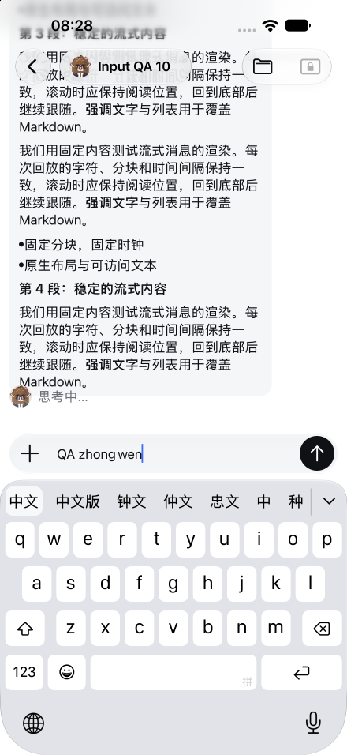
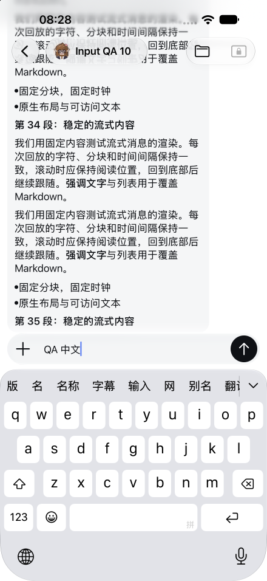
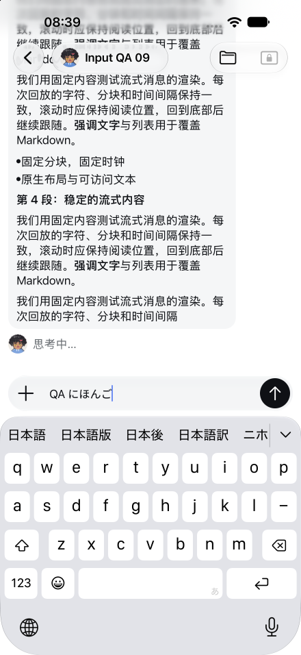
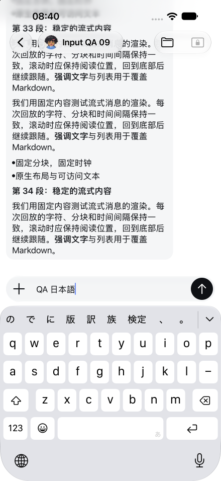
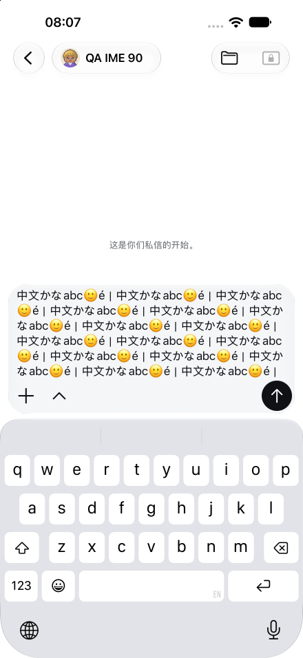

# Native Chinese and Japanese input acceptance

Product source: `d488ae9b8f074311c741eb636b935d028268f755`.
Environment: iOS 27 Simulator, native Debug app with production JavaScript.
These are acceptance captures from one product version, not a UI change before/after comparison.

This material covers input-method behavior only. The extension of the existing Channel Files capability has already merged and is outside this evidence set. Quote reply is also outside this scope.

## Captures

| Image | Captured state | What it shows |
| --- | --- | --- |
| [cn.png](cn.png) | Chinese candidate active during a fixed prose reply | Unconfirmed Pinyin and the `中文` candidate remain visible while reply paragraphs 3–4 are rendered. |
| [cn-end.png](cn-end.png) | Later state of the same Chinese run | Draft is `QA 中文`; reply paragraphs 34–35 are visible. |
| [jp.png](jp.png) | Japanese candidate active during a fixed prose reply | Unconfirmed `にほんご` and the `日本語` candidate remain visible while reply paragraphs 3–4 are rendered. |
| [jp-end.png](jp-end.png) | Later state of the same Japanese run | Draft is `QA 日本語`; reply paragraphs 33–34 are visible. |
| [long.png](long.png) | Successful 10,000-code-point draft preload | The synthetic draft has been pasted into the native editor. This image predates the Chinese composition steps; it is **not** their final-state screenshot. |

## Verified scope

- **Chinese, during a fixed prose reply:** real Pinyin candidate confirmation produced `QA 中文`. A new `ni` composition was entered and cancelled with Delete. Candidate confirmation and cancellation overlapped the recorded producer interval; the captured native surface also shows reply content progressing.
- **Japanese, during a fixed prose reply:** real candidate confirmation produced `QA 日本語`. Real `k` and `a` keys started a fresh `か` composition, which was cancelled with Delete. These actions overlapped the recorded producer interval.
- **Canonical messages for each streaming run:** count changed from 120 to 122, comprising only the fixture trigger and the fixed reply. Candidate confirmation/cancellation introduced no additional canonical message in these runs. This conclusion comes from canonical readback, not from counting visible rows in a screenshot.
- **Long Chinese draft, idle conversation:** full-text readback confirms the exact original 10,000-code-point fixture followed by `中文`, for 10,002 code points total. A subsequent unconfirmed `ni` suffix was cancelled. Canonical message count remained zero. The final native state is preserved in the original recording and accessibility readback; `long.png` shows only the successful preload.

The long-draft fixture's UTF-8 SHA256 is `cf0a05e7b0cde427d176cf7d3df32e3a02df16e00c2953d1f246c6b3ab0dd481`. Full-text equality was checked against that frozen fixture plus the confirmed suffix; a screenshot of its visible tail alone would not establish equality.

## Limits

These results establish the listed functional behavior on the Simulator. They do not establish physical-device or Human acceptance, input latency, frame-rate performance, equal cache/draft-store conditions for a benchmark, or complete visible playback through the final reply paragraph. The long-draft Chinese run was idle and does not establish 10k-plus-stream overlap.

## Image integrity and privacy review

Each selected PNG was inspected individually and copied byte-for-byte from its original capture. All are complete 440 × 956 app screenshots. No cropping, masking, resizing, generated content, text replacement or image editing was performed. The visible content is synthetic QA text, synthetic Bot names and avatars, app controls, and the system keyboard/status bar. No pairing link, credential, private Host identifier, unrelated conversation or personal content was visible in the selected images.

The PNGs contain only `IHDR`, `IDAT` and `IEND` chunks; no embedded text metadata was present. [SHA256SUMS](SHA256SUMS) records their copied-file hashes. Raw recordings, accessibility dumps, runtime logs, Profile data and operational identifiers are deliberately absent from this public candidate set.
