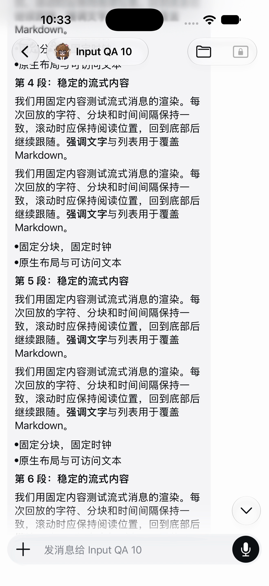
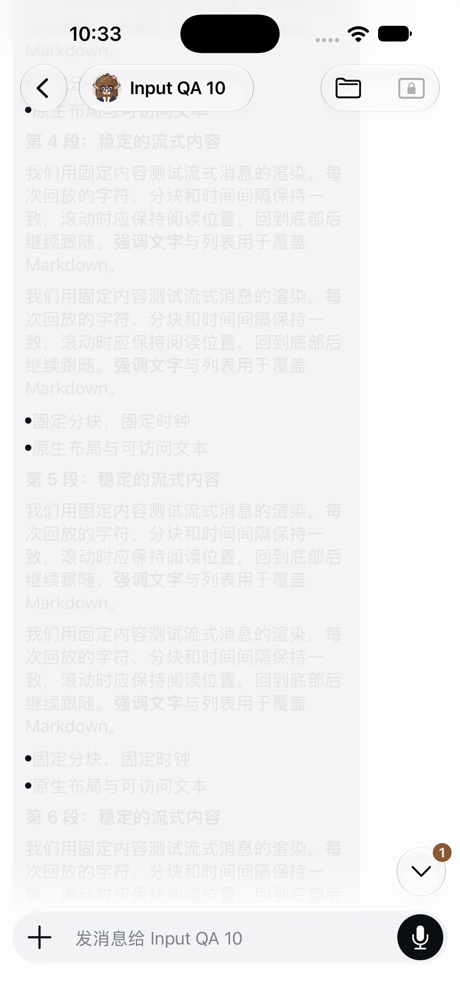

# Rejected Markdown animation candidate — batch 90 appendix

**Decision: reject candidate B at the visual correctness gate, before performance comparison.** Already-read paragraph and list text faded from black to near white during resume / explicit Jump, while the header and composer remained normal. This affected existing text, not only newly arriving glyphs.

The local research candidate B is `4b6083eac8af7ad96c4f075fe35cf609cccd2243`, based on A `8b08f4491b7c93a87f51858306b953874b177286`. Its source change was limited to the platform import and the public `streamingAnimation={Platform.OS === 'ios' && streaming}` option on the existing Markdown view. This appendix publishes the research result and reviewed images only; it does not publish B's source branch or propose a product PR.

## Exact captured frames

Both PNGs are unmodified copies of exact exported recording frames, each **1320 × 2868**. They show the same synthetic QA conversation. The frame mapping was verified against the passthrough export manifest before copying; an earlier export with invalid frame mapping was excluded.

| Image | Recorded source-frame index | Recorded PTS (seconds) | Visible state |
| --- | ---: | ---: | --- |
| [old.png](old.png) | 333 | 11.963333 | Previously read paragraph 4/5 and list text are dark. |
| [fade.png](fade.png) | 334 | 14.606667 | That existing text is near white; header and composer remain normal. |

These are two states within candidate B, not an A/B before-and-after comparison. Their timestamps differ; the two still images do not establish the duration of the transition.

## What the recording establishes

The completed ROI scan covered all **1,875 decoded frames**, matching the recording's expected frame count. The primary near-white episode appears in five encoded-frame samples at PTS **14.606667, 14.620000, 14.633333, 14.641667 and 14.658333** seconds. The first-to-last sampled PTS span is about **52ms**. This is not native presentation timing, native FPS, touch latency, or the exact total duration of the visual effect. The frame observation was separately confirmed by visual inspection.

The final reply eventually reached its complete tail. Canonical history increased 137→139, comprising the fixture trigger and fixed reply. Eventual tail correctness does not waive the old-text fade failure.

| Check | Result |
| --- | --- |
| C1: existing text stays readable during resume / Jump | **FAIL — B rejected** |
| Final tail | Complete eventually; does not override C1 |
| C2: width variation | Not applicable to this fixed portrait fixture |
| C3: font-size changes | Exercised Large → XXX Large → Small → Large; initial Large restored. No comprehensive font/layout acceptance claim. |
| C4 / C5 | NOT RUN after rejection |
| CPU, FPS or matched A/B performance comparison | NOT RUN |

After rejection, the runner restored A and qualified the loaded source. There is no matched A recording for this same gate, so this evidence does **not** establish that B introduced the fade rather than exposing pre-existing behavior. It is sufficient to reject B's observed correctness result before any performance claim.

## Integrity, privacy and limits

The two complete images were individually reviewed: only synthetic QA text, a synthetic Bot name/avatar, app controls and the system status bar are visible. No pairing link, credential, private Host identity or unrelated conversation is visible. No cropping, masking, resizing, text changes or image generation was applied. Source hashes and modification times were stable across reads before copying.

PNG chunks are `IHDR`, `IDAT`, `IEND`, `cHRM`, `cICP`, `gAMA` and `pHYs`: image data plus color/physical-dimension metadata, with no text or EXIF chunks. Copied file SHA256 values:

| File | SHA256 |
| --- | --- |
| `old.png` | `86c19aaddd4ff23032e2b818355b7d2ba47c4d12d1c3475884b5ff2e533603e0` |
| `fade.png` | `56de7c633f5497fc72b40fd91ebf56e2529cbb4060d3863e43f9b6f19cfe9d85` |

This was an iOS Simulator observation, not a physical-device or Human-acceptance result. No raw CPU traces, videos, Profile data, runtime identifiers or private logs are included. The earlier IME evidence is unchanged.
